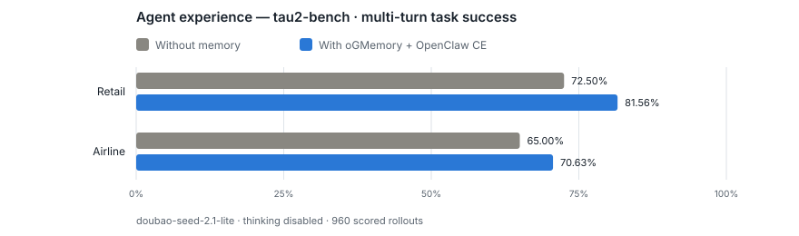

<div align="center">

### ContextEngine: Context Lifecycle Engine <br> for CLI Agents

Across every phase of the Agent loop, manage what goes **in**, what **stays**, what gets **evicted**, and what can be **recalled**.
Seven context types. Three-level cache hierarchy. One virtual filesystem.
Cut token cost. Preserve signal density. Survive session boundaries.

English | [中文](README_zh.md)

Documentation: [docs/README.md](docs/README.md)
</div>

---

## The Problem: Token Budget is the Bottleneck

Every CLI Agent runs on a **fixed token budget**. The context window is both the most expensive and the most scarce resource.

| Symptom | Root Cause | Missing Lifecycle Stage |
| -------- | --------- | ----------------------- |
| Agent forgets earlier conversation | Context window fills up, old content is evicted with no persistence | ④ **afterTurn** — no extraction + persist mechanism |
| Same mistakes repeated across sessions | No mechanism to carry lessons from one session to the next | ⑥ **session_end** — no archival + ② **bootstrap** — no cold-start injection |
| A query that should cost $0.05 costs $0.50 | Flat retrieval loads entire documents when an abstract would suffice | ② **assemble** — no L0/L1/L2 hierarchical retrieval |
| Multi-agent coordination failures | Agents cannot see each other's working context | ④ **afterTurn** — no cross-session sharing + multi-tenant isolation |
| Context bloat in long sessions | No systematic compression — the Agent drowns in its own history | ⑤ **compact** — no signal scoring + summary chain |

This isn't a model problem. It's an **infrastructure problem**.

ContextEngine provides the missing infrastructure: a full-stack context lifecycle management system that intercepts the Agent loop at six defined stages, treating the context window as a **managed resource** — not an unbounded buffer.

---

## Design Philosophy

### Core Insight: Context Has a Lifecycle

Current RAG systems treat retrieval as a single operation — embed a query, search a vector store, return results. This misses the fundamental reality: **context in an Agent system has a complete lifecycle**, just like data in a database.

```
  Born          Structured       Stored           Indexed          Recalled        Compressed       Archived
  (extracted    (categorized     (written         (embedded +      (vector         (summarized,     (session end,
   from          by type,        atomically       upserted         search,         deduplicated,    archived,
   conversation) routed by       with ordering    to L0/L1/L2      hierarchical    compressed)      checkpointed)
                  policy)         guarantees)      IndexRecords)    expansion)
```

Each phase has different constraints. Extraction must be incremental (don't reprocess old messages). Storage must be atomic (incomplete writes are detectable). Indexing must be asynchronous (don't block the Agent's response). Retrieval must be budget-aware (load only what fits). Compression must preserve signal (protect important context).

A system that handles only one or two of these phases — say, just retrieval — leaves the rest to chance. ContextEngine covers the full lifecycle.

### The Six Interception Points

The Agent loop isn't a black box. It has well-defined execution phases. Each phase presents a different opportunity to read, write, or transform context.

```
  ┌──────────────────────────────────────────────────────────────────────┐
  │                         Agent Loop (infinite)                         │
  │                                                                       │
  │   ┌─────┐     ┌──────────┐     ┌──────────┐     ┌─────────┐         │
  │   │ ①   │     │    ②     │     │    ③     │     │   ④     │         │
  │   │ MSG │────▶│ REASON   │────▶│ TOOL     │────▶│ TURN    │         │
  │   │ IN  │     │ PREP     │     │ CALL     │     │ END     │         │
  │   └──┬──┘     └──────────┘     └──────────┘     └────┬────┘         │
  │      ▲                                              │               │
  │      │         ┌──────────┐         ┌─────────┐     │               │
  │      │         │    ⑤     │         │   ⑥     │     │               │
  │      └─────────│ COMPRESS │◀────────│ SHUTDOWN │◀────┘               │
  │                └──────────┘         └─────────┘                      │
  │                                                                       │
  └──────────────────────────────────────────────────────────────────────┘
```

The key design choice: **intercept at the loop boundary, not inside model inference.** Stages ①–⑥ are all outside the LLM call. This means zero latency impact on model inference itself — all context operations happen before or after, never during.

### Not All Context Is Equal

Seven types of context, each with fundamentally different lifecycle behavior. This isn't arbitrary categorization — it's driven by the semantics of the information itself.

| Type | Why this lifecycle? | Write Policy |
| ---- | ------------------- | ------------ |
| **Profile** | User state changes — "I live in London" may become "I moved to Tokyo" | **Merge** — new overwrites old on conflict |
| **Preference** | Preferences accumulate per topic but each topic has one current view | **Aggregate by slug** — merge within topic |
| **Entity** | Entities accumulate facts, but "Project Alpha" is still "Project Alpha" | **Aggregate by slug** — merge within entity |
| **Event** | History is immutable — "completed migration on March 15" never changes | **Append only** — never overwrite |
| **Case** | Problem-solving traces are historical records | **Append only** — never overwrite |
| **Pattern** | Patterns emerge from repeated observations and evolve over time | **Aggregate by slug** — refine over time |
| **Skill** | Tool expertise grows cumulatively — more experience = better knowledge | **Cumulative append** — knowledge accumulates |

Four distinct write policies, each justified by the information's lifecycle semantics. A single "store everything the same way" approach would either lose mutable state (if append-only) or corrupt immutable history (if overwriting).

---

## Key Architectural Decisions

### Why YAML-driven schemas?

**The problem:** Hardcoding extraction schemas in Python means every new context type requires code changes, testing, and deployment.

**The solution:** YAML schemas declare what to extract and how to categorize it. The SchemaRegistry, PolicyRouter, and URIResolver all consume these schemas at runtime. Adding a new type — say "Decision" or "Handoff" — means adding a YAML file, not modifying the extraction pipeline.

**What breaks without it:** Every new context type becomes a code change that touches extraction, commit routing, and URI resolution — three packages that must be co-released. In practice, teams just skip adding new types, and everything gets shoved into generic "notes."

### Why the Outbox pattern for async indexing?

**The problem:** Embedding + upserting to a vector index takes 100–500ms. If synchronous, every `afterTurn` blocks for that duration, adding latency to the Agent's response.

**The solution:** The Outbox pattern decouples writing (fast, ~50ms) from indexing (slow, async). Each write deposits an OutboxEvent on disk. A background worker consumes events with at-least-once delivery guarantees and a DLQ for permanent failures. The write path returns immediately; the index catches up within seconds.

**What breaks without it:** The Agent's perceived response time balloons by 2–10x. Worse, if the vector index is temporarily down, writes fail and context is lost — the system becomes fragile to infrastructure transients.

### Why L0/L1/L2 three-level retrieval?

**The problem:** Longer content doesn't mean better vector similarity — in fact, the opposite. An embedding of a 5000-token document must represent *every* concept it contains, diluting the signal for any single topic. When you query "what does Alice do?", an L2 content chunk packed with details about Go, Kubernetes, PostgreSQL, and migration strategies produces a diffuse embedding where "backend engineer" is just one signal among dozens. A focused L0 abstract ("Alice is a backend engineer") produces a concentrated embedding that matches the query directly.

**The solution:** Each context node is indexed at three granularities. L0 abstracts (~100 tokens) produce focused embeddings — they're accurate topic signposts. L1 overviews (~500 tokens) are mid-grain. L2 full content (~5000 tokens) has the detail but diffuse embeddings. The retrieval engine does a single vector search across all levels, then uses L0/L1 hits as **directory entry points** for recursive tree expansion: when an L0 abstract matches, the searcher expands into its children to discover L2 content that flat search would miss. Score propagation (`final = α·child + (1-α)·parent`) boosts borderline L2 hits under strongly-matching parents.

```
  ┌─────────────┐    ┌─────────────┐    ┌──────────────┐
  │  L0 Abstract │    │  L1 Overview │    │  L2 Content   │
  │  ~100 tokens │    │  ~500 tokens │    │  ~5000 tokens │
  │  Focused     │    │  Balanced    │    │  Comprehensive│
  │  embedding   │    │  signal      │    │  but diffuse  │
  │  → signpost  │    │  → decision  │    │  → full detail│
  └──────┬───────┘    └──────┬───────┘    └──────┬────────┘
         │                   │                    │
         ▼                   ▼                    ▼
    .abstract.md        .overview.md          content.md
```

**Recall benefit**: Flat vector search on L2 content alone misses relevant chunks whose embeddings got diluted by surrounding detail. The L0/L1 signposts guide the searcher to the right neighborhood, then tree expansion discovers the full content underneath — including chunks whose raw vector score was below threshold but whose parent topic was a strong match.

### Why a filesystem abstraction?

**The problem:** Context operations — create, read, update, link, delete — need to be composable, atomic, and multi-tenant-safe. Building each as a bespoke API means reimplementing concurrency, permissions, and consistency for every operation.

**The solution:** ContextFS maps every context operation to a file operation on `ctx://` URIs. The file metaphor is universally understood — `open`, `read`, `write`, `link`, `unlink`, `gc` map directly to context operations. Multi-tenant isolation is enforced at the filesystem level (via `account_id + owner_space` in every path), making it impossible to bypass even by buggy callers.

**What breaks without it:** Tenant isolation becomes "each caller must remember to check permissions." Atomic writes become "each caller must implement the 4-step write protocol correctly." Every new feature re-solves the same infrastructure problems.

| Filesystem Concept | Context Equivalent | Benefit |
| ------------------ | ------------------ | ------- |
| `open(path)` | Load context by URI | Uniform access to any context type |
| `read(fd, offset, len)` | Read L0 / L1 / L2 at chosen depth | Pay only for the tokens you need |
| `write(fd, data)` | Persist new context | Atomic writes with ordering guarantees |
| `link(src, dst)` | Create relation edge | Graph traversal without a separate API |
| `unlink(path)` | Delete / archive context | GC for stale context |
| `gc()` | Repair Job | Self-healing persistence layer |
| Permissions (chmod) | Tenant isolation | Enforced at filesystem level, not by callers |

### Why optimistic locking for concurrent writes?

**The problem:** Profile nodes are written by every session a user has. Two sessions can extract conflicting profile updates simultaneously.

**The solution:** Optimistic locking — read the current `.meta.json` version, write only if unchanged. This handles the common case (no contention) with zero infrastructure overhead. On the rare case of concurrent writes, the second writer retries with fresh state.

**What breaks without it:** Distributed locks require a coordination service (etcd/ZooKeeper) — adding infrastructure complexity for a problem that occurs rarely. Without any locking, last-writer-wins silently loses the first writer's updates.

### Why the ReAct loop for extraction?

**The problem:** Extraction quality depends on knowing what already exists. If the system already knows "Alice is a backend engineer," extracting that again wastes LLM tokens and creates duplicate entries that must be deduplicated later.

**The solution:** The LLM is given tool access — `read(uri)`, `list(uri)`, `get_relations(uri)`, plus `extract_*` actions — and runs in a loop. Each iteration: it *reads* existing memory nodes (Reason), decides what's genuinely new, then calls the appropriate `extract_*` tool (Act). If unsure, it reads more nodes and loops. This is true ReAct: interleaved reasoning and tool use, not single-shot extraction.

```
  Iteration 1:  read(profile_uri) → "Alice, backend engineer, London"
                 → Nothing new to extract. Skip.

  Iteration 2:  read(entities/go) → "Go expert, prefers error handling pattern X"
                 → New: "Alice now also uses Rust for side projects"
                 → extract_entity(slug="rust", ...)
```

**What breaks without it:** Every turn re-extracts the same facts. Over 100 turns, "Alice is a backend engineer" gets extracted 100 times, creating 100 Profile merge operations — each one burning LLM tokens on content that was already stored. Extraction cost grows linearly with conversation length instead of with information density.

---

## Architecture

### Overall Architecture

```
         CLI Agent (Claude Code / OpenClaw / SDK)
              │  HTTP REST (port 8090) or Python SDK
              ▼
    ┌─ HTTP Layer ──── Flask REST · Auth/RBAC · Sessions ─┐
    └──────────────────────┬───────────────────────────────┘
    ┌─ Service Layer ── MemoryWriteAPI · MemoryReadAPI ────┐
    └──────────────────────┬───────────────────────────────┘
        ┌──────────────────┴──────────────────┐
        │  Write Path          │  Read Path    │
        │  Two-Phase Extract   │  IntentClass. │
        │  PolicyRouter        │  SeedRetriever│
        │  MergePolicy         │  ResultRanker │
        │  ContextWriter       │  ContextReader│
        └──────────────────────┬───────────────┘
    ┌─ ContextFS ── Semantic · Relation · Content · Meta ──┐
    └──────────────────────┬───────────────────────────────┘
    ┌─ Async Index ── OutboxWorker · RepairJob ────────────┐
    └──────────────────────┬───────────────────────────────┘
              ┌─────────────▼─────────────┐
              │  PostgreSQL · Vector · Graph│
              └───────────────────────────┘
```

**Dev mode**: InMemory vectors + PostgreSQL — install `postgresql` and `pgvector` extension.
**Production**: pgvector + PostgreSQL RLS — horizontally scalable with row-level tenant isolation.

### Write Path: Conversation to Persistent Memory

```
  Agent Turn completes
        │
        ▼
  ┌─────────────────────────────────────────────────┐
  │  ReAct Extraction Loop                          │
  │                                                 │
  │  LLM has tools: read(uri), list(uri),           │
  │  get_relations(uri), extract_*()                │
  │                                                 │
  │  Iteration 1: read(profile) → "Alice, engineer" │
  │  Iteration 2: "Alice now also uses Rust"        │
  │              → extract_entity(slug="rust")       │
  └────────────────────┬────────────────────────────┘
                       │  CandidateMemory[]
                       ▼
  ┌──────────────────┐     ┌──────────────────┐
  │  Policy Routing  │     │  Atomic Write    │
  │                  │────▶│  (4-step order)  │
  │  ProfilePolicy   │     │                  │
  │  AggregatePolicy │     │  ① content.md    │
  │  AppendOnlyPolicy│     │  ② .relations    │
  │  SkillToolPolicy │     │  ③ abstract+over │
  └──────────────────┘     │  ④ .meta.json ✱  │
                           └────────┬─────────┘
                                    │
                          ┌─────────▼─────────┐
                          │  Outbox Event     │
                          │  (async, durable) │
                          └─────────┬─────────┘
                                    │
                    ┌───────────────▼───────────────┐
                    │  Index Worker (background)    │
                    │  embed(abstract) → L0 upsert  │
                    │  embed(overview)  → L1 upsert  │
                    │  embed(content)   → L2 upsert  │
                    └───────────────────────────────┘
```

The write path is designed so that the synchronous portion (extraction through atomic write) completes in ~50ms. The expensive operations — embedding and vector upsert — happen asynchronously via the Outbox, never blocking the Agent's response.

### Read Path: Query to Assembled Context

```
  User Message arrives
        │
        ▼
  ┌───────────────────┐     ┌──────────────────────────────────────────┐
  │  Intent Classify  │     │  Global Vector Search (all levels)       │
  │                   │     │                                          │
  │  Keywords → type  │────▶│  Embed query, search L0+L1+L2 in one go │
  │  "recall"→MEMORY  │     │  → L0/L1 hits = directory signposts      │
  │  "how"→SKILL      │     │  → L2 hits = direct content matches      │
  │  "doc"→RESOURCE   │     └────────────────────┬─────────────────────┘
  └───────────────────┘                          │
                                          ┌──────▼──────┐
                                          │  L0/L1 hit? │
                                          └──────┬──────┘
                                           Yes   │   No
                                          ┌──────▼──────▼──────┐
                                          │  Recursive Expand  │  Use L2 hits
                                          │                    │  directly
                                          │  search_children() │
                                          │  per directory node│
                                          │  Score propagation │
                                          │  α·child+(1-α)·   │
                                          │  parent            │
                                          └────────┬───────────┘
                                                   │
                                          ┌────────▼─────────┐
                                          │  Assemble         │
                                          │  Merge + dedup    │
                                          │  (cos>0.9)        │
                                          │  Rank by blended  │
                                          │  score + hotness  │
                                          │  Inject into      │
                                          │  context window   │
                                          └──────────────────┘
```

One vector search, not three sequential passes. L0/L1 hits serve as directory entry points for tree expansion — discovering relevant L2 content that flat search would miss due to embedding dilution in long documents.

Hierarchical expansion is enabled by default. To search only L2 content,
set `retrieval.expand_hierarchy: false` in the service YAML, or
`OGMEM_RETRIEVAL_EXPAND_HIERARCHY=false` when the YAML field is omitted.
The setting applies to the whole service instance and requires restarting
every worker. When disabled, retrieval searches L2 directly and skips roots,
hierarchical expansion, and child searches, including empty-result fallbacks.
Existing ranking, top-k limits, access scope, optional content filling, and
public URI/read behavior still apply. This removes expansion work but can
lose results discovered through L0/L1 summaries; measure recall on your
workload. See [retrieval configuration](config/README.md#hierarchical-retrieval-expansion)
for precedence and accepted values.

**Namespace isolation:** Queries are scoped by intent type. MEMORY queries search both `users/{user}/memories/` and `agents/{agent}/memories/`. SKILL queries search only `agents/{agent}/skills/`. The `owner_space` filter is set by the QueryPlanner based on `context_type` and `visible_owner_spaces`, enforced at the vector index level — callers cannot override it.

---

## The Agent Context Lifecycle

The six stages form a pipeline where each stage's output feeds the next. The design principle: **never block model inference**. All context operations happen at loop boundaries — before the LLM thinks or after it acts, never during.

| Stage | When | What happens | Key invariant |
| ----- | ---- | ------------ | ------------- |
| ① message_received | Before inference | Classify intent, prefetch candidates from L0 | Never block; fail silently if timeout |
| ② bootstrap + ingest + assemble | Before prompt build | Cold-start profile injection, budget-aware L0→L1→L2 loading, dedup, skill injection | Never exceed token budget |
| ③ before_tool_call + tool_result_persist | Around tool execution | Inject known failure patterns, compress oversized results, extract immediate facts | Tool params informed by history |
| ④ afterTurn | After Agent responds | Incremental extraction of delta, policy-routed writes, relation building, async index | Only extract what's new |
| ⑤ before_compaction + compact | When context fills | Score signal, protect critical nodes, compress redundancy | Never lose Profile or active task |
| ⑥ session_end + dispose | Session closes | Archive completed tasks, snapshot state for next session, audit integrity | Next session picks up seamlessly |

The lifecycle is circular: Stage ⑥'s task snapshot becomes Stage ②'s Handoff injection. Context born in Stage ④ gets recalled in Stage ①. What persists across sessions is what makes the system *learn*, not just *remember*.

---

## Data Flow: End-to-End Walkthrough

```
  Session 1 — Write Path: "I'm Alice, a backend engineer based in London"
  ────────────────────────────────────────────────────────────────────────
    User Message → Stage ④ afterTurn
        → Incremental Extraction (name, role, location)
        → CandidateMemory(category="profile")
        → PolicyRouter → ProfilePolicy (merge)
        → ContextWriter (atomic 4-step: content → relations → abstract+overview → meta.json ✱)
        → OutboxEvent → async IndexRecordBuilder (L0 + L1 + L2 embed + upsert)

  Session 2 — Read Path: "What does Alice do for a living?"
  ────────────────────────────────────────────────────────────────────────
    User Message → Stage ① message_received
        → Intent Classifier → "fact recall"
        → Async Prefetch → embed query → L0 search → seed hit (profile matches)
        → Stage ② assemble → Budget Planner → L0 hit → L2 load
        → Inject "Alice is a backend engineer"
        → Agent responds correctly
```

Write costs ~50ms (synchronous) + ~100ms (async indexing). Read costs ~50ms. The cost is paid *once* at write time, amortized over *many* reads.

---

## How It Differs

ContextEngine is not "vector RAG with extra steps." The fundamental differences are in lifecycle coverage, write policies, and retrieval granularity.

| Dimension | ContextEngine | Standard Vector RAG | Mem0 |
| --------- | ------------- | ------------------- | ---- |
| **Lifecycle coverage** | 6 stages: extract → store → index → recall → compress → archive | 1 stage: retrieve | 2 stages: write + retrieve |
| **Write policies** | 4 policies (merge, aggregate, append, cumulative) matched to information semantics | Single: upsert | Single: upsert with memory_id |
| **Retrieval granularity** | L0/L1 as directory signposts → recursive tree expansion → L2 content discovery, score propagation | Flat top-k similarity search | Flat top-k with graph expansion |
| **Context types** | 7 types with distinct lifecycle behavior per type | 1 type: "document chunk" | 1 type: "memory" with scope labels |
| **Multi-tenant isolation** | Enforced at filesystem level (account_id + owner_space in every path), impossible to bypass | Application-level filtering (depends on caller) | Application-level filtering |
| **Concurrent writes** | Optimistic locking with version check | Last-writer-wins (or external lock) | Last-writer-wins |
| **Atomicity** | 4-step ordered write with detectable incomplete state | Best-effort | Best-effort |
| **Compression** | Signal scoring + protected nodes + summary chain (Phase 2) | None | None |

The core distinction: ContextEngine treats context as a **managed lifecycle**, not a store-and-retrieve problem. Write policies are not configuration — they're architectural decisions derived from information semantics. Retrieval is not a single operation — it's a three-stage decision process with budget awareness. And the system is designed to run continuously across sessions, not just serve queries.

---

<picture>
  <source media="(prefers-color-scheme: dark)" srcset="docs/images/tau2-benchmark-dark.svg">
  
</picture>

---

## Quick Start

### Prerequisites

- **Python 3.11+**
- **PostgreSQL 14+** with [pgvector](https://github.com/pgvector/pgvector) extension (for PostgreSQL mode)
- **Docker** (optional, for containerized deployment)

### Install

```bash
git clone https://gitcode.com/opengauss/oGMemory.git
cd oGMemory
python3 -m venv .venv && source .venv/bin/activate
```

<details>
<summary><strong>Option A: Local OpenGauss mode (default)</strong></summary>

```bash
pip install -e .

# Interactive setup wizard (OpenGauss is the default vector and SQL backend)
ogmem onboard

# Check the existing database and start ContextEngine (SQL mode needs no AGFS)
ogmem start local
```

Start OpenGauss separately before onboarding. The wizard verifies connectivity
before writing configuration; local startup checks the configured SQL database
and launches ContextEngine. SQL startup and shutdown do not manage AGFS.
When using a custom config, pass `-c /path/to/ogmem.yaml` to
`ogmem start local`. The stop command uses the verified process record and does
not need the configuration path. For
a file-backed local setup, explicitly use
`--vector-db chroma --storage-backend agfs`.

Docker mode reuses the repository's `deploy/user-quickstart/deploy.sh` flow,
including its OpenGauss, oGMemory, MCP, persistence, and OpenClaw checks.
The current quickstart images and host script require ARM64 Linux, Docker,
Bash, `ss`, and the standard GNU command-line tools:

```bash
ogmem onboard --non-interactive --mode docker --provider openai --api-key "$LLM_API_KEY" \
  --base-url "$LLM_BASE_URL" --model "$LLM_MODEL" \
  --embedding-provider openai --embedding-api-key "$EMBEDDING_API_KEY" \
  --embedding-base-url "$EMBEDDING_BASE_URL" \
  --embedding-model "$EMBEDDING_MODEL" --embedding-dimension 1024
```

This non-interactive command starts containers after preflight. To generate configuration
and start later, run `ogmem onboard --mode docker` and decline immediate startup.
Docker supports OpenAI, Volcengine, DashScope and Zhipu; DashScope/Zhipu embeddings
use the OpenAI-compatible adapter with the supplied endpoint and credentials.
Mock providers are available in local mode only.
Zhipu's default `embedding-3` configuration uses its native 2048 dimensions.
The configured embedding dimension must match the service's returned vectors;
it does not change a model's output dimension by itself.

<details>
<summary><strong>Non-interactive mode (CI / automation)</strong></summary>

```bash
ogmem onboard --non-interactive --mode local \
  --provider openai --api-key sk-xxx \
  --embedding-model text-embedding-ada-002 --vector-db chroma \
  --storage-backend sql --sql-dialect opengauss \
  --db-connection "$DB_CONNECTION"
```

</details>

</details>

<details>
<summary><strong>Option B: PostgreSQL mode (direct SQL storage)</strong></summary>

**1. Install & configure PostgreSQL**

```bash
# Ubuntu / Debian
sudo apt-get install postgresql postgresql-contrib
sudo apt-get install postgresql-16-pgvector   # adjust version to match your PG

# macOS
brew install postgresql@16
brew install pgvector

# Start PostgreSQL
sudo service postgresql start   # Ubuntu
brew services start postgresql  # macOS

# Create database & enable pgvector
sudo -u postgres createdb ogmemory
sudo -u postgres psql -d ogmemory -c "CREATE EXTENSION IF NOT EXISTS vector;"
```

**2. Install ContextEngine with SQL extras**

```bash
pip install -e ".[dev,sql]"
```

**3. Configure connection**

```bash
cp config/ogmem.reference.yaml config/ogmem.yaml
# Edit storage.connection_string to point at your PostgreSQL instance
```

</details>

### Use It

<details>
<summary><strong>HTTP Server (recommended)</strong></summary>

**AGFS mode:**

```bash
ogmem start local    # Start AGFS + ContextEngine, ports 1833 + 8090
```

**PostgreSQL mode:**

```bash
cp config/ogmem.reference.yaml config/ogmem.yaml
# Edit ogmem.yaml: set storage.connection_string to your PostgreSQL DSN
python server/app.py
```

# Ingest a conversation turn
curl -X POST http://localhost:8090/api/v1/after_turn \
  -H "Content-Type: application/json" \
  -d '{"userId":"user-1","sessionId":"session-1",
       "messages":[{"role":"user","content":"I am Alice, a backend engineer"},
                   {"role":"assistant","content":"Nice to meet you!"}]}'

# Search memory
curl -X POST http://localhost:8090/api/v1/compose \
  -H "Content-Type: application/json" \
  -d '{"userId":"user-1","sessionId":"session-2","query":"what is alice job"}'
```

</details>

<details>
<summary><strong>Python SDK</strong></summary>

```python
from service.api import MemoryWriteAPI
from core.models import RequestContext
from fs.sql_adapter import SQLContextFS
from providers.config import ProviderConfig

config = ProviderConfig.from_env()
fs = SQLContextFS(connection_string="host=127.0.0.1 port=5432 dbname=ogmemory user=postgres password=postgres")
write_api = MemoryWriteAPI(fs=fs, llm=config.create_llm())

ctx = RequestContext(account_id="acct", user_id="u1", agent_id="a1", session_id="s1", trace_id="t1")
result = write_api.commit_session([
    {"role": "user", "content": "I'm Alice, backend engineer, London"},
    {"role": "assistant", "content": "Nice to meet you, Alice!"},
], ctx)
```

</details>

<details>
<summary><strong>Docker / HTTP API Reference</strong></summary>

```bash
# Configure .env, then follow deploy/compose/README_zh.md.
bash deploy/compose/deploy.sh start

# Multimodal stack: see deploy/README.md.
cd deploy
docker compose --profile with-db up
```

The Compose stack runs oGMemory and openGauss images and preserves memory and database data in host directories.
The current database image requires ARM64. Database and AGFS ports are internal.
See [Docker Compose deployment and verification](deploy/compose/README_zh.md) for configuration,
networking, model connectivity checks and cross-session persistence tests.

| Endpoint | Method | Description |
| -------- | ------ | ----------- |
| `/api/v1/compose` | POST | Search memory, return context for current turn |
| `/api/v1/after_turn` | POST | Extract + persist memories from conversation |
| `/api/v1/ingest` | POST | Single message ingest |
| `/api/v1/ingest_batch` | POST | Batch message ingest |
| `/api/v1/prefetch` | POST | Best-effort pre-compose retrieval staged into the session topic buffer |
| `/api/v1/prepare_compaction` | POST | Run pre-compaction extraction and return a one-time `prepareToken` |
| `/api/v1/compact` | POST | Commit/archive the session and return compacted context; accepts `prepareToken` |
| `/api/v1/bootstrap` | POST | Cold-start session with profile + preferences |
| `/api/v1/dispose` | POST | Release session resources and persist session state |
| `/api/v1/sessions/{id}/commit` | POST | Commit session: archive + extract |
| `/api/v1/session_working_set` | GET/POST | List active sessions ordered by access time |
| `/api/v1/evict_idle_sessions` | POST | Evict sessions idle longer than `maxIdleSeconds` |
| `/api/v1/health` | GET | Health check (PostgreSQL + LLM + vector DB) |
| `/api/v1/admin/*` | Various | Tenant admin (accounts, users, roles, agents) |

</details>

### Configuration

Key environment variables (see [docs/OGMEMORY_ENV.md](docs/OGMEMORY_ENV.md) for full reference):

| Variable | Default | Description |
| -------- | ------- | ----------- |
| `OGMEM_API_KEY` | — | LLM API key (OpenAI-compatible) |
| `OGMEM_BASE_URL` | — | Custom LLM API base URL |
| `OGMEM_LLM_MODEL` | `gpt-4o-mini` | LLM model for extraction + classification |
| `OGMEM_EMBEDDING_MODEL` | `text-embedding-ada-002` | Embedding model for vector indexing |
| `OGMEM_EMBEDDING_API_KEY` | — | Separate key for embedding API (falls back to `OGMEM_API_KEY`) |
| `VECTOR_DB_TYPE` | `memory` | Vector backend: `memory` / `opengauss` (pgvector) |
| `STORAGE_BACKEND` | `sql` | Storage backend: `sql` |
| `SQL_DIALECT` | `postgresql` | SQL dialect: `postgresql` / `opengauss` |
| `SQL_CONNECTION_STRING` | — | SQL database DSN (e.g. `host=127.0.0.1 port=5432 dbname=ogmemory`) |
| `OGMEM_HTTP_PORT` | `8090` | HTTP server listen port |
| `OGMEM_CONFIG` | `ogmem.yaml` | Path to YAML config file |
| `OGMEM_AFTER_TURN_THRESHOLD` | `400` | Pending token threshold before automatic after-turn extraction |
| `OGMEM_ROLLING_COMPRESS_ENABLED` | `true` | Enable Layer 2 rolling session compression |
| `OGMEM_ROLLING_COMPRESS_FALLBACK_ENABLED` | `false` | Use rule-based rolling fallback when LLM compression is unavailable |
| `OGMEM_COMPACT_PREPARE_TOKEN_TTL` | `300` | One-time prepare token TTL in seconds |
| `OGMEM_ARCHIVE_MAX_COUNT` | `10` | Target archive count after merge |
| `OGMEM_ARCHIVE_MERGE_THRESHOLD` | `10` | Archive count threshold that triggers merge |
| `OGMEM_PREFETCH_ENABLED` | `false` | Enable `/prefetch` staging before compose |
| `OGMEM_PREFETCH_TOP_K` | `5` | Maximum staged prefetch hits |
| `OGMEM_SESSION_STATE_BRIDGE_ENABLED` | `true` | Sync durable `SessionState` into `SessionWindowState` |
| `OGMEM_SESSION_STATE_SYNC_INTERVAL_TURNS` | `1` | Minimum turns between state bridge syncs |

### Repository Layout

[Source directories](docs/architecture/repository-layout.md) · [Documentation](docs/README.md) · [Client integrations](docs/integrations/README.md)

---

## Codex Integration

For portable memory retrieval and writing across clients, see the
[Agent Plugin package](plugins/agent-plugins/README.md) and
[client tutorial](docs/integrations/agent-plugins.md).

The repository-local [`ogmemory` Codex plugin](plugins/ogmemory/) connects all Codex lifecycle hooks to a local or remote oGMemory HTTP service. It captures sessions, prompts, tools, permissions, compaction, subagents, completed turns, and session shutdown. See the [Codex integration guide](docs/integrations/codex.md).

---

## OpenCode Integration

The npm-ready [`plugins/opencode`](plugins/opencode/) package provides automatic memory recall, incremental conversation write-back, and canonical Trace capture through OpenCode lifecycle hooks. It targets OpenCode 1.15.11 or later and operates above MCP; MCP remains available for explicit memory tools.

For source installation, configuration, privacy controls, and verification steps, see the [plugin README](plugins/opencode/README.md).

---

## DeepSeek Harness Integration

The installable [`plugins/deepseek-harness`](plugins/deepseek-harness/) bundle connects
DeepSeek Harness to an oGMemory HTTP service and provides automatic cross-session
memory recall.

See the [DeepSeek Harness integration guide](docs/integrations/deepseek-harness.md).

---

## LangChain Deep Agents Integration

Install `python -m pip install '.[deepagents]'` and pass
`OGMemoryMiddleware` from `integrations.deepagents` to
`create_deep_agent(middleware=[...])` for automatic recall and turn capture.
Both sync and async execution are supported, with `configurable.thread_id`
isolating sessions. See the [Deep Agents integration guide](docs/integrations/deepagents.md)
and [example](examples/deepagents_memory.py).

## Hermes Agent Integration

The native [`plugins/hermes`](plugins/hermes/) provider adds automatic
recall, turn write-back, session commit, and explicit `ogmemory_search` and
`ogmemory_remember` tools to Hermes Agent.

See the [Hermes Agent integration guide](docs/integrations/hermes.md).

---

## OpenClaw Integration

```bash
ogmem onboard --mode plugin

# Or install manually from the plugin source directory
cd plugins/openclaw && openclaw plugins install -l .
```

`ogmem onboard --mode plugin` exports connection configuration for an **existing
Agent and independently deployed oGMemory service**. It does not install the
Agent/plugin, change active Agent settings, install backend dependencies, or
start services. Select OpenClaw, Claude Code, Codex, OpenCode, DeepSeek Harness,
Hermes, or Deep Agents with `--agent`; other Agent names generate HTTP MCP configuration.

```bash
ogmem onboard --mode plugin --agent openclaw --non-interactive \
  --ogmem-url https://memory.example.com \
  --account-id acct-1 --user-id user-1 --agent-id openclaw \
  --ogmem-api-key-env OG_AUTH_API_KEY

# Other Agents: supply the MCP endpoint explicitly; its port may differ from REST.
ogmem onboard --mode plugin --agent my-agent --non-interactive \
  --mcp-url https://memory.example.com:18091/mcp \
  --ogmem-api-key-env OG_AUTH_API_KEY
```

Files are exported to `./ogmem-client-config/<adapter>/` (or `--output-dir`),
including instructions to install the plugin, merge the configuration, and verify
it on the Agent machine. Configuration export does not mean the integration is
active. MCP provides tools; native lifecycle recall/writeback requires an adapter.
See [Agent configuration export](docs/integrations/plugin-config.md).

```
OpenClaw Agent
  → og-memory-context-engine (Node context-engine plugin)
  → ContextEngine HTTP API (`/prefetch`, `/compose`, `/after_turn`, `/prepare_compaction`, `/compact`)
  → ContextFS / SQL storage + vector index
```

The plugin can run in `remote` mode against an already-running oG-Memory service, or `local` mode where it starts AGFS and ContextEngine for the gateway. It stages optional prefetch hits before compose, injects layered context messages, delegates turn-end extraction to `/after_turn`, and can let oG-Memory own compact result generation through the two-stage prepare/compact protocol.

---

## Implementation Status

**Phase 0 + 1 (production quality):** Core models, ContextFS/PostgreSQL adapter (SQLContextFS), extraction pipeline (YAML SchemaRegistry + ReAct loop), write chain (4 merge policies + OutboxStore), hierarchical retrieval (L0/L1/L2) with **BM25 hybrid search** (vector + keyword fusion, alpha-weighted), async indexing, providers (OpenAI/Volcengine LLM, 4 embedders, InMemory/ChromaDB/pgvector), HTTP REST API with auth/RBAC, session management, compact/rolling compression, session state persistence, archive merge, prefetch staging, and **L0 structured summary generation** with dual-template extraction. 100+ test files (contract + unit + integration + e2e).

### Benchmark Results (LoCoMo10)

| Run | Accuracy | Key Changes |
|-----|----------|-------------|
| Run76 | **88.2%** (1358/1540) | L0 structured summary + BM25 hybrid retrieval + extraction prompt optimization |
| Run69 | 88.2% | L0 summary injection + prompt optimization (+6.6% over run68) |
| Run68 | 81.6% | session_time fix (baseline) |

Evaluated on [LoCoMo](https://arxiv.org/abs/2402.10790) long-context conversational memory benchmark (10 sessions, 4 categories, 1540 questions).

**Lifecycle stages covered:** ① message_received, ② bootstrap + ingest + compose, ④ afterTurn, ⑤ prepare_compaction + compact, and the session-state persistence portion of ⑥ session_end + dispose.

**Phase 2 (planned):** Tool context injection, result compression around tool calls, graph retrieval, AI_Functions, optional topic detection and compression quality gates. **Phase 3 (planned):** Graph clustering, adaptive planning, observability.

**Lifecycle stages to cover:** ③ before_tool_call + tool_result_persist and the remaining operational hardening for ⑥ session_end + dispose.

**Documentation:** [docs/OGMEMORY_ENV.md](docs/OGMEMORY_ENV.md) (environment setup) | [Client integrations](docs/integrations/README.md) | [Codex](docs/integrations/codex.md) | [DeepSeek Harness](docs/integrations/deepseek-harness.md) | [Hermes Agent](docs/integrations/hermes.md) | [Quickstart](docs/QUICKSTART.md) | [Deployment](docs/deployment/deployment_operations_guide.md) | [OpenClaw Plugin](plugins/openclaw/README.md) | [Benchmark](tests/e2e/) (LoCoMO evaluation)

**MCP:** [Protocol compatibility](docs/integrations/mcp-protocol-compatibility.md)

**Testing:** `pytest tests/contract/ -v` (core invariants) | `pytest tests/ -v` (all tests) | `pytest tests/ --cov=core --cov=fs --cov=service --cov-report=html`

---

## References

### Benchmark & Evaluation
- [LoCoMo: Evaluating Long-Context Conversational Memory](https://arxiv.org/abs/2402.10790) — Maharana et al., 2024 — long-context conversational memory benchmark used in our evaluation

### Memory Architectures for LLM Agents
- [MemoryBank: Enhancing LLMs with Long-Term Memory](https://arxiv.org/abs/2305.10250) — Zhong et al., 2023 — sentiment-centric memory processing for persistent conversational memory
- [A-MEM: Agentic Memory for LLM Agents](https://arxiv.org/abs/2502.12110) — 2025 — dynamic, agentic memory organization with dynamic indexing
- [Mem0: Production-Ready AI Agents with Scalable Long-Term Memory](https://arxiv.org/abs/2504.19413) — 2025 — user/session/agent scoped memory with vector store + knowledge graph
- [SeCom: Memory Construction and Retrieval for Personalized Conversational Agents](https://arxiv.org/abs/2502.05589) — 2025 — segment-level memory bank with conversation segmentation (related to our two-phase extraction)

### Hierarchical Retrieval & Multi-Granularity
- [ReadAgent: Gist Memory of Very Long Contexts](https://arxiv.org/abs/2402.09727) — Lee et al., 2024 — human-inspired reading agent with gist memory, 20x effective context length (related to our L0/L1/L2 hierarchy)
- [MemoRAG: Memory-Augmented Retrieval](https://arxiv.org/abs/2409.05591) — Qian et al., 2024 — dual-system architecture with global memory + retrieval-augmented generation
- [LATTICE: LLM-guided Hierarchical Retrieval](https://arxiv.org/abs/2510.13217) — Gupta et al., 2025 — hierarchical retrieval framework for large document collections

### Context Compression
- [LLMLingua-2: Task-Agnostic Prompt Compression](https://arxiv.org/abs/2403.12968) — Pan et al., 2024 — data distillation for efficient prompt compression up to 20x
- [LongLLMLingua: Question-Aware Compression for Long Context](https://aclanthology.org/2024.acl-long.91.pdf) — Jiang et al., 2024, ACL — coarse-to-fine compression with 17.1% improvement at 4x compression (related to our compression pipeline design)
- [Prompt Compression for Large Language Models: A Survey](https://arxiv.org/abs/2410.12388) — 2024 — comprehensive survey of prompt and context compression techniques

### Reasoning & Acting
- [ReAct: Synergizing Reasoning and Acting in Language Models](https://arxiv.org/abs/2210.03629) — Yao et al., 2023, ICLR — interleaved reasoning traces and task-specific actions (our lazy extraction mode is based on this paradigm)

### Multi-Agent & Governance
- [Governed Memory](https://arxiv.org/abs/2603.17787) — Taheri, 2026 — memory governance and access control
- [Collaborative Memory](https://arxiv.org/abs/2505.18279) — multi-user memory sharing + dynamic ACL (related to our multi-tenant isolation)
- [Multi-Agent Memory Systems for Production](https://mem0.ai/blog/multi-agent-memory-systems) — Mem0, 2026
- [Cemri et al.](https://arxiv.org/abs/2503.13657) — multi-agent coordination failure analysis

### Infrastructure
- oGMemory uses an AGFS-backed hierarchical storage layer for durable, session-scoped memory resources
- [AI Agent Memory Architectures](https://zylos.ai/research/2026-03-09-multi-agent-memory-architectures-shared-isolated-hierarchical) — Zylos Research, 2026

## SWE-bench reference workflow

See [SWE-bench Lite testing guide and scripts](benchmarks/swebench/README.md) for baseline versus oGMemory with openGauss SQL storage, official evaluation, and usage reporting (guide in Chinese).

## License

[Apache License 2.0](LICENSE)
