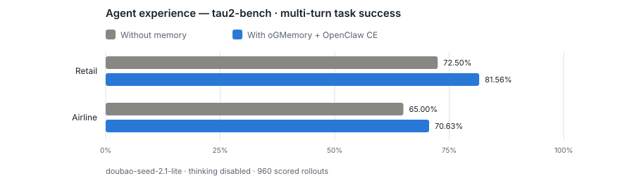

<div align="center">

### oGMemory: A Context Lifecycle Engine <br> for AI Agents

Capture selected conversation and tool evidence, recall it across sessions, and manage what enters the model context.
Memories use schema-defined types, layered representations, and a shared `ctx://` namespace.

English | [中文](README_zh.md)

Documentation: [docs/README.md](docs/README.md)
</div>

---

## The Problem: Token Budget is the Bottleneck

Agents operate within a model context window and a configured prompt budget. The memory layer determines which earlier facts and task details to bring into a turn.

| Symptom | Root Cause | Missing Lifecycle Stage |
| -------- | --------- | ----------------------- |
| Agent forgets earlier conversation | Context window fills up, old content is evicted with no persistence | ④ **afterTurn** — no extraction + persist mechanism |
| Same mistakes repeated across sessions | Lessons are not carried forward | ⑥ **session_end** and ② **bootstrap** — persist and reuse relevant context |
| Unnecessary context consumes the prompt budget | Flat retrieval loads entire documents when an abstract would suffice | ② **assemble** — no L0/L1/L2 hierarchical retrieval |
| Multi-agent coordination failures | Agents cannot see each other's working context | ④ **afterTurn** — no cross-session sharing + multi-tenant isolation |
| Context bloat in long sessions | Earlier turns consume an increasing share of the prompt | ⑤ **compact** — summarize and archive eligible session history |

oGMemory provides persistent context across six common lifecycle boundaries. Native adapters use the boundaries their host exposes. HTTP, MCP, and Python integrations can call the corresponding operations directly.

---

## Design Philosophy

### Core Insight: Context Has a Lifecycle

Agent context has a lifecycle from extraction and persistence to indexing, recall, compaction, and archival.

```
  Born          Structured       Stored           Indexed          Recalled        Compressed       Archived
  (extracted    (categorized     (written         (embedded +      (vector         (summarized,     (session end,
   from          by type,        atomically       projected        search,         deduplicated,    archived,
   conversation) routed by       with ordering    to applicable    hierarchical    compressed)      checkpointed)
                  policy)         guarantees)      index levels)    expansion)
```

Extraction processes eligible new messages. Persistence tracks completion separately from indexing. Retrieval applies owner scope and context budgets, and compaction prepares a smaller session context for the next model call.

### The Six Interception Points

A native agent can use different lifecycle hooks to read, write, or transform context.

```
  ┌──────────────────────────────────────────────────────────────────────┐
  │                         Agent Loop (infinite)                         │
  │                                                                       │
  │   ┌─────┐     ┌──────────┐     ┌──────────┐     ┌─────────┐         │
  │   │ ①   │     │    ②     │     │    ③     │     │   ④     │         │
  │   │ MSG │────▶│ REASON   │────▶│ TOOL     │────▶│ TURN    │         │
  │   │ IN  │     │ PREP     │     │ CALL     │     │ END     │         │
  │   └──┬──┘     └──────────┘     └──────────┘     └────┬────┘         │
  │      ▲                                              │               │
  │      │         ┌──────────┐         ┌─────────┐     │               │
  │      │         │    ⑤     │         │   ⑥     │     │               │
  │      └─────────│ COMPRESS │◀────────│ SHUTDOWN │◀────┘               │
  │                └──────────┘         └─────────┘                      │
  │                                                                       │
  └──────────────────────────────────────────────────────────────────────┘
```

Native integrations map the host's available hooks to these operations. Retrieval and compaction can add work before a model call. Projection can run in the background, and callers can wait for it when fresh recall is required.

### Not All Context Is Equal

The following schema-defined categories illustrate how write policies follow the shape of the information.

| Type | Why this lifecycle? | Write Policy |
| ---- | ------------------- | ------------ |
| **Profile** | User state changes — "I live in London" may become "I moved to Tokyo" | **Merge** — new overwrites old on conflict |
| **Preference** | Preferences accumulate per topic but each topic has one current view | **Aggregate by routing key** — merge within topic |
| **Entity** | Entities accumulate facts, but "Project Alpha" is still "Project Alpha" | **Aggregate by routing key** — merge within entity |
| **Event** | History is immutable — "completed migration on March 15" never changes | **Append only** — never overwrite |
| **Case** | Problem-solving traces are historical records | **Append only** — never overwrite |
| **Pattern** | Patterns emerge from repeated observations and evolve over time | **Aggregate by routing key** — refine over time |
| **Skill** | Reusable procedures can evolve with new experience | **Upsert** — keep a reusable skill or tool record current |

These are the core policy examples. Agent-owned tool and experience memory, skill packages, and optional scenario memory have their own update and access rules.

---

## Key Architectural Decisions

### Why YAML-driven schemas?

**The problem:** Hardcoding extraction schemas in Python means every new context type requires code changes, testing, and deployment.

**The solution:** YAML schemas declare extraction fields, URI layout, owner scope, and operation mode. SchemaRegistry, PolicyRouter, and URIResolver consume these definitions. A new category can reuse an existing policy. A new write behavior can also require a policy or API change.

**What breaks without it:** Extraction, routing, and URI rules would have to repeat category definitions in separate components.

### Why the Outbox pattern for async indexing?

**The problem:** Embedding and upserting into a search index can take longer than publishing the canonical record, and the index can be temporarily unavailable.

**The solution:** The write path records index work in an outbox backed by the selected storage. Workers claim events, update projections, and retry recoverable failures. The caller can wait for the required completion level.

**What breaks without it:** A service must otherwise coordinate canonical persistence and index publication in the request path. A durable outbox lets workers resume incomplete indexing after transient failures.

### Why L0/L1/L2 three-level retrieval?

**The problem:** A long record can contain several topics. A short query such as "what does Alice do?" may match a focused abstract more closely than the full record containing many unrelated details.

**The solution:** L0 abstracts, L1 overviews, and L2 content offer different reading depths. Ordinary memory nodes emit an L0 index record and an L2 record when content is present. Directory summaries and typed agent memory can also emit L1. Hierarchical retrieval uses eligible L0/L1 matches to expand to L2 evidence.

```
  ┌─────────────┐    ┌─────────────┐    ┌──────────────┐
  │  L0 Abstract │    │  L1 Overview │    │  L2 Content   │
  │  Brief summary │    │  Overview │    │  Full material │
  │  Focused     │    │  Balanced    │    │  Comprehensive│
  │  embedding   │    │  signal      │    │  but diffuse  │
  │  → signpost  │    │  → decision  │    │  → full detail│
  └──────┬───────┘    └──────┬───────┘    └──────┬────────┘
         │                   │                    │
         ▼                   ▼                    ▼
    .abstract.md        .overview.md          content.md
```

**Recall benefit:** Summary matches can lead to relevant full records even when the initial search ranks the full content lower. Direct L2 search is also available when hierarchy expansion is disabled.

### Why a filesystem abstraction?

**The problem:** Context operations — create, read, update, link, delete — need to be composable, atomic, and multi-tenant-safe. Building each as a bespoke API means reimplementing concurrency, permissions, and consistency for every operation.

**The solution:** ContextFS provides a common `ctx://` interface over SQL and AGFS. Storage and retrieval use the request's account and authorized owner spaces to scope access.

**What breaks without it:** Each feature would need to implement its own storage access, scope checks, and update conventions.

| Filesystem Concept | Context Equivalent | Benefit |
| ------------------ | ------------------ | ------- |
| `open(path)` | Load context by URI | Uniform access to any context type |
| `read(fd, offset, len)` | Read L0 / L1 / L2 at chosen depth | Pay only for the tokens you need |
| `write(fd, data)` | Persist new context | Publication and version checks appropriate to the storage backend |
| `link(src, dst)` | Relate context records | Relation metadata and optional SQL graph traversal |
| `unlink(path)` | Request deletion or archival | Apply memory lifecycle and visibility rules |
| `gc()` | Maintenance and repair | Reconcile incomplete background work |
| Permissions (chmod) | Tenant and owner scope | Storage and retrieval check access |

### Why optimistic locking for concurrent writes?

**The problem:** Profile nodes are written by every session a user has. Two sessions can extract conflicting profile updates simultaneously.

**The solution:** Updates can check the expected node version. A conflicting update can retry with fresh state or report a conflict. SQL also uses guarded updates and locks where the operation requires them.

**What breaks without it:** Concurrent writers can overwrite each other's changes. Version checks detect a stale update before publication.

### Memory extraction modes

The server defaults to `fast`. One LLM call per extraction batch can produce new cards, updates to previously read cards, and a session summary. The server validates the operations and checks the versions of existing cards before writing.

Set `memory.extraction.mode` to `eager` for native extraction with prefetched memory or `lazy` for a bounded ReAct loop. Explicit mode settings continue to apply. The deterministic extraction engine takes precedence over these LLM modes. [Configuration reference](docs/OGMEMORY_ENV.md#记忆与压缩)

```
  Lazy mode, iteration 1:  read(profile_uri) → "Alice, backend engineer, London"
                 → Nothing new to extract. Skip.

  Lazy mode, iteration 2:  read(entities/go) → "Go expert, prefers error handling pattern X"
                 → New: "Alice now also uses Rust for side projects"
                 → extract_entity(routing_key="rust", ...)
```

---

## Architecture

### Overall Architecture

```
  Native agent hooks / HTTP REST / MCP / Python API
                          │
                MemoryService + sessions
                   /                 \
      Write API + PolicyRouter      Read API + QueryPlanner
      Extraction + ContextWriter    Retrieval + ContextReader
                   \                 /
      ContextFS: SQL (openGauss / PostgreSQL) or AGFS
                          │
               Durable outbox and index workers
                          │
           Vector index + optional native BM25 and graph projections
```

**Local onboarding:** The wizard defaults to openGauss for SQL storage and vector search.
**Deployment:** SQL and AGFS are storage options. The vector backend can be openGauss,
PostgreSQL with pgvector, Chroma, Milvus, or an in-memory index for development.

### Write Path: Conversation to Persistent Memory

```
  Completed turn or explicit memory write
                      │
          Buffer and extract eligible messages
              (fast, eager, or lazy)
                      │
              Typed memory candidates
                      │
      Route by schema (merge, aggregate, append, skill/tool)
                      │
       Publish records to SQL or AGFS and record outbox work
                      │
      Worker projects applicable vector and optional lexical records
```

Write acknowledgments can describe buffered, completed, or pending work.
Use a stable request ID to look up the receipt or retry the write, and wait for
indexing when the next operation needs to retrieve the memory.

### Read Path: Query to Assembled Context

```
  Query or prompt
        │
        ▼
  Plan the query and apply the caller's memory scope
        │
        ▼
  Search vectors and, if configured, fuse openGauss BM25 matches
        ├── L0 / L1 summary hits → hierarchical expansion
        └── L2 content hits → direct candidates
        │
        ▼
  Rank and deduplicate by memory identity
        │
        ▼
  Read authorized records and assemble context within the configured budget
```

With hierarchy enabled, an initial mixed-level search can lead from summary matches to
full content. Optional BM25 combines lexical and vector ranks with weighted reciprocal
rank fusion. Relationship graph and scenario retrieval can add scoped evidence when enabled.

Hierarchical expansion is enabled by default. To search only L2 content,
set `retrieval.expand_hierarchy: false` in the service YAML, or
`OGMEM_RETRIEVAL_EXPAND_HIERARCHY=false` when the YAML field is omitted.
The setting applies to the whole service instance and requires restarting
every worker. When disabled, retrieval searches L2 directly and skips roots,
hierarchical expansion, and child searches, including empty-result fallbacks.
Existing ranking, top-k limits, access scope, optional content filling, and
public URI/read behavior still apply. This removes expansion work but can
lose results discovered through L0/L1 summaries; measure recall on your
workload. See [retrieval configuration](config/README.md#hierarchical-retrieval-expansion)
for precedence and accepted values.

**Namespace isolation:** Retrieval filters by account and authorized owner spaces. Query filters can narrow the visible scope, and canonical record reads enforce access checks.

---

## The Agent Context Lifecycle

These six boundaries show where an agent can use oGMemory. Lifecycle coverage depends on the host and adapter.

| Stage | When | What happens | Key invariant |
| ----- | ---- | ------------ | ------------- |
| ① message_received | Before inference | Optionally prefetch scoped candidates | Use the session and authorized memory scope |
| ② bootstrap + ingest + compose | Before prompt assembly | Load startup context and assemble relevant facts and skills | Apply the configured context budget |
| ③ before_tool_call + after_tool_call | Around tool execution | Capture tool traces and apply supported host hooks | Tool behavior depends on the integration and enabled features |
| ④ afterTurn | After the agent responds | Buffer messages and extract when eligible or explicitly requested | Track write completion separately from index visibility |
| ⑤ prepare_compaction + compact | When context needs compaction | Prepare extraction and compact session context | A prepare token is single use when the host uses both stages |
| ⑥ session_end + dispose | Session closes | Finalize traces and persist or dispose of available session state | Preserve eligible records for later recall |

Later sessions can retrieve eligible memories after persistence and indexing. The client can use the same authorized memory scope across sessions.

---

## Data Flow: End-to-End Walkthrough

```
  Session 1 — Write Path: "I'm Alice, a backend engineer based in London"
  ────────────────────────────────────────────────────────────────────────
    User Message → Stage ④ afterTurn with forceExtract for this short example
        → Incremental Extraction (name, role, location)
        → CandidateMemory(category="profile")
        → PolicyRouter → ProfilePolicy (merge)
        → ContextWriter publishes to the configured storage backend
        → OutboxEvent → worker projects the applicable index levels

  Session 2 — Read Path: "What does Alice do for a living?"
  ────────────────────────────────────────────────────────────────────────
    User Message → Stage ① message_received (optional prefetch)
        → Stage ② compose runs scoped recall and finds the profile
        → Load the relevant record within the context budget
        → Provide "Alice is a backend engineer" as context to the agent
```

Check write completion and index visibility before testing recall in another session. Model, embedding, and storage configuration all affect latency.

---

## How It Differs

This table compares oGMemory's lifecycle integration with a basic vector search
workflow and the documented [Mem0 Platform quickstart](https://docs.mem0.ai/platform/quickstart).

| Dimension | oGMemory lifecycle integration | Basic vector-search workflow | Mem0 Platform quickstart |
| --- | --- | --- | --- |
| **Lifecycle coverage** | Write, index, recall, compact, and archive through the service lifecycle | Query and return indexed records | Add and search memories |
| **Write policies** | Schema-driven merge, aggregate, append, and skill/tool policies | The application decides how to write or update records | The client adds messages and can use separate update and delete APIs |
| **Retrieval granularity** | Scoped L0/L1 expansion to L2, direct L2, and optional lexical or graph retrieval | Commonly returns the top matching chunks | Search returns matching memory records, with metadata filters available |
| **Context types** | Typed memories and skills with category-specific handling | The application defines document and metadata types | Search results include memory text and associated metadata |
| **Multi-tenant isolation** | Account and authorized owner scope in retrieval and canonical reads | Depends on the application's identity and filter configuration | The example adds and searches within a user ID |
| **Concurrent writes** | Version checks and backend-specific updates | Depends on the application's storage policy | Outside the quickstart's scope |
| **Atomicity** | Backend-specific record publication and durable outbox work | Depends on how canonical writes and index updates are coordinated | Outside the quickstart's scope |
| **Compression** | Prepare and compact session context with supported hooks | The application implements session compaction if needed | Outside the quickstart's scope |

oGMemory exposes both direct memory APIs and agent lifecycle hooks. Choose the integration points that the client supports.

---

## oGMemory Evaluation Results

<picture>
  <source media="(prefers-color-scheme: dark)" srcset="docs/images/tau2-benchmark-dark.svg">
  
</picture>

This paired OpenClaw CE evaluation measured weighted task success of 70.00% without memory and 77.92% with oGMemory across 480 rollouts per arm. See the [tau2-bench report and runtime manifest](docs/benchmarks/tau2-bench/README.md).

---

## Quick Start

### Prerequisites

- **Python 3.11+**
- **An existing openGauss database in PG compatibility mode** for the default local setup
- **PostgreSQL** with [pgvector](https://github.com/pgvector/pgvector) extension (for PostgreSQL mode)
- **LLM and embedding endpoints** with credentials and a matching embedding dimension
- **Docker** (optional, for containerized deployment)

### Install

```bash
git clone https://gitcode.com/opengauss/oGMemory.git
cd oGMemory
python3 -m venv .venv && source .venv/bin/activate
```

<details>
<summary><strong>Option A: Local OpenGauss mode (default)</strong></summary>

```bash
python -m pip install -e .
# Local onboarding defaults to openGauss for SQL storage and vector search.
ogmem onboard --mode local
ogmem status
```

Start openGauss separately before onboarding. On first setup, the wizard checks
database connectivity and can enable hybrid retrieval when the openGauss
vector database supports native BM25 and the role can create schema objects.
The wizard offers to start the service. If you defer startup, run
`ogmem start local -d` later. Use `ogmem start local -d --config /path/to/ogmem.yaml`
for a custom configuration and `ogmem stop local` to stop the managed service.
For an AGFS setup with Chroma, install `.[chroma]`, prepare the AGFS server as
described in the [AGFS guide](agfs/README.md), and select
`--vector-db chroma --storage-backend agfs`.

Docker mode reuses the repository's `deploy/user-quickstart/deploy.sh` flow,
including its OpenGauss, oGMemory, MCP, persistence, and OpenClaw checks.
The current quickstart images and host script require ARM64 Linux, Docker,
Bash, `ss`, and the standard GNU command-line tools:

```bash
ogmem onboard --non-interactive --mode docker --provider openai --api-key "$LLM_API_KEY" \
  --base-url "$LLM_BASE_URL" --model "$LLM_MODEL" \
  --embedding-provider openai --embedding-api-key "$EMBEDDING_API_KEY" \
  --embedding-base-url "$EMBEDDING_BASE_URL" \
  --embedding-model "$EMBEDDING_MODEL" --embedding-dimension "$EMBEDDING_DIMENSION" \
  --port 18090
```

This non-interactive command starts containers after preflight. To generate configuration
and start later, run `ogmem onboard --mode docker` and decline immediate startup.
Docker supports OpenAI, Volcengine, DashScope and Zhipu; DashScope/Zhipu embeddings
use the OpenAI-compatible adapter with the supplied endpoint and credentials.
Mock providers are available in local mode only.
Zhipu's default `embedding-3` configuration uses its native 2048 dimensions.
The configured embedding dimension must match the service's returned vectors;
it does not change a model's output dimension by itself.

<details>
<summary><strong>Non-interactive mode (CI / automation)</strong></summary>

```bash
python -m pip install -e '.[chroma]'
ogmem onboard --non-interactive --mode local \
  --provider openai --api-key "$LLM_API_KEY" \
  --base-url "$LLM_BASE_URL" --model "$LLM_MODEL" \
  --embedding-provider openai --embedding-api-key "$EMBEDDING_API_KEY" \
  --embedding-base-url "$EMBEDDING_BASE_URL" --embedding-model "$EMBEDDING_MODEL" \
  --embedding-dimension "$EMBEDDING_DIMENSION" --vector-db chroma \
  --storage-backend sql --sql-dialect opengauss \
  --db-connection "$DB_CONNECTION"
```

</details>

</details>

<details>
<summary><strong>Option B: PostgreSQL mode (direct SQL storage)</strong></summary>

**1. Install & configure PostgreSQL**

```bash
# Ubuntu / Debian
sudo apt-get install postgresql postgresql-contrib
sudo apt-get install postgresql-16-pgvector   # adjust version to match your PG

# macOS
brew install postgresql@16
brew install pgvector

# Start PostgreSQL
sudo service postgresql start   # Ubuntu
brew services start postgresql@16  # macOS

# Ubuntu / Debian example: create the database and enable pgvector.
sudo -u postgres createdb ogmemory
sudo -u postgres psql -d ogmemory -c 'CREATE EXTENSION IF NOT EXISTS vector;'
# On macOS, run createdb and psql as the role that administers your local instance.
```

**2. Install oGMemory**

```bash
python -m pip install -e .
```

**3. Configure connection**

Set `DB_CONNECTION` to the PostgreSQL DSN for your application role. The vector
backend key `opengauss` is also used for PostgreSQL with pgvector. If you prefer
Chroma for vectors, install `.[chroma]` and select `--vector-db chroma`.

```bash
ogmem onboard --mode local --storage-backend sql --sql-dialect postgresql \
  --vector-db opengauss --db-connection "$DB_CONNECTION" \
  --vector-db-connection "$DB_CONNECTION"
ogmem status
```

</details>

### Use It

<details>
<summary><strong>HTTP Server (recommended)</strong></summary>

**AGFS mode:** Point the service YAML at a running AGFS instance and choose a
compatible vector backend. Start the configured service with `ogmem start local -d`.

**SQL mode:** Start the SQL-backed instance with the wizard or
`ogmem start local -d` after configuration.

The next example uses the default local HTTP port. With role control enabled,
send the tenant API key and account/user headers and provide an authorized
agent ID. See [HTTP authentication](docs/integrations/http-rest.md).

```bash
# Submit a short turn and force extraction below the configured threshold.
curl -fsS http://127.0.0.1:8090/api/v1/after_turn \
  -H 'Content-Type: application/json' \
  -d '{"userId":"user-1","sessionId":"write-demo","forceExtract":true,"wait":true,
       "messages":[{"role":"user","content":"I am Alice, a backend engineer."},
                   {"role":"assistant","content":"Nice to meet you, Alice."}]}'
```

After the write completes and indexing is ready, retrieve context from another session.

```bash
curl -fsS http://127.0.0.1:8090/api/v1/compose \
  -H 'Content-Type: application/json' \
  -d '{"userId":"user-1","sessionId":"read-demo","prompt":"What does Alice do for work?",
       "messages":[{"role":"user","content":"What does Alice do for work?"}]}'
```

</details>

<details>
<summary><strong>Python SDK</strong></summary>

Use the configured service dependencies from a Python process. See the
[Python API guide](docs/integrations/python-api.md) for context and query options.

```python
from providers.unified_config import OgMemConfig
from server.memory_service import MemoryService

memory = MemoryService(config=OgMemConfig.load("config/ogmem.yaml"))
try:
    result = memory.after_turn({
        "userId": "user-1",
        "sessionId": "sdk-demo",
        "messages": [
            {"role": "user", "content": "I'm Alice, a backend engineer in London."},
            {"role": "assistant", "content": "Nice to meet you, Alice."},
        ],
        "forceExtract": True,
        "wait": True,
    })
    print(result["status"])
finally:
    memory.shutdown()
```

</details>

<details>
<summary><strong>Docker / HTTP API Reference</strong></summary>

```bash
cp .env.example .env
# Configure model endpoints and credentials in .env before starting.
bash deploy/compose/deploy.sh start
```

To build the source deployment instead, configure the files in `deploy/` first.

```bash
# Multimodal stack: see deploy/README.md.
cd deploy
cp .env.example .env
cp ogmemory.example.yaml ogmemory.yaml
# Configure services, database credentials, and ports before starting.
docker compose --profile with-db up -d
```

The root Compose stack runs oGMemory with AGFS for canonical storage and openGauss for vectors. Its default image set targets ARM64. It publishes HTTP on port 18090 and MCP on port 18091 by default, and keeps the database and AGFS ports internal. Set the image tags for the version you want to run.
See [Docker Compose deployment and verification](deploy/compose/README_zh.md) for configuration,
networking, model connectivity checks and cross-session persistence tests.

| Endpoint | Method | Description |
| -------- | ------ | ----------- |
| `/api/v1/compose` | POST | Search memory, return context for current turn |
| `/api/v1/after_turn` | POST | Buffer a completed turn and extract when eligible or requested |
| `/api/v1/sessions/{id}/write-requests/{request_id}` | GET | Check the status of an identified memory write |
| `/api/v1/memories/write`, `/query`, `/read` | POST | Write or access memory directly. Direct writes require `mcp.enable_write_tools`. |
| `/api/v1/ingest` | POST | Single message ingest |
| `/api/v1/ingest_batch` | POST | Batch message ingest |
| `/api/v1/prefetch` | POST | Best-effort pre-compose retrieval staged into the session topic buffer |
| `/api/v1/prepare_compaction` | POST | Run pre-compaction extraction and return a one-time `prepareToken` |
| `/api/v1/compact` | POST | Commit/archive the session and return compacted context; accepts `prepareToken` |
| `/api/v1/bootstrap` | POST | Cold-start session with profile + preferences |
| `/api/v1/dispose` | POST | Release session resources and persist session state |
| `/api/v1/sessions/{id}/commit` | POST | Commit session: archive + extract |
| `/api/v1/session_working_set` | GET/POST | List active sessions ordered by access time |
| `/api/v1/evict_idle_sessions` | POST | Evict sessions idle longer than `maxIdleSeconds` |
| `/api/v1/health` | GET | Report service and backend health |
| `/api/v1/admin/*` | Various | Tenant admin (accounts, users, roles, agents) |

</details>

### Configuration

The table lists service fallback values. The [reference YAML](config/ogmem.reference.yaml), local wizard, and deployment templates can select different settings. See [Configuration reference](docs/OGMEMORY_ENV.md) for precedence.

| Variable | Default | Description |
| -------- | ------- | ----------- |
| `OGMEM_API_KEY` | — | LLM API key (OpenAI-compatible) |
| `OGMEM_BASE_URL` | — | Custom LLM API base URL |
| `OGMEM_LLM_MODEL` | `gpt-4o-mini` | LLM model for extraction + classification |
| `OGMEM_EMBEDDING_MODEL` | `text-embedding-ada-002` | Embedding model for vector indexing |
| `OGMEM_EMBEDDING_API_KEY` | — | Separate key for embedding API (falls back to `OGMEM_API_KEY`) |
| `VECTOR_DB_TYPE` | `chroma` | Vector backend: `memory`, `chroma`, `opengauss` (also for pgvector), or [`milvus`](docs/integrations/milvus.md) |
| `STORAGE_BACKEND` | `agfs` | Canonical storage: `agfs` or `sql`. The local wizard defaults to SQL. |
| `SQL_DIALECT` | `postgresql` or auto-detected | Set `postgresql` or `opengauss` for the SQL storage connection. The local wizard defaults to openGauss. |
| `STORAGE_DB_CONNECTION_STRING` | — | Canonical SQL DSN. `SQL_CONNECTION_STRING` is a legacy alias. |
| `OGMEM_HTTP_PORT` | `8090` | HTTP server listen port |
| `OGMEM_CONFIG` | Project `config/ogmem.yaml` or `/etc/ogmem/config.yaml` | Path to the service YAML |
| `OGMEM_AFTER_TURN_THRESHOLD` | `400` | Pending token threshold before automatic after-turn extraction |
| `OGMEM_EXTRACTION_MODE` | `fast` | LLM extraction mode. Also accepts `eager` and `lazy`. |
| `OGMEM_DUAL_PASS_ENABLED` | `false` | Enable a second native extraction pass where supported. |
| `OGMEM_RETRIEVAL_HYBRID_ENABLED` | `false` | Enable native openGauss BM25 with SQL storage. Eligible first-time local onboarding can enable it. |
| `OGMEM_ROLLING_COMPRESS_ENABLED` | `true` | Enable Layer 2 rolling session compression |
| `OGMEM_ROLLING_COMPRESS_FALLBACK_ENABLED` | `false` | Use rule-based rolling fallback when LLM compression is unavailable |
| `OGMEM_COMPACT_PREPARE_TOKEN_TTL` | `300` | One-time prepare token TTL in seconds |
| `OGMEM_ARCHIVE_MAX_COUNT` | `10` | Target archive count after merge |
| `OGMEM_ARCHIVE_MERGE_THRESHOLD` | `10` | Archive count threshold that triggers merge |
| `OGMEM_PREFETCH_ENABLED` | `false` | Enable `/prefetch` staging before compose |
| `OGMEM_PREFETCH_TOP_K` | `5` | Maximum staged prefetch hits |
| `OGMEM_SESSION_STATE_BRIDGE_ENABLED` | `true` | Sync durable `SessionState` into `SessionWindowState` |
| `OGMEM_SESSION_STATE_SYNC_INTERVAL_TURNS` | `1` | Minimum turns between state bridge syncs |

### Repository Layout

[Source directories](docs/architecture/repository-layout.md) · [Documentation](docs/README.md) · [Client integrations](docs/integrations/README.md)

---

## Codex Integration

For portable memory retrieval and writing across clients, see the
[Agent Plugin package](plugins/agent-plugins/README.md) and
[client tutorial](docs/integrations/agent-plugins.md).

The repository-local [`ogmemory` Codex plugin](plugins/ogmemory/) connects supported Codex lifecycle hooks to a local or remote oGMemory HTTP service. It captures sessions, prompts, tools, permissions, compaction, subagents, completed turns, and session shutdown. See the [Codex integration guide](docs/integrations/codex.md).

---

## OpenCode Integration

The npm-ready [`plugins/opencode`](plugins/opencode/) package provides automatic memory recall, incremental conversation write-back, and canonical Trace capture through OpenCode lifecycle hooks. It targets OpenCode 1.15.11 or later and operates above MCP; MCP remains available for explicit memory tools.

For source installation, configuration, privacy controls, and verification steps, see the [plugin README](plugins/opencode/README.md).

---

## DeepSeek Harness Integration

The installable [`plugins/deepseek-harness`](plugins/deepseek-harness/) bundle connects
DeepSeek Harness to an oGMemory HTTP service and provides automatic cross-session
memory recall.

See the [DeepSeek Harness integration guide](docs/integrations/deepseek-harness.md).

---

## LangChain Deep Agents Integration

Install `python -m pip install '.[deepagents]'` and pass
`OGMemoryMiddleware` from `integrations.deepagents` to
`create_deep_agent(middleware=[...])` for automatic recall and turn capture.
Both sync and async execution are supported, with `configurable.thread_id`
isolating sessions. See the [Deep Agents integration guide](docs/integrations/deepagents.md)
and [example](examples/deepagents_memory.py).

## Hermes Agent Integration

The native [`plugins/hermes`](plugins/hermes/) provider adds automatic
recall, turn write-back, session commit, and explicit `ogmemory_search` and
`ogmemory_remember` tools to Hermes Agent.

See the [Hermes Agent integration guide](docs/integrations/hermes.md).

---

## QwenPaw Integration

The native [QwenPaw adapter](docs/integrations/qwenpaw.md) connects QwenPaw middleware to oGMemory. Follow its integration guide to install and configure it.

---

## OpenClaw Integration

```bash
ogmem onboard --mode plugin

# Or install manually from the plugin source directory
cd plugins/openclaw && openclaw plugins install -l .
```

`ogmem onboard --mode plugin` exports connection configuration for an **existing
Agent and independently deployed oGMemory service**. It does not install the
Agent/plugin, change active Agent settings, install backend dependencies, or
start services. Select OpenClaw, Claude Code, Codex, OpenCode, DeepSeek Harness,
Hermes, or Deep Agents with `--agent`. Use `agent-plugins` to export the portable bundle. Other agent names generate HTTP MCP configuration.

```bash
ogmem onboard --mode plugin --agent openclaw --non-interactive \
  --ogmem-url https://memory.example.com \
  --account-id acct-1 --user-id user-1 --agent-id openclaw \
  --ogmem-api-key-env OG_AUTH_API_KEY

# Other Agents: supply the MCP endpoint explicitly; its port may differ from REST.
ogmem onboard --mode plugin --agent my-agent --non-interactive \
  --mcp-url https://memory.example.com:18091/mcp \
  --ogmem-api-key-env OG_AUTH_API_KEY
```

Files are exported to `./ogmem-client-config/<adapter>/` (or `--output-dir`),
including instructions to install the plugin, merge the configuration, and verify
it on the Agent machine. Configuration export does not mean the integration is
active. MCP provides tools; native lifecycle recall/writeback requires an adapter.
See [Agent configuration export](docs/integrations/plugin-config.md).

```
OpenClaw Agent
  → og-memory-context-engine (Node context-engine plugin)
  → ContextEngine HTTP API (`/prefetch`, `/compose`, `/after_turn`, `/prepare_compaction`, `/compact`)
  → ContextFS / SQL storage + vector index
```

The plugin can run in `remote` mode against an existing oGMemory service, or in `local` mode to manage a local service based on its configured storage. It stages optional prefetch hits before compose, injects layered context messages, delegates turn-end extraction to `/after_turn`, and can let oG-Memory own compact result generation through the two-stage prepare/compact protocol.

---

## Implementation Status

**Current capabilities:** oGMemory supports schema-based extraction, scoped memory and skill retrieval, session state and compaction, source archives, durable write receipts, and outbox indexing. It also provides authorized memory access through HTTP and MCP, plus Memory Viewer for browsing records, background activity, and model usage. See the [feature guide](docs/features.md) and [Memory Viewer guide](docs/memory_viewer_guide.md).

### Benchmark Results (LoCoMo10)

**LoCoMo benchmark: 92.21% accuracy across 1,540 scored questions (1,420 correct).** The November 2026 920B run used source revision `59d354ae8`, native OpenClaw CE, DeepSeek-V4.1-Flash-1017, and `BAAI/bge-m3`. All 272 session writes settled. The run used eager single-pass extraction and native openGauss BM25. Category 5 was excluded from scoring. See the [evaluation protocol](docs/testing/memory-evaluation-guide-zh.md) and [`tests/e2e/`](tests/e2e/).

**Lifecycle stages covered:** Native adapters cover different sets of hooks. OpenClaw supports contextual recall, turn write-back, two-stage compaction, session finalization, and tool-call traces. See the [OpenClaw plugin guide](plugins/openclaw/README.md) and [integration matrix](docs/integrations/README.md).

**Optional runtimes:** Enable the SQL text relationship graph to build and retrieve typed links. [Scenario memory](docs/scene-runtime.md) has a separate configuration and groups related facts. [Agent tool and experience memory](deploy/agent-memory.md) can learn from finalized traces. The service also supports [skill management and learning](docs/features.md#技能学习与复用).

**Tool integration:** Native adapters handle tool hooks according to the host. See the [context management guide](docs/features.md#上下文管理) for supported behavior.

**Dev extensions:** [Code understanding and editing](docs/features.md#代码理解与编辑) supports workspace registration, search, and targeted edits when enabled. [Multimodal memory](docs/MultiModelMemory-architecture.md) uses an [operator service](docs/operator_service.md) for document, image, audio, and video inputs. Compatible hosts can also enable large tool-result externalization.

**Documentation:** [docs/OGMEMORY_ENV.md](docs/OGMEMORY_ENV.md) (environment setup) | [Client integrations](docs/integrations/README.md) | [Codex](docs/integrations/codex.md) | [DeepSeek Harness](docs/integrations/deepseek-harness.md) | [Hermes Agent](docs/integrations/hermes.md) | [Quickstart](docs/QUICKSTART.md) | [Deployment](docs/deployment/deployment_operations_guide.md) | [OpenClaw Plugin](plugins/openclaw/README.md) | [Benchmark](tests/e2e/) (LoCoMO evaluation)

**MCP:** [Protocol compatibility](docs/integrations/mcp-protocol-compatibility.md)

**Optional ContextNode graph:** [Semantic graph ingestion and retrieval](docs/semantic-context-graph.md) (opt-in SQL storage; no retrieval-time LLM)

**Testing:** Install `.[dev]` and run `python -m pytest tests/unit -q` for unit tests or `python -m pytest tests/contract -v` for core contracts. To generate an HTML unit-test coverage report, run `python -m pytest tests/unit --cov=core --cov=fs --cov=service --cov-report=html`. See the [test strategy](docs/testing/jenkins-test-strategy.md) for integration and evaluation prerequisites.

---

## References

### Benchmark & Evaluation
- [LoCoMo: Evaluating Very Long-Term Conversational Memory of LLM Agents](https://aclanthology.org/2024.acl-long.747/) — Maharana et al., 2024 — long-context conversational memory benchmark used in our evaluation

### Memory Architectures for LLM Agents
- [MemoryBank: Enhancing LLMs with Long-Term Memory](https://arxiv.org/abs/2305.10250) — Zhong et al., 2023 — sentiment-centric memory processing for persistent conversational memory
- [A-MEM: Agentic Memory for LLM Agents](https://arxiv.org/abs/2502.12110) — 2025 — dynamic, agentic memory organization with dynamic indexing
- [Mem0: Production-Ready AI Agents with Scalable Long-Term Memory](https://arxiv.org/abs/2504.19413) — 2025 — user/session/agent scoped memory with vector store + knowledge graph
- [SeCom: Memory Construction and Retrieval for Personalized Conversational Agents](https://arxiv.org/abs/2502.05589) — 2025 — segment-level memory bank with conversation segmentation (related to our two-phase extraction)

### Hierarchical Retrieval & Multi-Granularity
- [ReadAgent: Gist Memory of Very Long Contexts](https://arxiv.org/abs/2402.09727) — Lee et al., 2024 — human-inspired reading agent with gist memory, 20x effective context length (related to our L0/L1/L2 hierarchy)
- [MemoRAG: Memory-Augmented Retrieval](https://arxiv.org/abs/2409.05591) — Qian et al., 2024 — dual-system architecture with global memory + retrieval-augmented generation
- [LATTICE: LLM-guided Hierarchical Retrieval](https://arxiv.org/abs/2510.13217) — Gupta et al., 2025 — hierarchical retrieval framework for large document collections

### Context Compression
- [LLMLingua-2: Task-Agnostic Prompt Compression](https://arxiv.org/abs/2403.12968) — Pan et al., 2024 — data distillation for efficient prompt compression up to 20x
- [LongLLMLingua: Question-Aware Compression for Long Context](https://aclanthology.org/2024.acl-long.91.pdf) — Jiang et al., 2024, ACL — coarse-to-fine compression with 17.1% improvement at 4x compression (related to our compression pipeline design)
- [Prompt Compression for Large Language Models: A Survey](https://arxiv.org/abs/2410.12388) — 2024 — comprehensive survey of prompt and context compression techniques

### Reasoning & Acting
- [ReAct: Synergizing Reasoning and Acting in Language Models](https://arxiv.org/abs/2210.03629) — Yao et al., 2023, ICLR — interleaved reasoning traces and task-specific actions (our lazy extraction mode is based on this paradigm)

### Multi-Agent & Governance
- [Governed Memory](https://arxiv.org/abs/2603.17787) — Taheri, 2026 — memory governance and access control
- [Collaborative Memory](https://arxiv.org/abs/2505.18279) — multi-user memory sharing + dynamic ACL (related to our multi-tenant isolation)
- [Multi-Agent Memory Systems for Production](https://mem0.ai/blog/multi-agent-memory-systems) — Mem0, 2026
- [Cemri et al.](https://arxiv.org/abs/2503.13657) — multi-agent coordination failure analysis

### Infrastructure
- oGMemory can use AGFS or SQL to store persistent, scoped memory records
- [AI Agent Memory Architectures](https://zylos.ai/research/2026-03-09-multi-agent-memory-architectures-shared-isolated-hierarchical) — Zylos Research, 2026

## SWE-bench reference workflow

See [SWE-bench Lite testing guide and scripts](benchmarks/swebench/README.md) for baseline versus oGMemory with openGauss SQL storage, official evaluation, and usage reporting (guide in Chinese).

## License

[Mulan Permissive Software License v2](LICENSE). The package metadata currently declares Apache-2.0.
