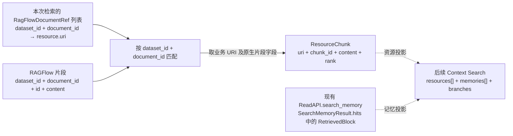
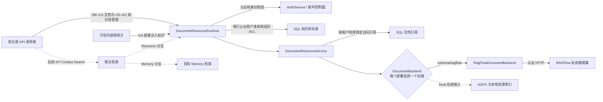
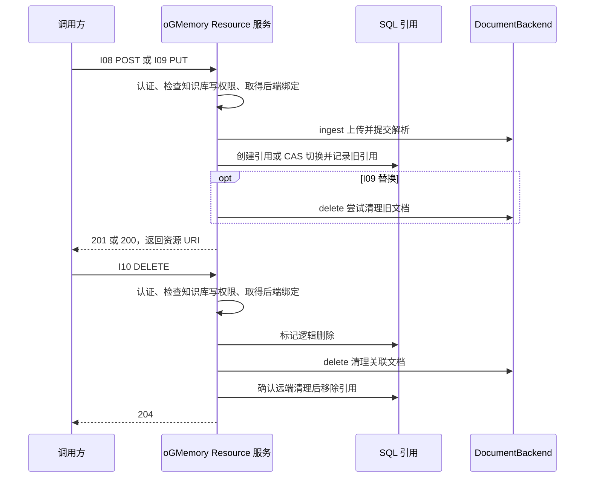

# Resource 与 Context Search 设计方案

## 1. 概述

oGMemory dev 已定义 `ContextType.RESOURCE`。代码资源以 `ContextNode` 表示，通过 `ContextFS` 和现有索引管理。知识文档新增独立模型，复用账号级 `ctx://{account}/resources/` 命名空间。首期以 RAGFlow v0.27.2 为联调目标。外部数据集保存原文，负责解析和检索片段。 [类型定义](https://gitcode.com/opengauss/oGMemory/blob/dev/core/enums.py) · [代码资源生命周期](https://gitcode.com/opengauss/oGMemory/blob/dev/service/code_resource_lifecycle.py) · [RAGFlow 正式发布](https://github.com/infiniflow/ragflow/releases/tag/v0.27.2)

oGMemory 用独立的 `KnowledgeBase` 对象管理文档。一个用户可管理多个个人库，一个租户可管理多个共享库，已有数据集迁为租户默认共享库。上传、替换、删除、状态、下载和检索从 oGMemory 按库授权。`knowledge_base.mode` 为部署选择唯一后端。`external` 接入外部知识库，当前提供方为 RAGFlow。`local` 后续接入本地 AGFS 和资源索引。Context Search 将现有记忆检索结果与有权读取的知识库结果一并返回。记忆沉淀经审阅发布到指定知识库并保留来源。

前台统一使用「资源管理」作为入口。知识文档按知识库组织，上传、检索和权限管理沿用库范围。OpenViking 的 Resource 也覆盖文档、网站、代码仓、数据集与编译知识库。 [OpenViking 资源组织](https://docs.openviking.ai/en/guides/23-data-organize)

## 2. 服务与组件

| 功能 | 阶段 | 组件与职责 | 接口与验收 |
| --- | --- | --- | --- |
| F01 文档建模 | 首期 | `Resource` 定义账号和资源 ID，`DocumentResource` 定义文档身份与文件属性 | I01、Q01 |
| F02 文档操作 | 首期 | `RagFlowResourceAdapter` 上传、提交解析、查询状态、下载、删除 | I01–I05、Q01–Q02 |
| F03 知识检索 | 首期 | 按账号和已授权的知识库选取活动文档引用，由当前后端返回 `ResourceChunk` | I06、I13、Q01、Q06、Q09 |
| F04 Context Search | 后续 | 并行查询记忆和当前模式选定的唯一资源后端，返回两类结果 | I07、Q04 |
| F05 记忆沉淀 | 后续 | 从记忆中整理可复用事实或流程，审阅后发布文档与溯源记录 | Q05 |
| F06 文档服务 | 首期 | 独立 Runtime 复用认证与账号控制面，Resource 服务通过后端协议完成读写 | I08–I14、Q06 |
| F07 知识库管理 | 首期 | 目录登记所有者、可见性、后端绑定和共享库成员，前台按账号及知识库导航 | I15–I18、Q07–Q09 |
| F08 共享库成员管理 | 首期 | 库管理员查看授权、从租户内已有用户选人、逐人调整或撤销授权 | I19–I21、Q10 |

## 3. 实现设计

### 3.1 知识库后端协议

`DocumentResourceRuntime` 复用 `AuthService` 和已初始化的账号控制面，独立于 `MemoryService`。它按认证账号校验知识库权限，再按部署模式与库绑定打开文档服务。`DocumentBackend` 以 `name` 和 `namespace` 标识后端范围，提供 `ingest`、`status`、`download`、`delete`、`search`。`RagFlowDocumentBackend` 将通用引用和状态转成 RAGFlow 对象，后续 AGFS 实现同一协议。

RAGFlow 适配层的可信内部调用方持有 `DocumentResource` 与 RAGFlow 数据集 ID。选择使用内置解析器、已配置嵌入模型的数据集。上传时把原文件名、媒体类型和原始字节交给 RAGFlow，获取远端文档 ID 后组合成 `RagFlowDocumentRef`。已有 RAGFlow 文档可由调用方直接构造引用。上传、解析、状态查询、下载、删除和非空范围检索各对应一次 HTTP 请求。调用方按需要读取解析进度并决定下一次操作。 [RAGFlow HTTP API](https://github.com/infiniflow/ragflow/blob/v0.27.2/docs/references/http_api_reference.md)

检索按引用提取 `dataset_ids` 和 `document_ids`，多数据集须配置相同的嵌入模型。按返回的 `(dataset_id, document_id)` 关联到 `DocumentResource.uri`，保留片段顺序。文档范围为空时直接返回空结果。引用中的后端 ID 和解析状态属于 RAGFlow 适配层。 [RAGFlow 检索源码](https://github.com/infiniflow/ragflow/blob/v0.27.2/api/apps/restful_apis/chunk_api.py)

### 3.2 Resource 路由与文档操作

知识库配置沿用统一配置，优先级为 YAML > 环境变量 > 默认值。修改后重启服务。

| YAML 路径 | 环境变量 | 取值 |
| --- | --- | --- |
| `knowledge_base.mode` | `OGMEM_KNOWLEDGE_BASE_MODE` | 知识文档资源的统一读写路由，`local`（默认）与 `external` 二选一 |
| `knowledge_base.external.provider` | `OGMEM_KNOWLEDGE_BASE_EXTERNAL_PROVIDER` | 外接提供方，首期为 `ragflow` |
| `knowledge_base.external.base_url` | `OGMEM_KNOWLEDGE_BASE_EXTERNAL_BASE_URL` | 提供方 HTTP(S) 地址，不含凭据、查询参数和片段 |
| `knowledge_base.external.api_key` | `OGMEM_KNOWLEDGE_BASE_EXTERNAL_API_KEY` | 提供方服务凭据 |
| `knowledge_base.external.account_namespaces` | `OGMEM_KNOWLEDGE_BASE_EXTERNAL_ACCOUNT_NAMESPACES` | 兼容迁移输入，账号 → 默认共享库的存量数据集。YAML 用字典，环境变量用 JSON 对象 |

仅 `external` 模式加载外部配置。控制面提供已注册的 active 账号与用户。应用端 API Key 解析出请求身份，在其租户范围内检查库权限。创建知识库时，服务为新库生成 UUID，在配置的 RAGFlow 身份下创建一个私有数据集，再保存绑定。请求以 `knowledge_base_id` 选择库，运行时从 SQL 取出后端命名空间。RAGFlow 服务凭据和数据集 ID 保留在服务端。 [现有认证](https://gitcode.com/opengauss/oGMemory/blob/dev/server/auth.py) · [账号控制面](https://gitcode.com/opengauss/oGMemory/blob/dev/server/tenant_admin.py)

```yaml
knowledge_base:
  mode: external
  external:
    provider: ragflow
    base_url: https://ragflow.example.com
    account_namespaces:
      acme: dsA
      demo: dsB
```

通过 `OGMEM_KNOWLEDGE_BASE_EXTERNAL_API_KEY` 注入上述示例所需的服务凭据。当前 `local` 模式下文档接口返回 503，AGFS 后续实现 `DocumentBackend`。

迁移时以配置中的账号和数据集创建一个确定 ID 的默认共享库。读取和写入继续使用同一数据集，现有文档通过 `account_id / backend / dataset_id` 关联，保留资源 ID、URI、原文和索引。省略 `knowledge_base_id` 的旧文档调用选择该默认库。新库按库 ID 管理。默认库沿用原管理员访问范围，普通成员由管理员显式授权。

- **注入。** 可信调用者使用 I14。HTTP 上传从 multipart 读取文件并复用 I14。服务生成 UUID，通过后端写入并提交解析，保存引用。HTTP 返回 201，解析异步执行。
- **替换。** 保留账号、UUID 和 URI，通过当前后端写入新文档并提交解析。用比较并交换（CAS）校验读取时的活动文档引用，将新引用和旧文档待清理记录同事务写入，再尝试删除旧文档。清理失败时保留 SQL 记录，下一次替换或删除先处理该记录。确认 CAS 冲突时清理本次新文档。SQL 提交结果不明时返回 503，日志记录 Resource ID 和远端文档 ID 供对账。替换成功后，可通过新引用下载原文，新内容在解析完成后参与检索。RAGFlow 的文档 `PATCH` 用于修改名称、元数据及解析等配置。 [RAGFlow 文档更新](https://github.com/infiniflow/ragflow/blob/v0.27.2/docs/references/http_api_reference.md#update-document)
- **删除。** 以账号和资源 ID 标记逻辑删除，使其退出后续检索范围，再清理当前引用与该资源的待清理文档。远端已缺失视同清理完成，确认清理后移除 SQL 引用。远端清理异常时返回 502，保留引用和逻辑删除标记，调用方可重试删除。

#### 知识库和知识读取访问控制

访问控制列表（ACL）以 `(account_id, knowledge_base_id)` 为目标，以同租户的已登记用户为授权主体。个人库由经过用户密钥认证的所有者管理。共享库由租户管理员或在该租户操作的 ROOT 管理，成员可获读或写授权。文档继承所属库的权限。个人库所有者和共享库成员同时绑定用户注册时间，删除同名用户后重新注册须重新授权。

| 权限 | 授权动作 |
| --- | --- |
| 读 | 知识库和文档列表、文档状态、原文下载、片段检索 |
| 写 | 读权限及上传、替换、删除文档 |
| 管理 | 写权限及改名、共享成员授权、删除可删除的空库 |

服务先按认证账号查找知识库，再校验权限并限定资源引用的后端和命名空间。检索只向 RAGFlow 传递该库中的活动引用，返回片段须能匹配这些引用。授权修改与文档写入、删库由同一库锁串行化。删除库要求没有本地文档引用，且该服务管理的私有数据集为空。外部数据集检查和删除分两次请求，库内写入统一由 oGMemory 管理。

共享库的成员管理沿用账号控制面。候选用户来自已注册且 active 的同租户普通用户，按用户 ID 搜索。租户管理员直接拥有共享库管理权限。成员管理按用户行写入授权表，每次只改变目标用户，已有其他授权可独立编辑。

### 3.3 Context Search

Memory 分支复用 `ReadAPI.search_memory` 及其可见性规则，查询显式指定 `context_type=MEMORY`。Resource 分支与写入共用 `knowledge_base.mode`，在当前后端中召回一个或多个已授权知识库。请求指定 `knowledge_base_ids` 时按这些库检索，省略时按调用方可读取的库检索。

| 服务端配置 | Resource 写入目标 | Resource 检索来源 |
| --- | --- | --- |
| `external`，`external.provider=ragflow` | RAGFlow 数据集原文与解析索引 | 认证租户内逐库授权，用各库的活动文档引用调用 I06，结果投影为 `ResourceChunk` |
| `local`（后续接入） | AGFS 原文与 oGMemory 配套资源索引 | 按同一资源可见范围查询本地资源索引，需要内容时从 AGFS 读取 |

两个分支共享查询和总时限，按类型回显结果、顺序、出处和状态。选定的资源后端不可用时，Resource 分支回显 `unavailable`。现有 Memory 与代码资源仍使用各自的检索链路。 [记忆检索实现](https://gitcode.com/opengauss/oGMemory/blob/dev/service/api.py)

### 3.4 AGFS 与记忆沉淀

沿用现有记忆按业务类型定义字段的思路。文档使用 `DocumentResource`。`local` 模式后续将库绑定指向 AGFS 目录命名空间，由 AGFS 配套索引完成知识召回。账号、库身份、ACL 和文档 URI 继续复用同一契约。 [记忆类型 Schema](https://gitcode.com/opengauss/oGMemory/blob/dev/extraction/schemas/models.py) · [AGFS 目录](https://gitcode.com/opengauss/oGMemory/blob/dev/docs/architecture/agfs-directory-spec.md)

记忆沉淀由授权使用者选择来源。从记忆中提炼文档草稿，审阅事实、适用条件和可见范围后，选定有权写入的知识库并调用 I14。每份产物记录来源 Memory URI、内容哈希或修订、审阅人和时间。目标库的读者须位于各来源权限的交集内。来源修改、删除或收窄授权时，可由溯源记录定位派生产物复审。 [OpenViking 内容编译](https://docs.openviking.ai/en/context-compilation/01-overview) · [W3C PROV-O](https://www.w3.org/TR/prov-o/#wasDerivedFrom)

## 4. 数据模型

### 4.1 Resource 领域模型

`Resource` 定义账号内的稳定资源身份。`DocumentResource` 继承公共字段，并定义文档属性。资源子类型按业务语义扩展。文档原文在上传或替换时随文件传入，由后端保存。

| 模型 | 字段 | 类型 | 来源、默认值及约束 | 示例 |
| --- | --- | --- | --- | --- |
| `Resource` | `account_id` | `str` | 必填，来自认证后的 `RequestContext`。由 ASCII 字母、数字、点、下划线或连字符组成，单独的点和双点为保留段。SQL 上限 128 字符 | `acme` |
| `Resource` | `resource_id` | `UUID` | 必填，POST 由服务生成 UUIDv4，PUT 和 DELETE 使用路径传入的 UUID。与 `account_id` 构成资源主键 | `c5a896a1-2b04-4306-9185-957c084b9264` |
| `Resource` | `context_type` | `ContextType` | 类常量，值为 `RESOURCE` | `RESOURCE` |
| `DocumentResource` | `filename` | `str` | multipart 文件的基本名，非空、可打印、单段。HTTP 和 SQL 上限 255 字符。替换时取新文件名 | `runbook.txt` |
| `DocumentResource` | `media_type` | `str` | multipart 文件的媒体类型，缺省为 `application/octet-stream`。值须可打印，HTTP 和 SQL 上限 255 字符 | `text/plain` |
| `DocumentResource` | `resource_type` | `str` | 类常量，值为 `document` | `document` |
| `DocumentResource` | `uri` | `str` | 由账号和 UUID 推导，格式 `ctx://{account_id}/resources/doc-{resource_id.hex}`。替换后保持相同 | `ctx://acme/resources/doc-c5a896a12b0443069185957c084b9264` |

对外响应 `id` 使用带连字符的 UUID。`uri` 使用同一 UUID 的 32 位小写十六进制格式。文件名用于显示与上传，资源查找使用账号和 UUID。

### 4.2 知识库、成员与文档引用

表 `knowledge_bases` 登记知识库对象与后端绑定。个人库归属于租户下的用户，共享库归属于租户。命名空间在同一后端唯一。`knowledge_base_members` 保存共享库的显式授权，成员身份以账号控制面的 `(account_id, user_id)` 校验。

| 表 | 字段 | 类型与约束 | 语义 |
| --- | --- | --- | --- |
| `knowledge_bases` | `account_id` | `VARCHAR(128) NOT NULL`，联合主键 | 复用租户账号 |
| `knowledge_bases` | `knowledge_base_id` | `VARCHAR(36) NOT NULL`，联合主键 | 知识库 UUID，API 中为 `id` |
| `knowledge_bases` | `name` | `VARCHAR(128) NOT NULL` | 展示名称 |
| `knowledge_bases` | `visibility` | `VARCHAR(8) NOT NULL`，`private\|shared` | 所有者与授权规则 |
| `knowledge_bases` | `owner_user_id` | `VARCHAR(128)`，个人库非空，共享库为空 | 个人库所有者 |
| `knowledge_bases` | `owner_user_generation` | `VARCHAR(64)`，个人库非空，共享库为空 | 个人库所有者注册时间，统一为 UTC |
| `knowledge_bases` | `backend` | `VARCHAR(64) NOT NULL`，与 `namespace` 联合唯一 | 当前使用 `external/ragflow` |
| `knowledge_bases` | `namespace` | `VARCHAR(128) NOT NULL` | RAGFlow dataset ID，后续可映射 AGFS 目录 |
| `knowledge_bases` | `is_default` | `BOOLEAN NOT NULL DEFAULT FALSE`，个人库为 `FALSE` | 租户迁移所得的默认共享库 |
| `knowledge_base_members` | `account_id`、`knowledge_base_id` | 类型同目录表，联合外键，删除库级联 | 授权归属 |
| `knowledge_base_members` | `user_id` | `VARCHAR(128) NOT NULL`，与库外键三列联合主键 | 同租户的被授权用户 |
| `knowledge_base_members` | `permission` | `VARCHAR(8) NOT NULL`，`read\|write` | 读写权限，管理员和所有者权限由身份推导 |
| `knowledge_base_members` | `user_generation` | `VARCHAR(64) NOT NULL` | 被授权用户的注册时间，统一为 UTC |

知识库目录的联合主键支持按认证账号列库与按库 ID 定位。后端命名空间唯一约束保证同一个数据集只归属一个库。资源表中的 `(account_id, backend, dataset_id)` 关联知识库归属。`knowledge_base_id` 通过目录解析到后端命名空间，保留旧文档与索引的关联。 [知识库与授权 DDL](../../server/knowledge_base_repository.py)

表 `document_resource_bindings` 只保存文档属性和远端引用。读出一行时，从 `account_id / resource_id / filename / media_type` 重建 `DocumentResource`，与 `backend / dataset_id / document_id` 一起构造 `DocumentRef(resource, backend, namespace, object_id)`，再和 `retired_object_id`、删除标志组装成 `DocumentBinding`。保留历史物理列名，`dataset_id` 对应命名空间，`document_id` 和 `retired_document_id` 对应当前及待清理对象 ID。

| SQL 字段 | 类型 | 可空与默认值 | 约束和用途 | 示例 |
| --- | --- | --- | --- | --- |
| `account_id` | `VARCHAR(128)` | 非空 | 联合主键第 1 列。与请求账号匹配 | `acme` |
| `resource_id` | `VARCHAR(36)` | 非空 | 联合主键第 2 列。存带连字符的 UUID，读取时重建领域身份 | `c5a896a1-2b04-4306-9185-957c084b9264` |
| `filename` | `VARCHAR(255)` | 非空 | 当前文档显示名称，随活动引用切换一同更新 | `runbook.txt` |
| `media_type` | `VARCHAR(255)` | 非空 | 当前文档媒体类型，随活动引用切换一同更新 | `text/plain` |
| `backend` | `VARCHAR(64)` | 非空，默认 `'external/ragflow'` | 通用后端标识，用于限定查询和引用更新 | `external/ragflow` |
| `dataset_id` | `VARCHAR(128)` | 非空 | 当前和待清理引用共用的命名空间。RAGFlow 使用数据集 ID | `dsA` |
| `document_id` | `VARCHAR(128)` | 非空 | 活动对象 ID，用于读取、检索和清理 | `docB` |
| `retired_document_id` | `VARCHAR(128)` | 可空，缺省 `NULL` | 至多一个旧文档 ID。初次上传为空，替换时写入旧 ID，清理确认后清空 | `docA` |
| `deleted` | `BOOLEAN` | 非空，缺省 `FALSE` | `TRUE` 表示逻辑删除，定位信息保留到远端清理完成 | `FALSE` |

```sql
CREATE TABLE IF NOT EXISTS document_resource_bindings (
    account_id VARCHAR(128) NOT NULL,
    resource_id VARCHAR(36) NOT NULL,
    filename VARCHAR(255) NOT NULL,
    media_type VARCHAR(255) NOT NULL,
    backend VARCHAR(64) NOT NULL DEFAULT 'external/ragflow',
    dataset_id VARCHAR(128) NOT NULL,
    document_id VARCHAR(128) NOT NULL,
    retired_document_id VARCHAR(128),
    deleted BOOLEAN NOT NULL DEFAULT FALSE,
    PRIMARY KEY (account_id, resource_id)
);
ALTER TABLE document_resource_bindings
    ADD COLUMN IF NOT EXISTS backend VARCHAR(64) NOT NULL DEFAULT 'external/ragflow';
```

联合主键支持按认证账号和资源 ID 精确定位，历史记录沿用 `external/ragflow` 后端标识。同一行持有一个当前远端定位，可附一个待清理定位。远端关联通过 `(dataset_id, document_id)` 在适配层核对。数据库只对业务主键施加唯一约束。RAGFlow 保存原文、解析状态、片段和索引。

**身份与引用映射图**

```mermaid
flowchart LR
    subgraph OG["oGMemory 领域模型与 SQL"]
        TENANT["AuthService / TenantAdminService<br/>认证与账号校验"]
        ACCOUNT["RequestContext.account_id"]
        USER["账号控制面用户<br/>account_id + user_id"]
        KB["KnowledgeBase<br/>account_id + knowledge_base_id"]
        ACL["KnowledgeBaseMember<br/>user_id + read / write"]
        BASE["Resource<br/>account_id + resource_id"]
        DOC["DocumentResource<br/>filename + media_type + uri"]
        ROW["document_resource_bindings<br/>主键 account_id + resource_id"]
        BIND["DocumentBinding<br/>ref + retired_object_id + deleted"]
        REF["DocumentRef<br/>resource + backend + namespace + object_id"]
        ADAPTER["RagFlowDocumentBackend<br/>namespace + object_id → dataset_id + document_id"]
        BASE -->|"文档子类型"| DOC
        TENANT -->|"已认证的 active 账号"| ACCOUNT
        ACCOUNT -->|"认证账号"| BASE
        ACCOUNT -->|"租户可有多个共享库"| KB
        ACCOUNT -->|"租户下有多个用户"| USER
        USER -->|"用户可有多个个人库"| KB
        USER -->|"共享成员授权"| ACL
        ACL -->|"控制库和其文档读写"| KB
        DOC -->|"受管写入 文档属性与业务主键"| ROW
        KB -->|"1 对 N 按 account_id + backend + namespace"| ROW
        ROW -->|"读取并重建"| BIND
        BIND -->|"当前 ref"| REF
        REF -->|"external ragflow"| ADAPTER
    end
    subgraph RF["RAGFlow"]
        DS["Dataset<br/>dataset_id"]
        FILE["Document<br/>document_id + 原文"]
        DS -->|"一个数据集包含 0 到多个文档"| FILE
    end
    KB -->|"external 绑定 dataset_id"| DS
    KB -.->|"local 绑定库目录"| AGFS["AGFS 目录"]
    ADAPTER -->|"按 dataset_id + document_id 定位"| FILE
    ROW -.->|"retired_document_id 可选 同数据集 用于清理"| FILE
```



### 4.3 引用随上传、替换和删除的变化

以下各行使用同一个数据集 `dsA` 和同一个业务主键 `(acme, c5a896a1-2b04-4306-9185-957c084b9264)`。对应 URI 始终由该主键推导。

| I08–I10 阶段 | `filename` | `document_id` | `retired_document_id` | `deleted` | 该行的用途 |
| --- | --- | --- | --- | --- | --- |
| 首次上传提交解析并落盘 | `runbook.txt` | `docA` | `NULL` | `FALSE` | 当前原文引用为 `docA` |
| 新文档上传，解析提交成功，CAS 切换 | `runbook-updated.txt` | `docB` | `docA` | `FALSE` | `docB` 为当前引用，`docA` 等待清理。新文档的检索可用性由解析进度决定 |
| 确认旧文档删除 | `runbook-updated.txt` | `docB` | `NULL` | `FALSE` | 只保留 `docB` 定位 |
| 删除请求标记逻辑删除 | `runbook-updated.txt` | `docB` | `NULL` | `TRUE` | 从后续资源检索范围移出，保留定位继续清理 |
| 当前文档和待清理文档均确认移除 | — | — | — | — | SQL 行删除，后续 DELETE 可返回 204 |

替换的比较并交换（CAS）条件包含账号、UUID、后端、命名空间、预期旧对象 ID、`deleted=FALSE` 和 `retired_document_id IS NULL`。切换引用与记录旧 ID 在同一次数据库写入完成。有待清理旧文档时，下一次替换或删除先处理该引用。上传受理返回的 `indexing_submitted` 和替换回显的 `cleanup_pending` 描述当次操作结果。持久字段 `deleted` 描述业务可见性。

### 4.4 文档状态与检索投影

| 对象 | 字段 | 类型与约束 | 映射来源 |
| --- | --- | --- | --- |
| `RagFlowDocumentRef` | `resource` | `DocumentResource`，必填 | 当前调用方提供，或从 SQL 文档属性重建 |
| `RagFlowDocumentRef` | `dataset_id`、`document_id` | `str`，必填，由 ASCII 字母、数字、下划线或连字符组成 | 数据集来自服务配置或可信 SDK 调用方，文档 ID 来自上传回包 `data[0].id` 或已有远端引用 |
| `RagFlowDocumentStatus` | `ingestion_status` | 非空 `str`，例如 `RUNNING`、`COMPLETED` | RAGFlow 适配器归一 I03 的 `run`（v0.27.2）或 `ingestion_status`（1.0） |
| `RagFlowDocumentStatus` | `chunk_count` | 非负 `int`，单位为片段 | I03 响应 `data.docs[0].chunk_count` |
| `DocumentIndexStatus` | `state`、`chunk_count` | `pending`、`indexing`、`ready`、`failed`、`canceled` 或 `unknown`，外加片段数 | 后端将适配层状态映射为资源状态，例如 `DONE → COMPLETED → ready`。I11 返回 `index_state` |
| `ResourceChunk` | `uri` | `str`，资源 URI | 用 I06 命中的 `(dataset_id, document_id)` 在本次请求所给的引用中查找，再取 `resource.uri` |
| `ResourceChunk` | `chunk_id` | 非空 `str`，远端片段标识 | I06 响应 `data.chunks[].id` |
| `ResourceChunk` | `content` | `str`，片段正文 | I06 响应 `data.chunks[].content` |
| `ResourceChunk` | `rank` | 正 `int`，起始为 1 | 按保留命中的返回顺序赋值 |

一个后端文档解析后可对应多个片段。单次检索中，一个远端文档定位只映射一个业务资源。`ResourceChunk` 与 `RagFlowDocumentStatus` 由查询生成。替换或重新解析可能改变片段标识，`(uri, chunk_id)` 引用的有效期取决于对应片段在远端索引中的保留状态。

**external/RAGFlow 检索结果与后续 Context Search 映射图**



例如 `(dsA, docB)` 的命中 `{"id":"chunkB","content":"发布需要三人审批。"}` 通过活动引用匹配至 `ctx://acme/resources/doc-c5a896a12b0443069185957c084b9264`。返回对象填入该 URI、`chunk_id="chunkB"` 和片段正文。若它是首个保留命中，`rank=1`。

### 4.5 后续模型复用

| 场景 | 复用的业务数据 | 新增边界 |
| --- | --- | --- |
| 现有代码资源 | `ContextNode.context_type=RESOURCE`、`metadata.resource_type=code` | 使用现有 `ContextFS` 和代码资源索引 |
| Context Search | `ResourceChunk` 投影为 `resources[]`。现有 `RetrievedBlock` 投影为 `memories[]`，保留记忆 URI 和已授权内容。二者各自排序 | Resource 侧按当前模式和知识库读权限，从选定后端检索。见 I07 |
| `local` 模式 | `Resource`、`DocumentResource` 和知识检索的对外投影 | AGFS 与本地资源索引负责该模式下的资源读写 |
| 文档 ACL | 按文档绑定定位其知识库，并继承库授权 | 列表、状态、下载和检索统一检查库读权限，写操作统一检查库写权限 |
| 记忆沉淀 | 审阅通过的稿件使用 `DocumentResource` 发布。以 Memory URI 和内容哈希或修订标记来源 | 溯源关系关联产物和一条或多条来源记忆，记录审阅人和时间 |

## 5. 接口与回显

### 5.1 内部 RAGFlow 适配器

`RagFlowResourceAdapter(base_url=..., api_key=..., transport=...)`。HTTP 使用 Bearer 认证，适配器判断 HTTP 状态和 JSON 业务码，二进制下载返回字节。下表中的 `{ds}` 和 `{doc}` 来自可信调用方管理的引用。 [HTTP 接口](https://github.com/infiniflow/ragflow/blob/v0.27.2/docs/references/http_api_reference.md) · [文档处理源码](https://github.com/infiniflow/ragflow/blob/v0.27.2/api/apps/restful_apis/document_api.py)

| 接口 | Python | RAGFlow 请求和成功回显 |
| --- | --- | --- |
| I01 上传 | `upload(resource, content, dataset_id=...) → RagFlowDocumentRef` | `POST /api/v1/datasets/{ds}/documents`，multipart 字段 `file`。`data[0].id` 为文档 ID |
| I02 解析 | `start_indexing(ref)` | `POST /api/v1/datasets/{ds}/chunks`，`{"document_ids":["docA"]}`。`{"code":0}` 表示受理 |
| I03 查询状态 | `get_status(ref) → RagFlowDocumentStatus` | `GET /api/v1/datasets/{ds}/documents?ids=docA&page_size=1`。读取 `data.docs[0].run` 或 `ingestion_status` 及 `chunk_count` |
| I04 下载 | `download(ref) → bytes` | `GET /api/v1/datasets/{ds}/documents/{doc}`。返回原文件字节 |
| I05 删除 | `delete(ref) → int` | `DELETE /api/v1/datasets/{ds}/documents`，`{"ids":["docA"],"delete_all":false}`。返回 `data.deleted` |
| I06 检索 | `search(query, [ref], limit=...) → list[ResourceChunk]` | `POST /api/v1/retrieval`，`{"question":"OrbitGate deploy approval","dataset_ids":["dsA"],"document_ids":["docA"],"page_size":10,"include_knowledge_compilation":false}`。映射 `data.chunks[]` |
| 数据集创建 | `create_dataset(name) → str` | `POST /api/v1/datasets`，`{"name":"ogmemory-<uuid>","permission":"me"}`。读取 `data.id`，使用提供方已有的默认嵌入模型 |
| 空数据集删除 | `delete_dataset_if_empty(dataset_id)` | 按 ID 确认私有数据集、文档数、存储大小及连接器，查询当前文档数后用 `DELETE /api/v1/datasets` 指定单个 ID，检查 `success_count` |

RAGFlow v0.27.2 原始状态示例 `{"code":0,"data":{"docs":[{"id":"docA","dataset_id":"dsA","run":"DONE","chunk_count":1}],"total":1}}`。适配器将 `DONE` 归一为 `COMPLETED`。新文档完成解析并生成片段后可检索。

```python
from json import loads
from os import environ
from time import monotonic, sleep
from uuid import uuid4

from core.resource_models import DocumentResource
from providers.resource_store.ragflow import RagFlowResourceAdapter

data = b"OrbitGate deploy approval requires two reviewers.\n"
account_id = "acme"
account_namespaces = loads(environ["OGMEM_KNOWLEDGE_BASE_EXTERNAL_ACCOUNT_NAMESPACES"])
resource = DocumentResource(
    account_id=account_id, resource_id=uuid4(),
    filename="runbook.txt", media_type="text/plain",
)
with RagFlowResourceAdapter(
    base_url=environ["OGMEM_KNOWLEDGE_BASE_EXTERNAL_BASE_URL"],
    api_key=environ["OGMEM_KNOWLEDGE_BASE_EXTERNAL_API_KEY"],
) as adapter:
    ref = adapter.upload(resource, data, dataset_id=account_namespaces[account_id])
    adapter.start_indexing(ref)
    deadline = monotonic() + 120
    while monotonic() < deadline:
        status = adapter.get_status(ref)
        if status.ingestion_status == "COMPLETED":
            break
        if status.ingestion_status in {"FAILED", "STOPPED"}:
            raise RuntimeError(status.ingestion_status)
        sleep(2)
    else:
        raise TimeoutError("等待 RAGFlow 内置解析完成")

    hits = adapter.search("OrbitGate deploy approval", [ref], limit=10)
    assert any(hit.uri == resource.uri and "two reviewers" in hit.content for hit in hits)
    assert adapter.download(ref) == data
    print(status.ingestion_status, status.chunk_count, hits[0].uri)
```

### 5.2 Context Search 契约草案

I07 `POST /api/v1/context/search`，认证沿用 oGMemory 入口。`query` 为必填文本，`limit_per_type` 为每类上限，建议默认 10。`knowledge_base_ids` 限定 Resource 分支的库范围。HTTP 200 返回同一请求的两个结果数组，各自按相关性排列。`resources[]` 来自部署选定后端中的已授权知识库。分支状态为 `ok`、`partial` 或 `unavailable`，两类均不可用时返回 HTTP 503。`chunk_id` 定位知识文档片段，`request_id` 用于故障定位。

```http
POST /api/v1/context/search HTTP/1.1
Authorization: Bearer <ogmemory-key>
Content-Type: application/json

{"query":"OrbitGate 发布审批","limit_per_type":4,"knowledge_base_ids":["a719bcc7-b7e0-48b8-a0cb-9e2fb731d76f"]}
```

```json
{
  "request_id": "req-7",
  "branches": {"memory": "ok", "resource": "ok"},
  "memories": [
    {"uri": "ctx://acme/users/lin/memories/preferences/release.md", "content": "用户习惯周三审阅发布。", "rank": 1}
  ],
  "resources": [
    {"uri": "ctx://acme/resources/doc-c5a896a12b0443069185957c084b9264", "chunk_id": "chunkA", "content": "OrbitGate 发布需要两人审批。", "rank": 1}
  ]
}
```

### 5.3 oGMemory 文档接口

现有 API Key 认证支持 `Authorization: Bearer <ogmemory-key>`。I08 与 I09 的 `multipart/form-data` 请求要求单个 `file` 字段，文件 part 提供基本名、媒体类型和文件字节。路径中的 `resource_id` 为 oGMemory UUID。文档操作支持查询参数 `knowledge_base_id=<uuid>`，省略时沿用默认共享库。客户端切换知识库后，列表、状态、检索和所有原文操作均发送选中的库 ID。

| 接口 | 方法与路径 | 成功回显 |
| --- | --- | --- |
| I08 上传 | `POST /api/v1/resources/documents` | 201，新资源已保存并提交解析 |
| I09 替换 | `PUT /api/v1/resources/documents/{resource_id}` | 200，原 URI 已切至新文档并提交解析，回显 `cleanup_pending` |
| I10 删除 | `DELETE /api/v1/resources/documents/{resource_id}` | 204，清理已完成或资源已不存在，响应体为空 |
| I11 状态 | `GET /api/v1/resources/documents/{resource_id}` | 200，资源属性、`index_state`、`chunk_count` |
| I12 下载 | `GET /api/v1/resources/documents/{resource_id}/content` | 200，响应为原文字节，附媒体类型和下载文件名 |
| I13 检索 | `POST /api/v1/resources/documents/search` | JSON `query` 去空白后 1–2000 字符，`limit` 取 1–100，默认 10。200 返回 `hits` 数组，片段结构见 §4.4 |

```bash
curl -i "$OGMEM_BASE_URL/api/v1/resources/documents?knowledge_base_id=$KB_ID" \
  -H "Authorization: Bearer $OGMEM_API_KEY" \
  -F 'file=@runbook.txt;type=text/plain'

curl -i -X PUT "$OGMEM_BASE_URL/api/v1/resources/documents/$RESOURCE_ID?knowledge_base_id=$KB_ID" \
  -H "Authorization: Bearer $OGMEM_API_KEY" \
  -F 'file=@runbook-updated.txt;type=text/plain'

curl -i -X DELETE "$OGMEM_BASE_URL/api/v1/resources/documents/$RESOURCE_ID?knowledge_base_id=$KB_ID" \
  -H "Authorization: Bearer $OGMEM_API_KEY"
```

I08 返回 `id`、`uri`、`filename`、`media_type`、`indexing_submitted`。I09 另返回布尔字段 `cleanup_pending`。示例为 I09 成功回显。

```json
{
  "id": "c5a896a1-2b04-4306-9185-957c084b9264",
  "uri": "ctx://acme/resources/doc-c5a896a12b0443069185957c084b9264",
  "filename": "runbook-updated.txt",
  "media_type": "text/plain",
  "indexing_submitted": true,
  "cleanup_pending": false
}
```

`indexing_submitted` 表示当前后端已受理解析。旧文档清理须重试时，I09 回显 `cleanup_pending: true`。错误使用现有 `{"error":"..."}` 结构。参数错误使用 400，认证与权限沿用现有错误协议，按 ID 读取或替换时资源不存在使用 404，并发引用冲突使用 409。后端操作失败返回 502。当前 `local` 模式或服务依赖不可用时返回 503。

I11 和 I13 示例响应如下。I13 请求示例为 `{"query":"OrbitGate 发布审批","limit":10}`。

```json
{
  "id": "c5a896a1-2b04-4306-9185-957c084b9264",
  "uri": "ctx://acme/resources/doc-c5a896a12b0443069185957c084b9264",
  "filename": "runbook-updated.txt",
  "media_type": "text/plain",
  "index_state": "ready",
  "chunk_count": 1
}
```

```json
{
  "hits": [
    {
      "uri": "ctx://acme/resources/doc-c5a896a12b0443069185957c084b9264",
      "chunk_id": "chunkB",
      "content": "OrbitGate 发布需要三人审批。",
      "rank": 1
    }
  ]
}
```

### 5.4 知识注入

I14 接受已认证的 `RequestContext`、文件基本名、媒体类型和字节，返回 `DocumentResource`。调用者可独立注入知识。HTTP I08 调用同一个 `ingest` 方法。

```python
with runtime.open_documents(ctx, knowledge_base_id, write=True) as documents:
    resource = documents.ingest("runbook.txt", "text/plain", b"Approval needs two reviewers.")
```

`runtime` 为 `DocumentResourceRuntime`，`ctx` 来自 oGMemory 认证。`knowledge_base_id` 为已授权目标库的 UUID。此调用创建知识文档及其引用。

### 5.5 知识库管理

| 接口 | 方法与路径 | 请求与回显 |
| --- | --- | --- |
| I15 列库 | `GET /api/v1/knowledge-bases` | 200，`items` 为可读库，另有 `default_knowledge_base_id` 及创建能力 |
| I16 建库 | `POST /api/v1/knowledge-bases` | `name`、`visibility` 与可选的共享库 `members`。201，返回创建后的目录项 |
| I17 修改 | `PATCH /api/v1/knowledge-bases/{knowledge_base_id}` | `name` 和 `members` 均可选，提交的 `members` 整体替换授权。200，返回更新后的目录项 |
| I18 删库 | `DELETE /api/v1/knowledge-bases/{knowledge_base_id}` | 204，清理空库的后端和目录项。库仍有文档时提示先清理文档 |

创建共享库请求及回显如下。个人库使用 `visibility: "private"`，所有者由认证的用户身份填写。共享库目录项的成员授权只向管理者回显。

```http
POST /api/v1/knowledge-bases HTTP/1.1
Authorization: Bearer <ogmemory-key>
Content-Type: application/json

{"name":"发布规范","visibility":"shared","members":[{"user_id":"lin","permission":"read"}]}
```

```json
{
  "id": "a719bcc7-b7e0-48b8-a0cb-9e2fb731d76f",
  "name": "发布规范",
  "visibility": "shared",
  "owner_user_id": null,
  "is_default": false,
  "permissions": {"read": true, "write": true, "manage": true},
  "members": [{"user_id": "lin", "permission": "read"}]
}
```

前台按个人库和共享库分组选库。建库后切入新库。从库的权限回显决定可用的上传、下载、替换、删文档和库管理操作。切库时重置分页、检索和文档详情。

### 5.6 共享知识库成员管理

管理员在已选共享库打开「成员管理」，查看生效的显式授权，搜索账号内候选用户并选择只读或可编辑。成员可逐个改权或撤销。每次更新回显调整后的权限，刷新当前列表。

| 接口 | 方法与路径 | 请求和回显 |
| --- | --- | --- |
| I19 列出授权与候选用户 | `GET /api/v1/knowledge-bases/{knowledge_base_id}/members?q=lin` | 200，`members` 返回生效授权，`candidates` 返回最多 50 个匹配的未授权用户，`candidate_count` 为候选总数 |
| I20 授权或改权 | `PUT /api/v1/knowledge-bases/{knowledge_base_id}/members/{user_id}` | `{"permission":"read"}`，200，返回 `{"user_id":"lin","permission":"read"}`。可编辑使用 `write` |
| I21 撤销授权 | `DELETE /api/v1/knowledge-bases/{knowledge_base_id}/members/{user_id}` | 204，移除目标用户的显式授权 |

I19 中的 `q` 只过滤候选用户。列表返回用户 ID 和知识库权限。I20、I21 与现有库更新共用库锁。每次提交以单用户的授权记录为写入单位，原有 I17 整体替换能力供已接入客户端继续使用。

## 6. 上下文图



虚线表示后续接入。文档服务依赖通用后端协议，按部署配置只选一条 Resource 路径。

## 7. 链路与类型关系

以下为首次上传、原文替换及删除链路。通过 I11–I13 检查解析进度、验证原文和检索片段。



对象映射见第 4 章。后续 Context Search 认证并解析访问范围后，并行查询 Memory 和当前模式选定的 Resource 后端，按类型回显结果及来源 URI。沉淀流程为选择记忆、提炼草稿、审阅、按当前模式发布文档并登记来源。

## 8. DFX 设计

| 维度 | 首期设计与观测 | 后续关注 |
| --- | --- | --- |
| 可靠性 | CAS 保护活动引用。保留待清理引用重试。删库与文档写入共用库锁，已删除的远端空库可重试本地清理 | Context Search 独立计量各分支完成率 |
| 时延 | 分别测量上传、解析等待和检索。性能数据随样本大小、嵌入模型、数据集规模报告 | 并行召回，按总体时限收敛 |
| 扩展性 | 内置解析并行度和索引由 RAGFlow 负责。调用方按实际负载调节上传和状态查询频率 | 按每类结果预算控制回显大小 |
| 安全性 | 由控制面认证的租户和主体决定知识库授权。文档读写继承库 ACL。RAGFlow 数据集使用私有权限，外部凭据与内部绑定保留在服务端 | Context Search 逐库授权，记忆沉淀校验来源与目标库访问范围 |

## 9. 正向验收

实机验收在鲲鹏 920B（`aarch64`）执行。使用真实 RAGFlow v0.27.2、启用通用解析（naïve）的私有数据集、BGE-M3 和隔离的 openGauss 7.0.0-RC2 数据库。文档引用表从原有 8 列迁移，账号沿用已初始化的控制面。该版本发布镜像为 Linux amd64。鲲鹏 920B 采用 ARM64 部署，应使用该标签的自构建镜像或可达的同版本实例。采用 Elasticsearch 时确认 `vm.max_map_count` 至少为 262144。记录服务版本、镜像和架构。 [发布镜像](https://hub.docker.com/r/infiniflow/ragflow/tags?name=v0.27.2) · [该版本部署要求](https://github.com/infiniflow/ragflow/blob/v0.27.2/README.md#-self-hosting) · [该版本 ARM64 构建指南](https://github.com/infiniflow/ragflow/blob/v0.27.2/docs/develop/build_docker_image.mdx)

配置 `OGMEM_BASE_URL` 和现有测试账号的 `OGMEM_API_KEY`，在仓库根目录运行以下命令。

```bash
python tests/e2e/run_resource_ragflow_smoke.py
```

| 用例 | 操作 | 通过标准 | 状态 |
| --- | --- | --- | --- |
| Q01 上传、解析、检索、下载 | 预配私有数据集、内置解析和嵌入模型。可按 §5.1 独立运行 SDK 示例，也由 Q06 的 HTTP 链路验证适配器 | 新文档可检索，下载字节与输入相同 | Q06 已覆盖；独立 SDK 示例待执行 |
| Q02 既有文档操作 | 在 Q01 环境以 `RagFlowDocumentRef(resource, dataset_id, document_id)` 指向已解析的验收文档，执行查询状态和下载；对该验收文档调用 `delete(ref)` | 读取既有解析结果，下载内容与预置文件相同，删除返回 `1` | 待实机联调 |
| Q03 同一 RAGFlow 内的跨数据集检索 | 在同一 RAGFlow 实例准备同嵌入模型的两个私有数据集，分别导入含 `OrbitGate approval` 与 `OrbitGate retention` 的文档。通过内部 SDK 以两条引用检索 `OrbitGate` | 返回两个文档 URI 对应的片段，名次与适配器返回顺序一致 | 待实机联调 |
| Q04 记忆与资源联合检索 | 使用 `external/ragflow` 写入「两人审批」知识文档，另写入「周三审阅发布」记忆，以有权读两者的账号运行 I07。`local` 接入后，在独立的 `local` 配置中按相同步骤验收 | 每种模式均返回记忆及对应知识库中的资源片段。按各自 URI 核对来源，并从调用记录核对单一资源后端 | 后续待执行 |
| Q05 记忆沉淀 | 选择已授权的验收记忆，提交带来源的审批草稿，审核发布后执行 I07 | 知识结果可回查来源记忆与审阅记录 | 后续待执行 |
| Q06 文档闭环 | 在前台选择知识库，上传、等待解析、检索、下载，再替换文件并检查第二版，最后删除 | 两版均达到 `ready`，下载字节一致，检索返回对应内容，资源 ID 和 URI 保持稳定，删除后列表更新 | 920B 通过 |
| Q07 默认库迁移 | 在隔离环境用旧接口向一个配置数据集写入文档，升级后打开知识页 | 旧数据集出现在默认共享库，原文可下载、文档 URI 和检索结果保留 | 920B 通过 |
| Q08 多库管理 | 注册用户创建两个个人库，管理员创建两个共享库，在前台切换并修改库名，以空库完成删除 | 个人及共享分组可选，切库显示对应文档，空库清理成功 | 920B 通过 |
| Q09 共享知识读取 | 管理员在共享库为租户内普通用户授予读权限，该用户打开知识页并执行检索、状态查询及下载 | 共享库以只读显示，检索返回已授权文档，下载和原文一致 | 920B 通过 |
| Q10 共享库成员管理 | 打开成员管理，按用户 ID 搜索并选中两个已有账号成员，分别授予只读和可编辑。逐人修改权限，确认撤销一项授权 | 名单即时反映新增、改权和撤销，另一成员的记录保留。只读成员可检索和下载，可编辑成员可上传 | 920B 通过 |

920B 实测使用 Edge 桌面和窄屏视口。迁移文档的 URI 保持一致，原文 80 字节，迁移后仍命中原片段。新库中的两版文档各索引 1 个片段，结果从 02:00 UTC 更新为 03:00 UTC，下载分别为 148 和 170 字节，与上传字节逐一一致。只读成员实际检索及下载了 170 字节的第二版。删除返回 204，清理后文档引用和授权记录各为 0，四个新建测试数据集均已删除。

成员管理实机测试通过独立浏览器会话验证两种授权。只读成员检索命中 1 个片段，下载字节与输入一致。可编辑成员上传返回 201。更新第一个成员权限并撤销第二个成员后，列表保留第一个成员的最新权限。验收文档和知识库清理成功。


## 10. 业界比较

核对日期 2026-11-24。

| 参考 | 实际机制 | 本方案应用 |
| --- | --- | --- |
| OpenViking | 按账号隔离租户，用 `viking://resources/` 组织账号共享目录，用 `viking://~/resources/` 组织个人资源。共享目录及文件可配置继承式 ACL。 [多租户](https://docs.openviking.ai/en/concepts/11-multi-tenant) · [资源组织](https://docs.openviking.ai/en/guides/23-data-organize) · [ACL](https://docs.openviking.ai/en/concepts/15-acl) | 沿用租户、用户、共享范围三层关系。用独立 UUID 标识知识库，统一文档读写权限并保留稳定 Resource URI。 |
| RAGFlow | 提供原文、内置解析及检索片段；检索按数据集和文档过滤。 [HTTP API](https://github.com/infiniflow/ragflow/blob/v0.27.2/docs/references/http_api_reference.md) | 数据集负责文档和索引。适配层转换解析状态，并将文档 ID 映射到 oGMemory URI。 |
| RRF 与 Azure AI Search | 对同一候选在多路结果中的名次进行倒数累加。 [RRF 论文](https://cormack.uwaterloo.ca/cormack/cormacksigir09-rrf.pdf) · [Azure 检索排序](https://learn.microsoft.com/en-us/azure/search/hybrid-search-ranking) | 记忆与文档片段各有身份，保留源内次序。需要跨源比较时用共同标注评估统一重排。 |
| OpenViking Compile 与 NEMORI | Compile 用授权来源生成独立 Wiki 等产物；NEMORI 从情景记忆提炼语义洞察，比较既有知识后选择新增、合并或处理冲突。 [Compile](https://docs.openviking.ai/en/context-compilation/01-overview) · [NEMORI §3.3](https://aclanthology.org/2026.acl-long.1607/) | 生成草稿、复核证据并发布。通过来源 URI、源内容标识和人工审阅记录支持核验。 |
