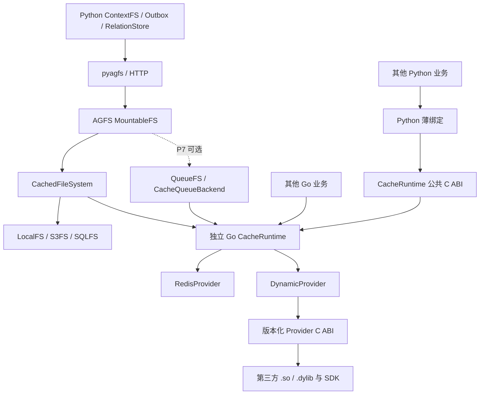

# oGMemory 统一 CacheRuntime 与文件系统缓存设计及实施方案

状态：设计草案，供开发前评审；本轮不实现业务代码。

日期：2026-11-18。基线：`dev@0632191c`。开发分支：`codex/cache-refactor`。

## 1. 目标与范围

将 上游文件系统读缓存能力按 oGMemory 的 Python + Go 架构移植，并落实两项调整：

1. CacheRuntime 是独立公共模块，AGFS 及其他业务均可调用；文件、目录、路径失效规则留在 CacheFS。
2. 第三方缓存统一通过 DynamicProvider 加载动态库，不在仓库内增加 YuanrongProvider、MooncakeProvider 或对应 SDK 构建链。

首版交付：公共 Runtime、RedisProvider、DynamicProvider、Python 调用入口、AGFS 小文件/原始目录缓存、完整写入失效、请求合并、故障降级、配置和部署验证。默认关闭，可按 mount 启用。

本轮仅更新设计与实施方案，不修改业务代码。P0–P5 交付文件缓存；P6 单独规划现有 AGFS 业务锁优化，P7 独立规划 QueueFS 的 CacheRuntime 后端，分别见 7.5、7.6。两者不阻塞首版文件缓存交付，也不自动迁移现有 Outbox、抽取重试或音频、检索等缓存，不增加 SQLContextFS 查询结果缓存。现阶段强制 bypass 与默认不缓存的对象均直接回源，其余对象默认允许缓存，仍须满足操作和大小等准入条件。业务锁不能靠缓存锁文件加速。

## 2. 参考依据与当前代码事实

### 2.1 参考资料

- 上游 CacheRuntime PR #41，标题 `feat(cache): unify runtime for CacheFS, QueueFS and PathLock`。已读取 PR head `338d6aa75cf0faa988c2cfff870309e6533d0063` 的代码和文档；页面记录的 merge commit 为 `08cf61b5c3dbe7d524906a81e34a77f457f92182`。
- 用户提供的上游文件系统缓存设计资料，重点采用其 Cacheable、BypassAlways、BypassIfPermissionDependent、NoPrefetch 分类，并按 oGMemory 实际控制路径补全规则。
- PR 重点参考路径：`crates/ragfs/src/cache_runtime/`、`crates/ragfs/src/cache/`、`crates/ragfs/src/plugins/queuefs/cache_backend.rs`、`cache_protocol.rs`、`the cache provider v1 header`、`docs/zh/guides/14-ragfs-cache.md`。

PR 已将 Provider、连接、生命周期收敛到 CacheRuntime，并实现版本化动态库 ABI、能力检查、二进制 envelope、遍历批读。其文档仍明确要求 CacheFS 单写者；不能将 QueueFS/PathLock 的多进程协调能力理解为文件缓存具备多写者一致性。PR 的测试记录只作为参考，不是 oGMemory 的验证结果。

### 2.2 oGMemory 的实际接入点

| 当前路径 | 已核实行为 | 对设计的影响 |
| --- | --- | --- |
| `server/memory_service.py` | ContextFS、outbox、relation store 等分别创建 AGFSClient | 在单个 Python 客户端上加缓存会漏掉其他读写者 |
| `fs/agfs_adapter/agfs_context_fs.py` | Python 经 pyagfs 访问 AGFS；`_read_node_snapshot` 用更新标记与 `.meta.json` 复核快照 | 缓存不能绕过访问检查、发布顺序和提交点校验 |
| `agfs/pkg/filesystem/filesystem.go` | Go FileSystem 支持 Read、ReadDir、Write、Create、Mkdir、Remove、RemoveAll、Rename、Chmod、Open、OpenWrite | CacheFS 应装配在 AGFS mount 对应的 FileSystem 上 |
| `agfs/pkg/mountablefs/mountablefs.go` | 路由经 `mount.Plugin.GetFileSystem()`；另有 Touch、OpenHandle、GetHandle、CloseHandle 等入口 | 普通调用和扩展调用必须统一经过缓存包装 |
| `agfs/pkg/handlers/handlers.go` | 通用 grep 遍历调用 Read/ReadDir；LocalFS 可经 ResolvePath 直接调用 ripgrep | 通用遍历可复用缓存；本地 ripgrep 需要明确保留或切换策略 |
| `agfs/pkg/plugins/s3fs/`、`sqlfs/` | 已有目录缓存；S3FS 还有 stat 缓存 | 新缓存启用时必须防止内部旧缓存成为“回源” |
| `agfs/cmd/server/main.go`、`cmd/pybinding/main.go` | 服务与原生绑定分别创建 MountableFS | 两个装配入口均需支持新 Runtime |
| `providers/unified_config.py`、`config/agfs/config.reference.yaml` | Python 与 AGFS 各有配置入口 | 共享配置模型，但跨进程分别加载与管理资源 |
| `docker/Dockerfile.compose`、`docker/Dockerfile.standalone` | Go 构建阶段目前仅复制 agfs 目录 | 独立 Go 模块需要同时进入构建上下文 |
| `agfs/pkg/plugins/queuefs/backend.go`、`queuefs.go` | 已有 QueueBackend，支持 memory、SQLite、MySQL/TiDB，尚无 cache 后端；memory 出队即移除、Ack 为空操作，持久化后端支持 processing/ack | 可新增后端，必须明确交付语义，不因接口相同就声称各后端具有相同可靠性 |
| `commit/outbox_store.py`、`commit/sql_outbox_store.py`、`server/memory_service.py` | 主要索引/投影任务使用文件 Outbox 或 SQL Outbox；SQL 可批量 claim 和 LISTEN/NOTIFY，AGFS 走扫描/轮询 | 当前不经 QueueFS；单独替换 QueueFS 后端不会自动优化这些任务 |
| `service/extraction_retry.py` | 使用 Python 进程内 Queue，配合 journal 与恢复发现 | 不能仅通过配置 QueueFS 后端完成重试队列迁移 |

不直接复制 Rust crate，也不将 RAGFS 替换进项目。迁移对象是接口契约、缓存语义和验证场景。

## 3. 总体架构与模块划分

### 3.1 推荐结构

采用独立 Go CacheRuntime，AGFS 直接依赖，Python 通过薄 C ABI 绑定调用。Go 代码只保留一套 Provider 实现；Python 不再维护独立 Redis/DynamicProvider 实现。



图中 Runtime 表示同一实现。AGFS 服务和 Python worker 是不同进程，不共享 Go 指针、连接池或 in-flight 表；它们各自创建 Runtime，使用同一 Provider 后端和兼容的 key 契约。一个进程内，由应用装配层持有 Runtime，并注入各业务模块，不做隐藏的全局单例。

Python 普通文件读取仍经 AGFS，只经过一层 CacheFS。Python 公共绑定供其他业务直接使用 KV，不在 pyagfs 上叠加第二层文件缓存。

P7 的 QueueFS 在插件内部直接调用 Runtime，不经过 CachedFileSystem；图中虚线为后续可选扩展。当前 Outbox 仍走自己的文件/SQL 存储，不能将该分支理解为现有任务已接入 QueueFS。

### 3.2 拟新增模块

```text
cache_runtime/                  # 独立 Go module，不依赖 AGFS/ContextFS
  go.mod
  runtime.go                    # 公共接口、生命周期、能力校验
  config.go / errors.go
  internal/provider/            # Provider 接口与工厂
  internal/redis/                # Redis 连接与命令适配
  internal/dynamic/              # C ABI loader、调用桥接、内存校验
  include/                      # Provider ABI 与 Runtime consumer ABI
  consumer/                     # 可复用的 consumer ABI 实现，不单独构建共享库
  internal/testutil/             # fake Provider、故障注入；不开放生产配置

providers/cache_runtime/        # Python 薄绑定、配置及进程内装配
agfs/pkg/cachefs/               # policy、envelope、generation、读写包装
agfs/cmd/pybinding/             # libagfsbinding 同时导出 AGFS / CacheRuntime 入口
```

`agfs/go.mod` 引用独立模块，仓库开发用 `replace ... => ../cache_runtime`。模块路径在实现时按本仓库命名固定。容器与源码分发必须同时包含两个 Go module，不能只修改本地 replace 后遗漏构建链。

### 3.3 职责约束

| 模块 | 负责 | 调用者不需要知道的内容 |
| --- | --- | --- |
| CacheRuntime | bytes KV、批量访问、能力校验、连接复用、调用预算、错误分类、关闭 | Redis 命令、动态库 handle、FFI 内存 |
| Provider Adapter | 将通用操作映射到后端 | 文件路径、租户权限、目录、generation 含义 |
| CacheFS | 文件/目录准入、命名、envelope、generation、失效、回源、请求合并 | 第三方 SDK 类型与错误码 |
| QueueFS cache 后端（P7） | 消息状态机、原子队列程序、实例心跳、恢复调度 | Provider SDK；不复用文件缓存 TTL、epoch 或 miss 回源策略 |
| Python 绑定 | 参数与结果转换、Runtime handle、资源释放 | 再实现缓存策略或 Provider |
| 业务调用者 | 选择业务 namespace、序列化和业务失效规则 | FileSystem 的缓存控制 |

Runtime 返回真实错误，不把失败伪装成 miss。是否可以回源由业务决定：CacheFS 可以；未来锁或队列不能把 Provider 故障当作执行成功。

## 4. 统一 Runtime 接口

### 4.1 首版公共接口

以下为接口草案，签名在第一阶段契约测试时冻结：

```go
type Runtime interface {
    Get(ctx context.Context, key string) (Value, error)
    Set(ctx context.Context, key string, value []byte, ttl time.Duration) error
    Delete(ctx context.Context, keys []string) (uint64, error)
    MGet(ctx context.Context, keys []string) ([]Value, error)
    Require(operations ...Operation) error
    Ping(ctx context.Context) error
    Close(ctx context.Context) error
}

type Value struct {
    Data  []byte
    Found bool
}
```

- 明确区分 miss、空 bytes、Provider 错误；MGet 保持输入顺序和重复项。
- Set 的 TTL 与 value 必须在 Provider 中一次提交；`ttl=0` 表示不设置过期，负值非法。Runtime 不隐藏业务默认 TTL。
- Delete 幂等，返回实际删除数量；多 key 删除不承诺事务原子性。
- Runtime 不自动给 key 增加文件前缀。各业务使用固定且相互隔离的前缀，CacheFS 有自己的完整命名规则。
- MGet 可以使用原生批量，或在相同总 deadline 内受控并发 Get；不能为每个 key 重置超时。不支持事务式 MSet 的后端无需假装支持。
- Require 在装配业务时执行。首版 CacheFS 要求 Get、Set、Delete、MGet 与健康/关闭能力；批读回退能力可由 Runtime 提供。
- 首版文件缓存不要求列表、集合或原子脚本。保留参考 ABI 的可选槽位；P6 通过单独的原子程序接口支持业务锁，不能用 Get + Set 拼接模拟原子操作。

Python 对应 `get/set/delete/mget/require/ping/close`，以 `None` 表示 miss，以 `bytes` 表示存在值，提供上下文管理器。首版使用同步入口，与项目当前同步业务路径一致；异步业务可通过有界线程调用，后续有实际需求再增加异步 facade。

### 4.2 生命周期和错误

错误至少区分：Timeout、Unavailable、Authentication、PermissionDenied、InvalidArgument、InvalidData、UnsupportedOperation、AbiMismatch、Closed。miss 是正常结果。

Runtime 有 OPEN → CLOSING → CLOSED 状态：关闭后拒绝新调用，等待在途调用结束，再关闭 Provider。Close 幂等，第三方 close callback 只执行一次。关闭预算耗尽时保留仍被调用的 native handle/library，不能提前卸载。

连接与 native handle 在 Gunicorn worker 启动后创建，禁止初始化后跨 fork 复用。绑定记录创建 PID，子进程误用父进程 handle 时返回明确错误。关闭入口接入现有 MemoryService.shutdown；没有业务使用 Runtime 时不加载 native 库、不连接缓存。

Python 原生交付统一复用现有 `libagfsbinding`，在同一 c-shared 动态库中导出 AGFS 和 CacheRuntime consumer 入口。本方案不新增或单独交付 `libogmemory_cache_runtime`。只使用公共 KV 时也按需加载 `libagfsbinding`，但不初始化 MountableFS、不挂载文件系统、不启动 AGFS 服务；接受共用动态库的体积成本，减少一套构建与加载组合。这里的动态库与 Docker 容器镜像是不同交付对象。

普通 HTTP pyagfs 进程在未使用公共 KV 时不加载该原生库。AGFS 原生接口和 KV 接口复用同一进程装配 owner；相同配置的 consumer 显式注入同一 Runtime，不分别创建隐藏连接池。加载器固定唯一库路径并校验 consumer ABI/build identity，拒绝加载另一份 Go 原生宿主库；Python 绑定不能分别打包私有副本。该约束覆盖项目提供的加载入口，任意第三方代码自行 dlopen 不在其拦截范围内。

### 4.3 可选原子程序能力（P6）

为业务锁单独提供版本化 `ExecuteProgram(ctx, programID, keys, args)` 与程序能力校验，不把 Redis Lua 暴露为业务接口。结果使用固定 schema，明确获取成功、冲突、失去所有权与执行失败；启动时逐项校验业务所需的程序及其版本，仅有通用脚本 callback 不等于具备锁能力。首版 CacheFS 仍只要求 KV。

RedisProvider 将程序映射为内置脚本；DynamicProvider 通过参考 ABI 的脚本槽位传递程序 ID、keys 与参数，由外部库实现同一原子契约，不增加专属第三方 Provider。PR 文档的 PathLock 仅验证内置 Redis，不能据此宣称第三方库已经支持。与 PR 对应程序 ID 的兼容性在 P6 契约测试时冻结。

### 4.4 可选队列能力（P7）

QueueFS 复用 4.3 的版本化原子程序机制，按自身需求校验能力，不要求先启用业务路径锁。参考 PR，除 Set/Delete/MGet 外还需要集合成员查询/枚举、列表长度/范围读取，以及 enqueue/dequeue/ack/recovery 等原子程序；普通 Get/Set/Delete 不能组合替代跨消息状态的原子转换。

列表/集合能力作为可选扩展接口，仅 P7 实现时补充；CacheFS 和公共 KV 不因此要求支持全部队列能力。启动时校验每项程序 ID/版本、输入输出和执行语义；DynamicProvider 使用同一 Provider ABI 的可选槽位，缺少能力就拒绝启用 cache 队列后端，不增加第三方专属实现。Provider 仅支持 KV，或仅声明一个 execute_script callback，均不足以证明可运行队列。

## 5. Provider 设计

### 5.1 内置 RedisProvider

参考 PR 保留 Redis 作为内置通用 Provider；第三方 SDK 接入统一走 DynamicProvider。

- 首阶段验证 standalone；Cluster、Sentinel 在后续验证阶段单独验收，未验证前不宣称支持。
- GET/SET/DEL 与 TTL 使用标准命令，读操作访问 primary。
- 跨 slot MGet 按 slot 分组或 pipeline GET，最后按原序重组；不把跨 slot pipeline 宣称为原子快照。
- 连接池、连接超时、命令超时、batch key 数和 batch 总字节数均有上限。
- 连接重建、failover 或命令执行结果不确定时，向调用者返回真实错误；CacheFS 按第 8 节处理。
- 日志不打印密码、带凭据 URL 或原始 params。

### 5.2 DynamicProvider

接入方式统一为：

```text
CacheRuntime
  -> DynamicProvider
  -> dlopen/dlsym + C 调用桥接
  -> 兼容的 v1 provider entry symbol
  -> Provider handle
  -> 第三方 SDK / Worker
```

建议保持 `cache_provider_v1.h` 的 v1 布局和兼容入口，以便复用符合该 ABI 的 Provider 发布物。源码文件名和文档使用通用名称，oGMemory 的缓存 key/envelope 独立版本化。

兼容承诺以跨宿主 fixture 验证为准。Go loader 用 cgo + 小型 C shim 调用函数表，输入/输出及 Host allocator 使用 C 内存；不把 Go 堆指针交给 Provider 长期保存。现有 AGFS plugin loader 的纯 Go/purego 加载方式可以参考部署经验，但文件系统 plugin ABI 与缓存 Provider ABI 分开管理。

加载和调用约束：

1. 只接收明确配置的绝对库路径；校验入口、ABI version、struct_size、必需 create/ping/close callback。
2. KV callback 缺失表示不支持，由 Require 在启动时报告；不会因缺少首版未使用的列表/脚本 callback 拒绝一个 KV Provider。
3. 传入 provider-owned JSON 参数；SDK 类型、地址细节和原生依赖只存在于外部库。
4. 使用 Host allocator 分配返回值，检查长度、数量、总字节数、可选值标记与所有权；正常输出与错误输出按 ABI 分开处理。
5. handle 支持并发；非线程安全 SDK 由外部库内部串行化或池化；异常不能穿过 C ABI。
6. 返回 buffer 转换为 Go/Python 自有数据后，按 allocator 契约释放；不得返回悬挂的 native view。
7. context 取消不能强制终止正在执行的 C 函数。Provider 必须配置自身 SDK timeout；在途调用继续占用并发额度，防止超时后无限堆积线程。
8. 返回给上层后仍可能完成的 Set/Delete 视为“不确定结果”，不能自动重试到同一个 CacheFS epoch。Close 必须等在途 native 调用与 Provider 后台任务退出后才能 dlclose。

第三方交付物是满足公共 ABI 的动态库及其依赖说明，例如由第三方提供的 Yuanrong/Mooncake adapter；核心项目不新增对应 Provider 类或链接 SDK。Linux 交付 .so，macOS 开发验证使用 .dylib。首版不承诺 Windows 动态加载。

### 5.3 两套 C ABI 的区别

- **Provider ABI**：Runtime 调用外部库，沿用 PR v1 契约。
- **Runtime consumer ABI**：Python 调用 `libagfsbinding` 中的 Runtime 入口，提供 handle、bytes/批量结果和明确的 free 函数，使用 oGMemory 自己的版本化入口。此入口复用独立模块的 consumer 实现，不要求初始化 AGFS。

两者不能混用。Python consumer 的 buffer 只由 Runtime consumer free 释放，不能借用 Provider buffer 的生命周期。

## 6. AGFS 文件系统缓存

### 6.1 装配位置

在插件初始化后为可缓存 backend 创建 CachedFileSystem，mount 同时保存原 plugin 与实际执行用的 FileSystem。所有路由调用后者；插件元数据、配置展示和 Shutdown 仍归原 plugin。

```text
plugin.Validate / Initialize
  -> original FileSystem
  -> 根据 mount CacheFS 配置包装
  -> mount 的实际 FileSystem
  -> MountableFS 路由、HTTP、原生绑定、handle 扩展
```

静态 `Mount` 和动态 `MountPlugin` 使用同一装配逻辑。ReadDir 先从包装后的 backend 获取 raw entries，再由 MountableFS 合成嵌套 mount、根目录等条目；不缓存合成后的 mount 视图。动态 mount/unmount 无需清理 backend 目录缓存中的虚拟条目。

启用统一 CacheFS 的 S3FS/SQLFS mount，在初始化前将其内部 `cache_enabled` 设为 false；CacheFS 关闭时沿用原配置。S3FS 的 stat cache 也关闭，因为首版 Stat 直读 backend。避免两层各自失效导致回源得到历史数据。

包装层按原 backend 语义转发可选的 CapabilityProvider、Toucher、Truncater、RandomWriter、HandleFS 等 Interface，不因包装而丢失能力，也不虚报支持。已确认的原始 FS 直达路径逐项盘点；ResolvePath 这类只读优化保留显式策略，所有变更路径必须受失效控制。

首版只显式允许 LocalFS、S3FS、SQLFS，其他插件默认关闭。queuefs、heartbeatfs、streamfs、serverinfofs 和读操作有副作用的路径强制 bypass。未来第三方 FileSystem 必须声明可缓存语义后再准入。

### 6.2 缓存对象与准入

| 操作/对象 | 首版策略 |
| --- | --- |
| `Read(path, 0, -1)` | 完整小文件读缓存；AGFS 的 read-all 标记是 -1，不能照搬 RAGFS 的 0 |
| range read / 大文件 | backend 原路径，不为填缓存额外读整个文件 |
| 原始 ReadDir | 缓存全部 FileInfo 字段，包括 Meta.Content、Mode、Size、ModTime、IsDir |
| Stat / exists 校验 | 直读 backend，不单独增加 stat/负缓存 |
| content.md、.abstract.md、.overview.md、.relations.json | 达到准入条件即可缓存 |
| `.meta.json`、tombstone、session state、回执、业务 metadata | 默认允许缓存；保留发布顺序和快照校验，按第 7 节完整失效 |
| 锁目录及其全部后代、lease、heartbeat、transaction marker | 强制 bypass；不能仅检查最终文件名 |
| staging/temp 发布路径、明确列出的高频工作状态 | 默认不缓存，现阶段直接 bypass；按 6.4 的具体范围匹配 |
| NotFound / backend 错误 | 不缓存 |
| 基于 Read/ReadDir 的递归遍历 / grep | 复用缓存；不缓存已做权限过滤的最终结果 |

初始建议上限：完整文件 1 MiB、目录 4096 项，并额外限制目录编码总字节数。文件阈值按实际读取结果判断；超过阈值仅不回填，不额外引入一次 Stat。返回 bytes/slice/map 必须防止调用者修改共享缓存对象。

权限检查仍在 Python ContextFS 原路径执行，缓存只存未经业务权限过滤的 backend 数据。读取结果如果依赖 caller/ACL/context，该 backend/path 不准入。所有 cache key 同时隔离部署、业务、backend/mount 和 account/path；不复用其他租户已过滤结果。

遍历策略默认 `backend`，保留本地 ripgrep 优化；`cached_traversal` 时相应 grep 路由显式采用 Read/ReadDir，才能命中文件和目录缓存。不能仅包住 FileSystem 就声称所有 grep 均受益，也不默认关闭本地 ripgrep。两种策略须分别测量，远端对象存储通常更适合 cached traversal。

三类策略的优先级、精确范围和写入失效行为按 6.4 执行；不因文件参与恢复、发布或幂等判定就整体排除缓存。默认允许缓存不表示新增 range、Stat、负缓存或流式读缓存。

### 6.3 Key 与 envelope

CacheFS 的 key 采用独立版本：

```text
ogmem:cachefs:v1:<deployment>:<mount-id>:<epoch>:file:<path-hash>
ogmem:cachefs:v1:<deployment>:<mount-id>:<epoch>:dir:<path-hash>
```

首版 deployment 为 namespace 的 SHA-256，mount-id 为规范化挂载路径的 SHA-256；每次 mount 创建独立随机 epoch，存储别名另在装配时检查。路径使用与 backend 相同的规范化规则。account 包含在规范路径及 envelope 校验信息中，不能将两个 account 路径归为一个 key。envelope 内保存规范路径来校验 hash 碰撞或错误命名，避免直接暴露敏感目录名到 key。

首版 envelope 使用五字节 magic/version（`OGCF\x01`）加 JSON 编码，包含 path、逻辑过期时间、generation 摘要、EOF 标志和 payload；kind 由 key 区分。文件 bytes 通过 JSON base64 编码，目录保留完整 AGFS FileInfo。解码检查长度、对象数量、版本及总载荷上限；损坏值按 miss 回源。

首版建议 file TTL 300s、dir TTL 30s，Provider 使用相应 TTL，envelope 再做逻辑过期校验。TTL 用于容量和过期控制，不是写后正确性的依据。每次 mount 启动与异常恢复生成新的随机 epoch，旧 epoch 数据只等待 TTL 回收，不扫描或 FLUSHDB。

### 6.4 缓存策略：两类 bypass，其余默认缓存

现阶段采用三类策略，前两类执行相同的直接回源行为，但保留不同理由，便于以后调整：

| 策略 | 判定依据 | 现阶段行为 |
| --- | --- | --- |
| 强制 bypass | 互斥/所有权与瞬时协调状态、有副作用的读、依赖 caller/权限的结果 | 直接回源，不能用短 TTL 替代 |
| 默认不缓存 | 明确列出的暂存、临时或高频工作状态，预期缓存收益低 | 同样直接 bypass；以后根据测量单独调整，当前不开放 allow 覆盖 |
| 默认允许缓存 | 未命中上述规则及用户 bypass 的对象 | 按 6.2 的操作、大小、TTL 等通用准入条件缓存，无需逐种文件加入白名单 |

该策略以 7.1 的单 AGFS 写入前提、7.3 的完整失效为基础。参与发布、恢复或幂等处理本身不是 bypass 的理由；缓存 `.meta.json` 等状态不能跳过现有发布顺序、快照前后复核或版本检查。失效失败按第 8 节进入 bypass 并作废 epoch，正确性不依赖等待 TTL。

policy 在与 backend 一致的路径解析之后、任何缓存访问之前执行。优先级为：插件/操作准入 → 强制 bypass → 默认不缓存 → 用户追加 bypass → 通用准入 → 缓存。未知插件仍按 6.1 关闭缓存；“其余默认缓存”适用于已启用 CacheFS 且语义可缓存的 backend。

以下 `/accounts/...`、`/.ogmemory/...` 表示业务存储根下的路径结构；`a/s/n/t` 分别为 account、session、节点名与 owner token。业务根可以是 `/local/plugin`，不能假设等于 AGFS mount `/local`。规则按规范路径分量结构匹配，允许前面有业务根前缀，不硬编码 `/local`。只有明确标注“子树”的规则才扩展到后代；后代为 `content.md` 也不能绕过祖先规则。

**强制 bypass 清单：**

| 类别 | 路径 / 操作范围 | 依据 |
| --- | --- | --- |
| 锁文件与锁目录 | `.path.ovlock`、以 `.lock` / `.lck` 结尾的分量及其子树 | 参考文档中的锁与所有权状态 |
| AGFS 资源与更新锁 | `.<n>.resource-mutation-lock`、`.<n>.resource-mutation-lock-<t>`、`.<n>.update-lock`、`.<n>.update-lock-<t>` 子树 | `agfs_context_fs.py`：覆盖候选目录、transaction marker、lease、临时 lease 以及锁内文件 |
| 明确的瞬时协调状态 | 协议登记的 heartbeat、lease、owner 判定路径；trace-store 的 `accounts/<account-hash>/candidates`、`candidate_claims` 子树及该 account 的 `state.json` | `agfs_trace_store.py`：candidate 记录承载 lease_owner/lease_until，legacy state 也可内嵌该状态；不扩大到整个 trace-store |
| 有副作用或权限依赖的读 | queuefs 等 6.1 已排除插件；enqueue/dequeue/peek/ack；结果依赖 caller/ACL/context 的路径 | 每次执行操作或重新检查权限；普通持久化 outbox 文件不因名称被视为队列操作 |

**默认不缓存清单，现阶段也直接 bypass：**

| 类别 | 路径范围 | 理由 |
| --- | --- | --- |
| 创建暂存 | `.<n>.create-<uuid>`、`.<n>.resource-create-<t>` 子树 | 生命周期短、发布前内容多次变化 |
| 元数据与删除状态发布临时文件 | `.meta.update-<t>.json`、`.meta.mutation-<t>.json`、`.delete_tombstone.mutation-<t>.json` | 只排除临时发布源，正式文件允许缓存 |
| Outbox 临时/处理中状态 | `.outbox` 下 `.tmp_*`、`.mutation-*`、`*.processing`；`.outbox-done` 下临时回执 | 只排除具体瞬态条目，不排除整个 `.outbox`、`.outbox-done` 或 dlq |
| 工作区绑定临时文件 | `/accounts/<a>/_system/code_workspace_sync` 下 `.mutation-<t>` 临时变体 | 正式绑定 JSON 允许缓存，锁仍由强制规则处理 |
| Trace 高频工作索引与临时文件 | trace-store 的 `work-accounts`、`accounts/<account-hash>/candidate_work` 子树及 `work-accounts-index.json`；该业务的 `.tmp-*` / `.bak` | 缩小到工作记录、索引和临时文件，稳定 events/turns 等允许缓存 |
| 工具结果未完成写入标记 | `/accounts/<a>/user/<u>/agents/<g>/sessions/<s>/tool-results/<artifact>/_writing.json` | 短生命周期的写入/回收标记，`metadata.json` 与 `output.txt` 允许缓存 |

**默认允许缓存的具体示例：**

| 对象 | 允许缓存的范围与保留约束 |
| --- | --- |
| 节点提交点与删除状态 | 正式 `.meta.json`、`.delete_tombstone.json`；保留 `_read_node_snapshot` 的前后复核及发布协议 |
| Outbox、完成回执与操作定位 | 普通事件、dlq、正式 `.outbox-done` 回执、memories 下 `.write_operations` 节点；不命中锁/临时规则即可缓存 |
| 工作区绑定 | code_workspace_sync 的正式绑定 JSON；不整体排除该目录 |
| 会话状态与抽取结果 | `/accounts/<a>/sessions/<s>/state.json`、legacy `state` 节点、`stage_results` 的普通内容；恢复 journal/checkpoint 不因参与恢复而单独排除 |
| Trace 稳定记录 | trace-store 中未命中上述协调/工作/临时规则的记录与目录，包含 events/turns 等；不整体排除 trace-store |
| 工具结果与普通业务文件 | 工具 `metadata.json`、`output.txt`，普通 `content.md`、`.abstract.md`、`.overview.md`、`.relations.json` 及其他合格小文件 |
| 原始目录枚举 | 包括 `/accounts`、`/accounts/<a>/sessions` 的恢复发现枚举；不因被恢复流程调用或包含 bypass 条目而整体排除 |

规则不能使用 `contains("lock")`，也不能整体禁用隐藏文件、JSON、sessions/history、stage_results 或 trace-store。cursor、offset、pid、checkpoint 等名称不是通用黑名单；只有明确承担瞬时协调/操作语义的协议路径才强制 bypass，其余按默认策略处理。分类由路径与操作语义决定，不为分类额外读取业务 JSON。

普通父目录的 raw ReadDir 保留 bypass 条目的名称等原始信息，不隐藏条目；子文件 bypass 不自动向父目录传播。如果目录结果内联强制 bypass 对象的内容或被协议明确用作瞬时所有权判定，则该次 ReadDir 也强制 bypass，不能借 FileInfo.Meta 间接缓存协调状态。符号链接/别名使用一致的实际对象路径判定；无法证明不会绕过规则的访问不准入。

统一执行契约：

1. **两类 bypass 均直达 backend**：不查文件/目录缓存或 generation、不回填、不负缓存、不加入 singleflight、不预取。普通 Read、ReadDir、Open/handle、批读、遍历及未来预取使用相同 policy；批读的 bypass 项分别回源。副作用读不可合并。所有读取仍执行原有权限、快照和所有权校验。
2. **变更始终执行必要失效**：包括 bypass 对象的变更，仍执行 7.3 的变更锁、mutation_seq、父目录失效与必要 subtree token 更新；暂存与正式路径之间 rename 必须处理双方及父目录，不能因任一端 bypass 提前返回。
3. **配置只能追加 bypass**：`bypass_prefixes` 使用 AGFS 绝对路径，规范化后按分量边界匹配，`/foo` 不匹配 `/foobar`；非法或越界路径启动报错。当前两类内置 bypass 都不能由用户 allow 覆盖；以后缩减默认不缓存清单须同步验证。policy 变更重建 mount 并启用新 epoch，首版不热更新。
4. **其余按通用规则缓存**：不增加逐类白名单或额外开关，也不默认排除新的普通业务文件；新增锁/协调或临时路径时才补充相应规则与用例。超限、范围读、Stat、NotFound 等仍遵守 6.2。

观测中分别记录“强制 bypass”“默认不缓存”“用户 bypass”和通用准入未通过的低基数原因，便于后续按收益调整；不记录敏感路径、token 或 lease 内容。当前无预取实现，两类 bypass 的 NoPrefetch 约束也适用于以后实现。

## 7. 一致性、并发与失效

### 7.1 首版明确前提

**一个 AGFS 进程是同一 backend 存储空间的唯一写入入口；所有修改经过它。** 多个 Python worker、独立 index 进程等可以同时访问该 AGFS 服务。

不支持多个 AGFS 服务或独立 embedded AGFS 同时写同一 backend，不支持外部绕过 AGFS 修改 local 目录/S3/SQLFS。多个进程“共用 Redis”不满足该前提；generation 不是分布式写协议。部署选择启用缓存即声明遵守该拓扑，程序不能可靠自动发现所有外部写者。

同一 backend 的多个可写别名 mount 不得各自启用独立缓存；首版对已知别名拒绝该配置，未知存储别名由部署保证。以后若确有多 AGFS 写者需求，需单独增加带 fencing 的发布/失效协议及崩溃恢复测试。

### 7.2 读取与请求合并

```text
policy / bypass 检查
  -> 缓存对象 + generation 校验
  -> hit 返回
  -> miss 加入同 key、同 mutation_seq 的 in-flight
  -> leader 再检查缓存，读取 backend
  -> 确认仍为相同 epoch / mutation_seq 后回填
  -> 所有 follower 共享结果（包括 backend error）
```

每个 mount 首版使用一个读写锁：普通读取并行，变更与 cache hit 校验、backend load、fill 互斥。保持接口简单，先接受不同路径的写入可能被慢读阻塞；按性能证据再改成 path/subtree 锁，不首版引入锁管理框架。

维护 mount 级 mutation_seq，变更后新来的读不能加入旧轮 in-flight；预取/批读未来接入也必须检查 epoch/seq。in-flight 限制 key 数，leader 结束保证通知并清理。当前同步 FileSystem 无 context，follower 等待 backend 完成；不额外承诺可取消的等待时限。Runtime timeout 不会给 backend I/O 增加可取消能力；backend 保留各自 timeout。

### 7.3 变更矩阵

变更在锁内执行 backend，再在返回前完成失效或安全切入新 epoch/bypass。缓存只从 backend 成功读取的最终值回填；首版不使用传入的 Write buffer 做写穿，避免误将 append、部分写或 offset 写当成完整文件。

| 变更 | 必须失效的对象 | generation |
| --- | --- | --- |
| Create / Write / WriteAt / Truncate | 本路径 file；直接父目录 dir（FileInfo 大小/时间也会变） | 必要时按路径变更 seq |
| Mkdir | 本路径历史 file/dir、父目录 dir | 更新该路径 subtree token，防止删除后重建复用旧值 |
| Remove | 本路径 file/dir、父目录 dir | 更新该路径 subtree token |
| RemoveAll | 本路径 file/dir、父目录 dir | 更新删除根的 token，使全部残留后代失效 |
| Rename / 覆盖目标 | 源/目标 file/dir、源/目标父目录 dir | 更新源、目标根 token，旧目标子树也失效 |
| Chmod / Touch | 本路径 file/dir、父目录 dir | 保留原调用与错误语义 |
| 流式或 writable handle | 见 7.4 | 写入期间 mount bypass，结束时换 epoch |

RemoveAll、对象存储 rename、部分 Write 等可能在返回错误前已修改 backend。对此仍执行保守失效；不能只在 `err == nil` 时失效。CacheFS 不把失败操作变成成功，也不回滚已经落地的 backend 数据。

首版 generation 完全由 mount 进程内的权威表维护，不写入远端缓存。每次变更递增 mutation_seq，更新本路径 exact version、所有祖先目录 exact version；删除、rename、Mkdir 等还更新受影响根的 subtree version。对象记录本路径 exact version 与祖先 subtree versions 的摘要。祖先目录同时失效，覆盖目录项 mtime 和 S3 隐式前缀变化。删除/rename 不扫描缓存后代。

该简化依赖单 AGFS 写者及所有修改经过执行 FS：当前 epoch 内未出现过的路径版本为 0，已发布版本绝不逐项淘汰；表超过 65536 项时整体切换随机 epoch 后清空。重启、挂载重建及故障恢复也换 epoch，旧 envelope 无法进入新命名空间。因此远端 generation key 淘汰问题不再存在，且无额外 generation 网络往返。此实现不能扩展解释为多进程一致性；如将来引入远端 generation，必须恢复缺失 token 不得命中旧对象的规则。in-flight 超过 1024 个 key 时新请求直接回源。

### 7.4 Stream / Handle 写入

只包装普通 Write 不足以保证正确性。必须覆盖 OpenWrite、OpenHandle 的 O_CREATE/O_TRUNC、handle Write/WriteAt、Sync/Close 及 Truncate；HTTP 与原生绑定返回的 handle 都要经过相同包装，不能从 GetHandle 取回未包装的原始对象。

为避免首版引入长生命周期路径锁：

- 开启可写 stream/handle 前，在操作锁内将 mount 标记为 writer-active 并换 epoch；此后该 mount 不命中或回填缓存。
- 开启过程的创建/截断也在此保护下；失败时保守处理可能已发生的变更。
- 保留 backend 的流/handle 返回语义；不持有操作锁直到 handle 生命周期结束。
- 最后一个 writable handle 正确关闭后，换新 epoch 再恢复缓存；关闭结果不确定时继续 bypass。
- reader stream 首版直读 backend，不把流的内容另行缓存。缓存关闭也不能卸载仍被 handle 使用的 backend。

这是保守的首版取舍：长时间打开的可写 handle 会降低整个 mount 的命中率，但覆盖 rename 后旧 handle 继续写等路径别名问题。后续凭测量结果再细化到 subtree。

### 7.5 现有路径锁与可选公共 Runtime 优化（P6）

当前 oGMemory 已有业务路径锁，但没有可直接替换为 PR PathLock 的统一实现：

| 实现 | 当前机制 | 本方案边界 |
| --- | --- | --- |
| AGFS 资源变更锁及复用者 | `resource_mutation_lock` 通过候选目录、transaction/lease 写入、rename 发布所有者；约 50ms 轮询，20s 续租、60s 失效恢复；session recovery、tool output、memory identity、outbox processing 复用它 | P0–P5 保留协议并绕过缓存；P6 首先针对这一入口评估替换 |
| 节点更新锁 | `.<node>.update-lock`、owner token、lease、提交点与版本校验，读快照检查标记及 `.meta.json` | 与资源锁及发布协议一起评审，不能只迁移获取操作而保留不兼容的恢复逻辑 |
| 工作区绑定互斥锁 | 对 `<state_path>.lock` 原子 Create，记录 token/期限并校验归属 | 首版保留；后续逐入口迁移，不能自动纳入统一锁 |
| SQLContextFS 锁 | 数据库 advisory lock，按业务使用事务级或会话级生命周期 | 保留数据库锁语义，不随 CacheFS 或 P6 自动迁移 |

CacheFS 内部的 mount 读写锁只维护缓存一致性，不能替代上述跨 Python worker 的业务锁。通过缓存 `.lock`、lease 或不存在结果降低轮询开销会破坏互斥，禁止采用。

P6 的方向是抽取业务级 `acquire(scope, paths, mode, deadline) -> Lease` 接口，Lease 提供 `refresh / ensure_owned / release`；默认仍选 `filesystem`，可显式选择 `cache`。scope 包含 deployment、account 与规范化业务路径，拒绝跨 account 或无界全局 tree lock。参考 PR 的批量获取、compare-write/remove、批量续租、冲突及后代扫描程序；首先覆盖当前所需的 exact 锁，只有实际调用需要时才开放 subtree 模式。批量程序必须定义成功/回滚、超时不确定结果及重复请求语义。

`cache` 实现直接调用公共 Runtime 的原子程序，不经过 CacheFS。Redis 和经 DynamicProvider 接入的外部库适用同一契约；缺少任一必需程序即在启动时拒绝该业务锁配置。KV-only Provider 仍可用于 CacheFS。锁请求失败/超时要返回失败或未知并保守停止受保护操作，不能在运行中自动退回文件锁，否则两个进程可能进入不同互斥域。所有参与者统一配置，切换 provider 前先排空业务并处理遗留租约。

业务锁是协调状态，必须具备可靠的原子操作、时限与故障恢复语义，不能按普通文件缓存对待。锁 key 使用独立 namespace，不含 CacheFS epoch，不被 CacheFS TTL/清理影响；其过期只由锁协议管理。存储须保证协调 key 不被容量淘汰，恢复/切主不能使旧 owner 在无验证情况下继续写。可以复用满足这些条件的同一个 Runtime/连接池；若文件缓存后端做不到，显式配置独立协调后端实例或拒绝启用，不能因“统一 Runtime”而隐藏创建第二套池。

迁移保留现有 token 与发布保护：续租、提交和释放均校验 owner，stale owner 不能删除新锁。当前恢复逻辑会在解锁前移除 token 绑定的发布源；P6 必须保持或替换成等效可验证的 fencing。仅在 KV 中拿到锁并不能阻止过期后恢复执行的旧进程向文件系统发布；必须让提交点可验证租约代际，或保留能撤销旧 owner 发布能力的协议。在 stale writer、暂停后恢复、切主/超时故障用例证明安全前，不切换生产锁实现。

P6 不承诺多 AGFS 写者缓存一致性，也不迁移 QueueFS。即使业务锁使用公共 Runtime，6.4 中仍在使用的旧锁/协调路径继续强制 bypass；发布临时文件继续按默认不缓存处理，不能仅因新增锁后端就删除旧规则。

### 7.6 QueueFS 的 CacheRuntime 后端与 Outbox 边界（P7）

PR 的 QueueFS 优化是由 CacheRuntime 承担消息及队列状态存储，而非缓存 `dequeue` 等控制文件的读取结果。oGMemory 的 AGFS 已有可扩展的 QueueBackend，因此适合单独新增 `CacheQueueBackend`；当前主要异步任务并未使用它，插件后端完成后不能宣称 Outbox 或抽取流程已获得相应收益。

**插件后端设计：**

- 在 `agfs/pkg/plugins/queuefs/` 内实现现有 QueueBackend 契约，并由 AGFS 统一装配层注入 Runtime。保留 memory、SQLite、MySQL/TiDB 及当前默认值，通过显式 `backend: cache` 选择新后端，不替换为 RAGFS。
- 消息经 pending → processing → ack 状态转换，未确认且所属实例失活的消息可回到 pending；交付语义为至少一次，消费者必须幂等。获取、确认与重投的原子边界由队列程序保证，不能先 Get 再 Set 模拟。迁移需核对现有 message ID、JSON、队列层级、Size/Peek/Clear/RemoveQueue 等完整接口语义。
- 参考 `queuefs.create_queue.v1`、`remove_queue`、`enqueue`、`dequeue`、`peek`、`ack`、`clear`、`recover_stale` 及恢复 leader 的获取/释放程序。RedisProvider 实现原子脚本；DynamicProvider 必须实现并通过等价契约，不能因 CacheFS 已接入第三方库就推定队列也受支持。Redis Cluster 下同一原子程序涉及的 key 必须满足同 slot 约束。
- 参考 PR 的实例 heartbeat 与单恢复 leader：heartbeat/leader TTL 30s，心跳与扫描间隔 10s，启动后立即扫描失活实例的 processing 消息。这些是待验证的初始值；有界扫描、leader token 校验/续约、正常关闭释放和异常后继续扫描均须覆盖。实例存活但任务卡死的处理需要额外的任务超时/租约协议，不能声称实例心跳已经覆盖。
- 明确重复请求、超时未知结果、旧实例恢复后的迟到 ack 等语义。确认操作须避免旧 delivery 删除已交给新消费者的消息；必要时扩展内部 delivery token 或限制调用协议，不能照搬仅凭 message ID 确认而忽略重投竞态。不得承诺 exactly-once。
- 队列 key 使用独立 namespace，不包含 CacheFS epoch；消息与 pending/processing 等状态不得按文件缓存 TTL 到期或被容量淘汰，只有 heartbeat/leader 等协议租约使用对应 TTL。作为权威队列存储时，需声明并验证 Provider 的持久化、重启/切主数据保留与确认边界，不能把可丢弃缓存当作可靠消息源。
- Provider 失败/超时向调用者返回真实错误或未知结果，不自动切换到 memory/SQLite，也不把失败解释为空队列。相同配置复用显式注入的 Runtime/连接池；不能满足消息存储条件时，显式选择合格后端实例或拒绝启用。

QueueFS 所有控制入口仍绕过 CacheFS，`Read(dequeue)` 每次真正执行队列操作；此规则与其内部使用 Runtime 完全兼容。关闭时先停止接收队列操作、停止心跳/恢复任务并排空调用，再释放 backend；共享 Runtime 仍由应用 owner 最后关闭。启用新后端前须排空旧后端或安排显式迁移，不在运行中混用两个权威队列。

**现有业务的后续接入方向：**

P7 只交付插件后端，不直接替换 `OutboxStore`、`SQLOutboxStore` 或 `ExtractionRetryWorker`。如后续测量表明 AGFS Outbox 扫描成本或通知延迟是瓶颈，可另立业务接入变更，让 QueueFS 承载通知/待处理索引，并保留持久化 Outbox 为事实来源：

1. 先成功发布持久化 Outbox 事件，再发送含 account、URI、event ID 的通知。文件/数据库与队列之间没有共同事务；失败或结果未知不能遗失已发布事件，定期补扫负责发现未入队工作，索引可重建。
2. 消费通知后重新从 Outbox 读取并校验事件，继续使用原有 claim/lease、重试时间、幂等与完成回执；通知重复、晚到或对应事件已完成均安全处理。原有延迟重试和定期扫描不能仅靠一次队列通知替代。
3. Outbox 状态持久化完成后再 ack 通知；队列故障可回到持久化 Outbox 的扫描路径。这是可重建通知层的业务降级，不是将 cache 权威队列自动切换到另一个后端。
4. SQL 模式保留现有批量 claim 与 LISTEN/NOTIFY，除非实际验证显示额外队列有收益。抽取重试若后续迁移，也须保留恢复 journal，并单独验证任务所有权与崩溃恢复。

直接用 cache 队列替换持久化 Outbox 会改变事件发布与恢复边界，不在 P7 范围；多 AGFS 写者的 CacheFS 一致性也不会因此获得支持。

## 8. 故障、恢复与生命周期

Runtime 层报告错误，CacheFS 维护业务安全状态。首版不增加“缓存维护失败则声称 backend 写失败”的 strict 写语义：backend 已成功时，业务仍成功，CacheFS 负责停止使用旧数据并输出指标。

| 事件 | CacheFS 行为 |
| --- | --- |
| Get / MGet / 解码失败 | 本次回源；Provider 错误进入 mount bypass |
| Fill Set 失败或超时 | 返回已经读取的 backend 数据；将当前 epoch 作废 |
| Delete 失败、执行结果不确定 | 返回真实 backend 结果；在操作锁内使当前 epoch 作废、进入 bypass |
| cache 关闭 | 文件操作继续回源；直接 Runtime 调用收到 Closed |
| 服务重启 / mount 重建 | 生成全新 epoch，不读取历史 epoch |

CacheFS 状态为 ACTIVE → BYPASS → PROBING → ACTIVE。每个 mount 只有一个有界恢复探测任务；探测 Get/Set/Delete/Ping 成功、没有 active writer 后，持操作锁生成新 epoch、清空旧 generation 记录，再恢复准入。Redis 连接延迟建立，临时不可达时进入上述恢复流程；DynamicProvider 必须先成功 create，初始化失败直接报错，其实例存续期间的临时调用故障可进入探测恢复。

短暂 bypass 到时不直接恢复原 key 空间。晚到的 native Set/Delete 只能修改旧 epoch，不污染新 epoch。Redis 等后端即使探测成功，也必须满足同 key 写删成功后的可见性前提；无法提供该语义的 Provider 不准入 CacheFS。副本读取、无通知的数据回滚等不满足此前提的配置不承诺正确性。

启动配置错误、ABI 不兼容、缺少必需能力在开始服务前报错；临时连接失败允许文件缓存降级为 bypass。P6 的业务锁按 7.5 失败关闭，P7 的权威队列按 7.6 返回错误/未知结果，不能套用文件缓存的回源降级。未启用任何 cache consumer 时，不创建 Runtime。共享 Runtime 的关闭由应用 owner 负责，单个 mount 卸载只释放自己的 CacheFS，不能关闭其他业务仍在用的 Provider。

关闭顺序：停止接收新业务 → 停止探测/预取 → 排空读写及 handle → 卸载 mount/backend → 关闭共享 Runtime → native close 完成后卸载动态库。AGFS 当前使用直接 ListenAndServe，需补充与本功能生命周期相关的有界关闭装配；不扩大为整体服务重构。

## 9. 配置与交付

### 9.1 AGFS 配置草案

Runtime 与 CacheFS 配置分开，顶层 `cache` 不嵌在某个插件里：

```yaml
cache:
  provider: dynamic
  command_timeout_ms: 50
  max_inflight: 32
  params:
    library: /opt/ogmem/providers/libcache_adapter.so
    endpoint: 127.0.0.1:31501
    request_timeout_ms: 50

cachefs:
  enabled: false
  namespace: ogmemory-dev
  mounts:
    - /local
  max_file_size_bytes: 1048576
  max_dir_entries: 4096
  max_dir_encoded_bytes: 4194304
  traversal_mode: backend
  file_ttl_seconds: 300
  dir_ttl_seconds: 30
  bypass_prefixes: []  # AGFS 绝对路径；只能追加，按路径分量边界匹配
```

Redis 可替换为：

```yaml
cache:
  provider: redis
  command_timeout_ms: 50
  max_inflight: 32
  params:
    mode: standalone
    endpoints: ["redis://127.0.0.1:6379"]
    pool_size: 32
    connect_timeout_ms: 1000
    password_env: OGMEM_CACHE_REDIS_PASSWORD
```

50ms 等数值只是起始预算，开发期用实际 RTT 校准；不以此宣称性能保证。用户配置只能追加 bypass，不能覆盖当前强制 bypass 或默认不缓存清单；其余对象默认按通用条件缓存。关闭 cachefs 后不影响其他业务使用 Runtime；cachefs 启用时必须有合法的 cache provider 与非空 namespace。

`bypass_prefixes` 使用 AGFS 绝对路径，例如 `/local/plugin/accounts/a/private`，解析到所属 mount 后按规范路径比较，包含自身及后代，但不匹配同级 `private-copy`；拒绝非法或越界路径。6.4 的内置规则随版本生效，不依赖用户手写这些前缀。策略变更通过重建 mount 和新 epoch 生效。

### 9.2 Python 与进程间配置

Python `ogmem.yaml` 的顶层 cache 使用相同 schema，由 `providers/unified_config.py` 解析。Python 业务通过其装配入口得到 Runtime；纯 SQL 部署也可直接用公共 KV，按需加载带 consumer 入口的 `libagfsbinding` 即可，不需要启动 AGFS 服务。

独立 AGFS 服务读取自己的配置文件，不会自动读取 Python 内存中的配置。托管 standalone/compose 的启动配置生成器将选定的公共 cache 配置渲染给相应进程；连接预算按所有 worker/AGFS Runtime 数量累计。远端独立部署则各自显式配置，文档必须说明该差异。

P6 另在 Python 业务装配层增加 `pathlock.provider: filesystem | cache`，默认 `filesystem`，不由 `cachefs.enabled` 隐式切换。选择 `cache` 时对业务锁所需原子程序和协调存储配置做启动校验；P0–P5 不提前开放尚未实现的配置。独立协调实例确有需要时必须显式命名和注入，连接预算也要单独列明。

P7 在现有 `plugins.queuefs.config` 下增加 `backend: cache` 与非空 `cache_key_prefix`，复用所选 Runtime，前缀隔离 deployment/队列部署；同一逻辑队列的实例使用同一前缀。只有选择 cache 后端时才校验队列扩展能力与存储条件；不由 `cachefs.enabled` 自动切换，不改变现有 QueueFS 默认 backend，也不在 P0–P5 提前开放配置。权威队列与业务锁的启用检查分别执行，不能共用一个笼统的“支持缓存”标记。

### 9.3 构建与部署

- 默认 AGFS 构建可使用 Redis，DynamicProvider 用可选构建能力隔离；未构建该能力却配置 dynamic 时启动报错。
- 复用现有 `libagfsbinding` 的构建/发布链，把 Runtime consumer 入口随该库一起交付；不增加独立 Runtime 共享库。Python 薄绑定按需加载，未启用原生消费的用户不被迫本地编译 Go；使用公共 KV 的安装包需包含对应平台的该库。
- 给出开发编译命令、Linux amd64/arm64 c-shared 产物与 ABI/系统依赖检查、macOS .dylib 验证路径；验证 KV-only、AGFS-only、AGFS + KV 共用一库三种调用组合。
- standalone/compose 构建上下文增加 cache_runtime module；有 Python 公共 KV consumer 的镜像包含统一的 `libagfsbinding`。同一进程内的绑定从同一安装位置加载，禁止分别捆绑两份 Go 宿主库。
- 默认镜像不携带第三方 SDK。外部 Provider 通过明确路径部署，并记录 OS/CPU、ABI、SDK 依赖与校验和。
- P0–P5 禁用 CacheFS 即恢复原文件调用路径；不更改持久化目录格式，不需要数据迁移，不依赖清空共享 Redis。P7 的队列存储后端切换按 7.6 排空/迁移，不能视为关闭读缓存。

| 使用方式 | 交付内容 | 运行时行为 |
| --- | --- | --- |
| 仅 HTTP pyagfs + AGFS CacheFS | 含 Runtime 的 AGFS 服务二进制/容器，Python 沿用 HTTP 客户端 | Runtime 位于 AGFS 进程，Python 无需加载原生库 |
| Python 公共 KV，可同时使用 AGFS native | Python 薄绑定 + 同一份 `libagfsbinding.so`（macOS 为对应动态库） | KV-only 只创建 Runtime；native AGFS 需要时才初始化；相同配置共享装配 owner/连接池 |
| DynamicProvider 第三方后端 | 另外部署符合 Provider ABI 的 adapter 动态库与 SDK 依赖 | 由实际使用该后端的进程加载；它是外部 Provider 插件，不是第二套 oGMemory Runtime 宿主库 |

第三方 adapter 不应再嵌入另一套 Go runtime；若其自身用 Go c-shared 实现，应改为在进程外提供服务并由兼容 adapter 连接，或另行评估，不纳入当前单宿主库交付承诺。

## 10. 开发实施拆分

按以下顺序实施，每步都有独立验收结果。P0 冻结契约，P1–P4 完成可试用版本，P5 完成生产部署验收；P6 业务锁优化与 P7 QueueFS 后端为独立可选扩展，不阻塞文件缓存交付。

| 阶段 | 改动范围 | 验收条件 |
| --- | --- | --- |
| P0：冻结契约与回归基线 | 固定参考代码版本、Runtime Interface、Provider ABI、缓存准入与一致性矩阵；盘点所有写入口，按 6.4 区分两类 bypass 与默认缓存 | 形成明确的分类清单；缓存关闭的现有 Go/Python 定向回归有基线；明确缺失环境和已有失败 |
| P1：公共 Runtime 与 Redis | 新增独立 Go module、错误/生命周期/并发预算、Redis standalone、测试 fake、配置校验 | Get/空值/miss、TTL、Delete 幂等、MGet 顺序、超时/关闭契约通过；模块无 AGFS 依赖 |
| P2：DynamicProvider 与 Python 入口 | C shim、PR v1 ABI、fixture 动态库、libagfsbinding consumer C ABI、Python 薄绑定、懒加载/fork/关闭 | 相同 KV 契约在 Redis 与动态 fixture 上通过；KV-only 不初始化 AGFS；AGFS/KV 共用一库与装配 owner，原生内存/关闭竞态通过验证 |
| P3：AGFS CacheFS | policy/envelope/generation、singleflight、epoch 恢复、mount 执行 FS 装配、普通及 stream/handle 变更、关闭内部旧缓存 | LocalFS 冷热读、所有失效路径、部分失败、writer-active bypass、静态/动态 mount、HTTP/原生绑定一致通过 |
| P4：oGMemory 集成与故障回归 | 配置装配、6.4 三类策略与祖先规则、节点快照/权限/outbox/恢复回归；Redis 故障和 AGFS 重启 | 两类 bypass 不查缓存/不回填；正式 metadata、状态、回执等可命中且更新后无旧值，跨 bypass 边界发布仍失效；多 Python 进程读取完整版本；缓存关闭兼容通过 |
| P5：交付和性能验收 | 容器/二进制/可选 wheel、Linux amd64/arm64、可用的 S3/SQLFS 环境、真实第三方库、部署手册；按需要补 Redis Cluster/Sentinel | 可重复部署，明确每个实际验证的 Provider/拓扑；性能收益与代价可归因，回滚有效 |
| P6：可选业务锁优化 | 业务 Lease 接口、版本化原子程序、Redis 实现与 Dynamic 能力校验，逐入口衔接旧发布/恢复协议 | 互斥、续租、stale owner、超时未知、崩溃/切主及 fencing 回归通过；协调状态不受文件缓存 epoch/淘汰影响；不支持能力时拒绝启用 |
| P7：可选 QueueFS CacheRuntime 后端 | 扩展 Runtime 列表/集合与队列原子程序、AGFS CacheQueueBackend、实例心跳/恢复 leader、配置和关闭装配 | 现有队列操作兼容，至少一次投递、崩溃重投、迟到 ack/超时未知安全；Redis 与具备能力的 Dynamic 契约通过；QueueFS 绕过 CacheFS；不迁移现有 Outbox |

建议按 P1、P2、P3、P4/P5 拆为四个可评审变更，P0 的契约与后续实现同步维护。P3 不能把“handle 稍后再补”作为提前开启 CacheFS 的理由。

P6 单独评审和启用，先完成所选入口的故障契约与发布保护，再迁移调用；保持 filesystem 默认值，不同时重写所有现有锁。

P7 在公共 Runtime/ABI 基础上单独评审，复用可选原子程序机制，不以 P6 业务锁上线为前提。先完成队列后端的可靠性验证再启用；Outbox 通知/索引接入属于后续独立业务变更，须按 7.6 验证漏通知补扫、重复消费及延迟重试。不能将插件契约测试替代业务接入验收。

预计实现触点：

| 类别 | 路径 |
| --- | --- |
| 新公共模块 | `cache_runtime/`、`providers/cache_runtime/` |
| AGFS 包装与装配 | `agfs/pkg/cachefs/`、`pkg/mountablefs/`、`pkg/config/config.go`、`cmd/server/main.go`、`cmd/pybinding/main.go`、`go.mod` |
| 内部缓存控制 | `agfs/pkg/plugins/s3fs/`、`agfs/pkg/plugins/sqlfs/`，仅做统一缓存启用所必需的配置衔接 |
| 可选 QueueFS 扩展（P7） | `agfs/pkg/plugins/queuefs/backend.go`、`queuefs.go`、新增 cache 后端/协议与定向测试；Runtime 可选能力、AGFS server/native 装配与配置 |
| Python 业务装配 | `providers/unified_config.py`、`server/memory_service.py`、worker 启动/关闭入口 |
| 配置、分发、镜像 | `config/ogmem.reference.yaml`、`config/agfs/config.reference.yaml`、`deploy/ogmemory.example.yaml`、相关 launcher、两个主 Dockerfile、native 构建及发布规则 |
| 验证 | 新 Runtime/CacheFS Go 契约与集成测试，Python 绑定测试，既有 oGMemory AGFS 回归的 cache on/off 参数化 |

## 11. 验证矩阵与成功标准

### 11.1 正确性和原生调用

至少覆盖：

1. 第一次 miss 回填、第二次命中；空文件、EOF、range read、大小阈值和超大目录与 backend 语义一致。
2. Write/append/offset/部分写失败、Create、Mkdir、Chmod、Touch、Truncate、Remove/RemoveAll、文件和目录 Rename、覆盖目标、删除后重建均不返回历史缓存。
3. 并发冷读只有一个 leader；leader backend error 被共享；写后新请求不加入旧 in-flight；取消/退出后无泄漏。
4. 本地 generation 表达到容量上限、cache 对象损坏、Provider 超时、延迟 Set、连接恢复、进程重启后旧缓存不复活。
5. OpenWrite、O_TRUNC、handle WriteAt、打开 handle 后 rename、Close/CloseHandle 路径覆盖；活跃写者期间不回填，最后关闭才安全恢复。
6. 静态/动态 mount、嵌套 mount/unmount 与原生绑定；backend/ripgrep 和 cached_traversal 两种路径；所有 FileInfo 字段 round-trip 一致，返回对象修改不污染其他调用。
7. Dynamic ABI 版本/大小/缺失 callback、空值与空数组、畸形长度/重复所有权、创建失败、关闭竞态、SDK 超时和不支持操作。
8. 复用 PR C fixture 或其等价契约 fixture 验证 Provider ABI；原生 C 部分用 sanitizer/泄漏检测，Go 部分使用 race detector。恶意或崩溃 native 库无法靠 ABI 校验隔离，不对不可信库承诺进程保护。
9. Python API 用真实 KV 场景证明不依赖 AGFS 服务或 mount 初始化；跨 fork handle 被拒绝；KV-only/AGFS-only/混合入口使用同一 libagfsbinding，混合入口复用相同 Runtime；经项目加载器重复加载其他 Go 宿主库被拒绝，禁用时无动态库依赖。

### 11.2 三类策略准入与失效

实现阶段对 6.4 每一类建立正反例，既验证 bypass，也验证默认缓存不会被旧规则误排除：

1. 为强制 bypass 与默认不缓存的路径预埋历史值，读取仍逐次回源；读操作自身不产生 CacheFS Provider Get/MGet/Set 或 generation 查询，不加入 in-flight、不预取。分别覆盖锁候选/后代、lease/claim、创建暂存、临时 metadata、工作索引及 `_writing.json`，并发副作用读不能合并。
2. 正式 `.meta.json`、tombstone、session state/legacy state、stage_results、普通 outbox/dlq、完成回执、`.write_operations`、工作区绑定、工具 metadata、稳定 trace 等在阈值内首次读取回填、无变更的第二次读取命中；不需要额外 allow 配置或逐类开关。确认移除了整段目录排除规则。
3. 对上述可缓存状态覆盖 Write/Create/Remove/Rename、覆盖发布、删除后重建以及失败/超时恢复，不返回旧值；节点快照交错读写仍能复核完整版本，tombstone 与回执更新即时可见，工具 metadata 检查继续控制 output 可见性。
4. bypass 对象变更仍使可缓存父目录失效；暂存→正式路径发布、反向 rename、覆盖目标及 backend 部分失败均安全。锁/临时条目新增删除不能使普通目录列表残留旧项。
5. `/accounts`、session 恢复发现目录与普通父目录 ReadDir 默认可命中，保留 bypass 条目原貌；只有命中自身规则、内联强制 bypass 内容或明确的瞬时所有权枚举才 bypass。批读/遍历、Open/handle 使用相同 policy。
6. 规范化路径、重复分隔符、`.`/`..`、祖先 bypass 目录、已支持的别名及 mount 边界不能逃逸规则；业务根等于 mount 根或位于 `/local/plugin` 等子目录时均生效。用户不能取消两类内置 bypass，前缀 `/foo` 不误伤 `/foobar`。
7. 普通文件、隐藏摘要、合法 JSON、含 `lock` 单词的业务名及非协调用途的 checkpoint/cursor 不误伤；权限依赖结果、NotFound、超限/范围读等仍按通用规则不缓存。
8. 策略变更/重启启用新 epoch，历史 bypass/cache 分类对应的对象不被跨策略读取；观测中能区分两类 bypass 与默认缓存的命中。

### 11.3 现有业务回归

实现阶段在缓存开/关两组运行实际可执行测试，包括：

- `tests/unit/fs/test_agfs_context_fs.py`、`test_agfs_recovery_missing_directory.py`。
- `tests/unit/providers/relation_store/test_agfs_relation_store.py` 与相关 outbox 定向测试。
- `tests/integration/test_agfs_node_snapshot_reads.py`、`test_agfs_snapshot_recovery.py`、`test_agfs_session_recovery.py`。
- `tests/integration/test_outbox_concurrent_projection_agfs.py`、`test_standalone_agfs_compatibility.py`。
- 当前 code resource 生命周期、删除 tombstone 和 publication 相关的集成测试。

已有 `tests/contract/test_agfs_write_order.py` 只提供顺序约束的辅助证据；真实快照、故障和进程间测试才是发布顺序没有被缓存破坏的验收依据。需要 AGFS binary、数据库、Redis 或对象存储的测试明确记录运行环境与 skip，不将跳过计为通过。

### 11.4 可选业务锁验收（P6）

按同一契约验证 Redis 和声明支持所需原子程序的 Dynamic fixture/真实库：多进程互斥、批量获取回滚、续租与释放校验 owner、旧 owner 无法改写新锁、调用超时后结果未知的处理、崩溃恢复，以及旧进程暂停至租约过期后恢复仍无法发布。涉及 subtree 时另测祖先/后代冲突、scope/account 隔离。Provider 故障不得自动切换互斥域，CacheFS 重启/换 epoch/清理不得删除业务锁；不符合协调存储条件或缺少程序时启动失败。未经真实库故障验证不得宣称该 Dynamic 后端支持生产锁。

### 11.5 可选 QueueFS 与后续通知层验收（P7）

P7 至少覆盖：

1. CreateQueue/Enqueue/Dequeue/Peek/Size/Ack/Clear、层级队列枚举/删除、消息格式与 ID 的兼容；并发消费者的领取与状态转换原子，重复请求及重复 ack 有明确结果，不依赖文件读缓存。
2. 消费实例崩溃、heartbeat 到期、恢复 leader 更替后，processing 消息重新可领取；其他存活实例无需重启。正常关闭、扫描任务异常、Provider 短暂故障后恢复及多轮恢复不漏消息；允许重复投递，业务用例验证幂等。
3. enqueue/dequeue/ack 超时后可能已经提交，返回未知结果而非空队列/成功；旧实例暂停后恢复、旧 delivery 迟到 ack 不得删除新 delivery；实例存活的卡死任务明确记录当前协议限制。
4. 缺少列表/集合操作或任一队列程序时启动失败；Redis 与 Dynamic fixture 使用同一契约，真实第三方库通过同等故障验收后才声明支持。声明 Cluster 时另测原子程序的 slot 约束。
5. QueueFS 操作不进入 CacheFS/singleflight，缓存换 epoch/清理不能影响队列；消息不被缓存 TTL/淘汰删除，Provider 重启/切主后的保留行为符合已声明的持久化边界。故障不自动切换队列后端，关闭无心跳/恢复任务泄漏，连接池显式复用。
6. 与现有后端并列运行兼容测试；切换前排空或显式迁移，不把当前 memory 后端的破坏性出队与持久化后端的确认语义混为一谈。

后续若接入 Outbox 通知层，再单独覆盖：持久化事件发布成功而入队失败、通知丢失/重复/晚到、队列不可用、消费崩溃、延迟重试等场景。补扫能够重新发现所有应处理事件，通知索引可重建，读取/claim/回执以持久化 Outbox 为准，完成状态落盘后才 ack；SQL 原有通知路径与抽取 journal 恢复不退化。测量扫描次数、通知到执行延迟及新增 Provider 成本，再决定是否启用。

### 11.6 性能与观测

比较 cache off、cold、warm 三组，分别使用 LocalFS 和可用的远端 backend；输入、并发、文件分布与数据量保持相同。覆盖 L0/L1/L2 读取、list summaries、树/grep 遍历、同 key 突发读和读写混合。

记录端到端 p50/p95/p99、吞吐、backend Read/ReadDir 调用数、Provider 调用数/字节数、CPU/RSS、命中/过期/bypass、失效失败、epoch 切换、in-flight 合并及写延迟。路径/租户不直接作为高基数指标 label。

硬验收：相同 epoch 内、无变更的第二次合格文件/目录读取不再访问对应 backend；单 key 冷读并发可合并；所有正确性测试通过。性能报告再给出实际收益，不预设缺少测量依据的“提升数倍”。本地磁盘和写密集场景可能没有收益，可按 mount 关闭。

## 12. 本轮结论与剩余外部依赖

推荐独立 Go Runtime + Python 薄绑定、Redis/Dynamic 两类 Provider、AGFS mount 内 CacheFS。关键修订包括公共 Runtime 与文件语义分层、第三方动态 ABI、单 AGFS 写入前提、完整 handle 写入覆盖、故障恢复换 epoch，以及关闭 backend 内旧缓存。现阶段策略为“强制 bypass + 默认不缓存均直接回源，其余按通用条件默认缓存”，不再整体排除发布、恢复、回执或 trace 内容；依靠完整写入失效与原有业务校验保证一致性。Python 复用 libagfsbinding 交付，不新增独立 Runtime 共享库；同一进程显式共享 Runtime 和连接池。

外部第三方动态库尚未由用户提供，P2 用 fixture 验证加载与契约，P5 只有取得真实库/SDK 环境后才能声称 Yuanrong/Mooncake 实机接入完成。业务路径锁为可选 P6，须原子程序与发布 fencing 验证后逐入口迁移；QueueFS 的 Runtime 后端为可选 P7，适用于 AGFS 插件扩展，不能直接宣称加速现有 Outbox。未来 Outbox 通知/索引接入保留持久化事件与补扫，另行验收；直接替换 Outbox、迁移抽取重试及多 AGFS 写者一致性仍不在本次交付范围。

## 13. CacheFS 首版实现记录（2026-11-19）

本次先交付文件缓存链路：独立 Go `cache_runtime`（Redis standalone、DynamicProvider KV 子集）、`agfs/pkg/cachefs`、静态/动态挂载执行 FS、AGFS server 配置及同一 `libagfsbinding` 的 `AGFS_ConfigureCache` / `AGFS_CacheStats` / `AGFS_Shutdown` 入口。选中 LocalFS/S3FS/SQLFS 时统一包装，后两者关闭旧内部缓存；不包装 QueueFS。默认关闭，通过 AGFS 配置文件显式开启。

两类 bypass 直达 backend，其余完整小文件及原始 ReadDir 默认准入；范围读取、Stat、流和 handle 的读取保持原语义。变更失效、子树版本、并发冷读合并、writer-active bypass、故障恢复换 epoch 已接通。`Close(ctx)` 限制调用者等待时间，底层 I/O 尚未结束时保留资源；有活动流或无法确认关闭的句柄时拒绝卸载，关闭流后可重试。共享 Runtime 只由装配 owner 关闭。

首版接口与完整规划的差异：公共 Go Runtime 已可独立使用；Python 公共 KV consumer C ABI、Python 薄绑定和 `ogmem.yaml` 到 AGFS 的配置自动渲染尚未实现。现有 HTTP pyagfs 无需改动，不加载 native 库；native 调用方在 mount 前显式调用 ConfigureCache。不存在单独交付的 `libogmemory_cache_runtime`。P6 路径锁、P7 CacheQueueBackend 均未实施。

性能与格式选择：采用 6.3 的 magic + JSON envelope 和 7.3 的本地 generation 表；尚无批量目录预取。Runtime MGet 当前通过有界调用预算内顺序 Get 实现，不承诺原子快照或单次网络往返。CacheFS 对每个 mount 使用一把读写操作锁保证失效顺序，写操作会等待同挂载的在途回源；正式性能验收需包含这一代价。DynamicProvider v1 的列表、集合、原子程序等可选扩展尚未开放，只有 KV 基础能力可用。

使用与验证步骤见 [CacheFS 使用与验证](cachefs-usage.md)。真实 S3/MySQL、第三方 SDK adapter、Redis Cluster/Sentinel 及 Linux amd64 发布物仍需各自环境验收，不能由 fixture 和 SQLite 测试替代。
