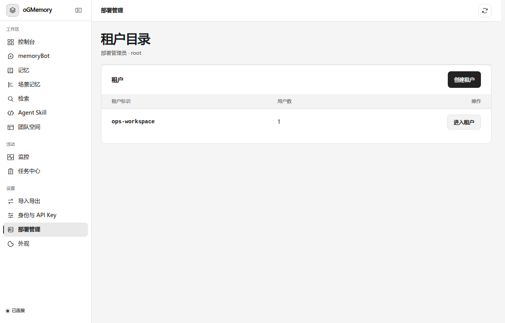
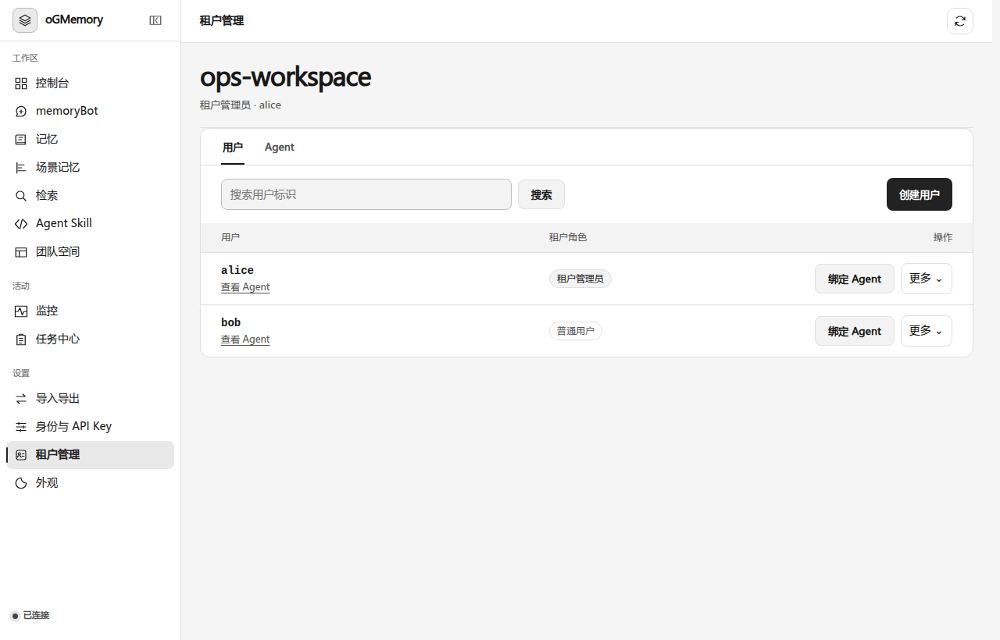
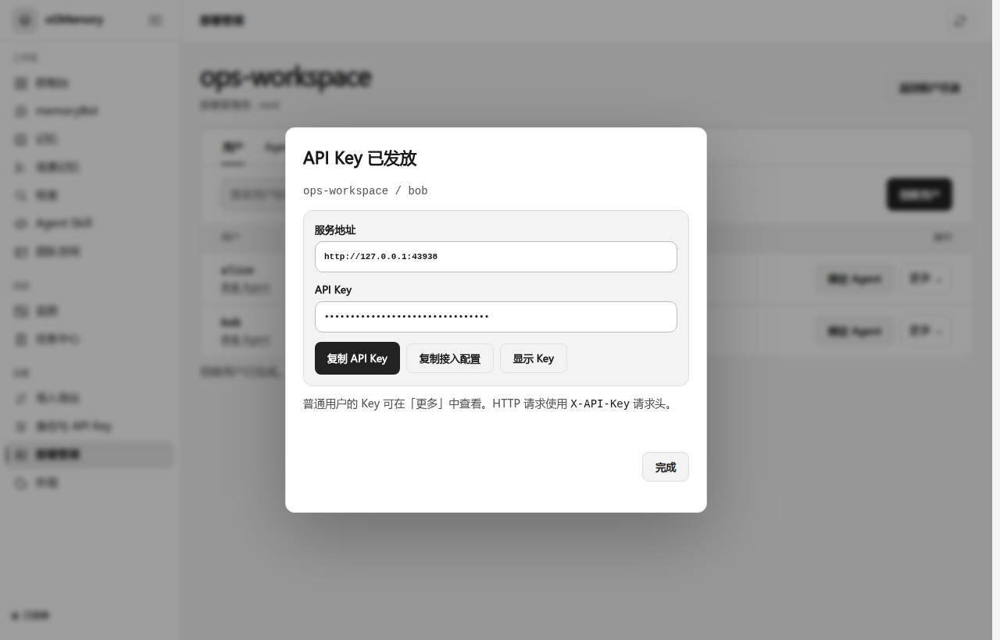
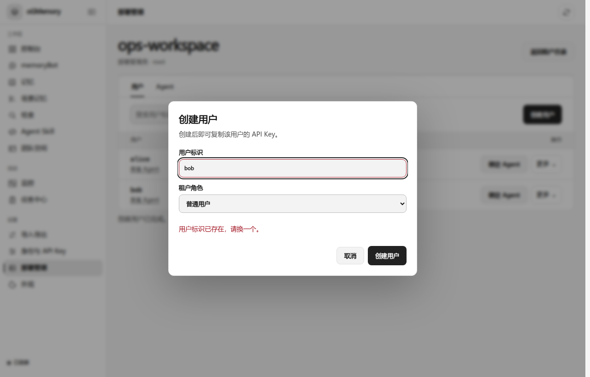
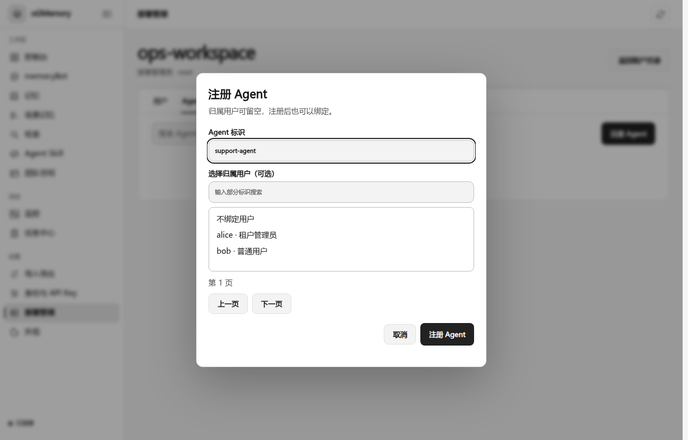

# 打开和使用 oGMemory 管理界面

通过浏览器查看记忆、检索内容、检查模型用量和处理后台任务。管理界面由 oGMemory HTTP 服务提供，与 API 使用同一个地址和端口。

## 开始之前

准备以下信息：

- 已启动的 oGMemory HTTP 服务地址。
- HTTP 端口：按 [openGauss 部署指南](../deploy/ogmem_opengauss_deploy.md) 配置时为 `8090`，以实际 `service.http_port` 为准。
- oGMemory API Key：启用权限控制时需要，由管理员提供。

## 打开管理界面

在浏览器地址栏输入：

```text
http://<服务器IP>:8090/memory-viewer/
```

如果浏览器和服务运行在同一台机器，打开 [本机管理界面](http://127.0.0.1:8090/memory-viewer/)。如果服务部署在远程服务器，将地址中的 `<服务器IP>` 替换为服务器地址。

### 通过 SSH 访问远程服务

如果服务器的 HTTP 端口仅供本机访问，在自己的电脑上建立隧道：

```bash
ssh -N -L 18090:127.0.0.1:8090 <用户名>@<服务器IP>
```

保持命令运行，然后打开 [隧道访问地址](http://127.0.0.1:18090/memory-viewer/)。本地端口 `18090` 被占用时，换一个空闲端口，并同步修改浏览器地址。

## 连接账户

1. 点击左侧 **身份与 API Key**。
2. 在 **API Key** 中填写 oGMemory 的访问密钥。
3. 点击 **连接**。
4. 查看右上角 **账户**，确认当前查看范围。

这里填写的是 oGMemory API Key，与调用 LLM 或 Embedding 的模型服务密钥不同。API Key 保存在浏览器会话存储中；新会话需要时重新填写。

| 身份 | 查看范围 |
| --- | --- |
| Root | 可查看多个账户，并通过右上角切换账户。 |
| 账户管理员 | 查看密钥所属账户内的用户和 Agent。 |
| 普通用户 | 查看当前身份有权限访问的用户和 Agent 空间。 |

权限由服务端校验。使用日常查看所需的最小权限密钥；远程访问建议使用 HTTPS 或 SSH 隧道。

## 查看记忆

1. 点击左侧 **记忆**。
2. 展开账户目录，再展开 `users` 或 `agents`。
3. 选择用户或 Agent，展开 `memories` 和对应类型目录。
4. 点击一条记忆，在右侧查看内容。

目录结构与 ContextFS 一致，例如：

```text
ctx://
└── acct-demo
    ├── users
    │   └── alice
    │       └── memories
    │           ├── profile
    │           ├── preferences
    │           └── events
    └── agents
        └── main
            ├── memories
            └── skills
                ├── generated
                └── imported
```

目录右侧显示该层级的记忆数量。Skill 单独显示数量。目录中的数据较多时，使用分页控件继续查看。

详情包括 **L0 · 摘要**、**L1 · 概览**、**L2 · 正文** 和 **元数据**。需要返回当前内容所在目录时，点击目录树标题栏中的 **定位当前文件** 按钮。

顶部搜索框按名称、路径或摘要筛选已经加载的节点。要按语义查找记忆，使用左侧 **检索**。

## 检索记忆

1. 点击 **检索**，输入问题或关键词。
2. 选择 **范围** 和 **返回数量**。
3. 如需缩小结果，打开 **更多筛选**，设置记忆类型、最低分数或 Session ID。
4. 点击 **检索**，再点击一条结果，在当前页面查看命中内容。

例如，输入“用户偏好的沟通方式”，查找相关偏好记忆。结果按语义相关度排序；结果较少时，可以扩大范围或降低最低分数后再次检索。

## 管理租户与用户

启用配置 `auth.role_control_enabled` 后，通过左侧「身份与 API Key」连接。可用入口取决于 Key 对应的身份。

| 身份 | 前台入口 | 管理范围 |
| --- | --- | --- |
| 部署管理员 | 部署管理 | 创建租户和首位管理员，进入租户管理其用户和 Agent |
| 租户管理员 | 租户管理 | 管理本租户的用户、Agent 和用户 Key |
| 普通用户 | 身份与 API Key | 连接并使用有权限访问的记忆 |

### 创建租户与复制 API Key

1. 使用部署管理员 Key 连接。打开「部署管理」，点击「创建租户」，填写租户标识和首位管理员用户名。
2. 在成功弹窗点「复制 API Key」，或点「复制接入配置」获取服务地址和 Key 的 JSON。用新 Key 重新连接即可进入该租户的「租户管理」。部署管理员也可在租户目录点「进入租户」，直接管理其用户和 Agent。



### 管理用户与 Agent

在「租户管理 → 用户」点击「创建用户」选择租户角色。创建成功即可复制该用户的 API Key。重复标识会以红字提示，并定位到对应输入框。







在「Agent」页点击「注册 Agent」。可按部分标识搜索已注册的归属用户，也可留空。注册后，可从 Agent 列表的「变更归属」绑定、转交或解除绑定，也可从用户列表使用「绑定 Agent」「查看 Agent」。在「团队空间 → 成员管理」可选择本租户已注册的用户或 Agent。团队角色在所属团队空间内生效。



普通用户的 Key 可通过「更多 → 查看 API Key」重新获取，查看会记录审计。本人可在「身份与 API Key」查看已连接的 Key。「轮换 Key」会立即使旧 Key 失效，需要更新使用旧 Key 的客户端。移除用户前须转交其 Agent，移除后历史记忆保留原用户标识。每个租户至少保留一位管理员。

### 通过 HTTP 注册

`BASE` 是 oGMemory HTTP 服务地址。部署管理员使用 `ROOT_KEY` 创建租户。从响应中取出 `user_key` 作为 `ADMIN_KEY`，用于注册该租户的用户与 Agent。

```bash
curl -X POST "$BASE/api/v1/admin/accounts" \
  -H "X-API-Key: $ROOT_KEY" -H 'Content-Type: application/json' \
  -d '{"account_id":"ops","admin_user_id":"alice"}'

curl -X POST "$BASE/api/v1/admin/accounts/ops/users" \
  -H "X-API-Key: $ADMIN_KEY" -H 'Content-Type: application/json' \
  -d '{"user_id":"bob","role":"MEMBER"}'

curl -X POST "$BASE/api/v1/admin/accounts/ops/agents" \
  -H "X-API-Key: $ADMIN_KEY" -H 'Content-Type: application/json' \
  -d '{"agent_id":"ops-agent","owner_user_id":"bob"}'
```

把创建用户响应中的 `user_key` 放入客户端的 `X-API-Key` 请求头即可接入。注册 Agent 时，省略 `owner_user_id` 或传 `null` 可保留未绑定状态。变更归属使用 `PATCH /api/v1/admin/accounts/ops/agents/ops-agent`，传 `{"owner_user_id":null}` 可解除绑定。

用户和 Agent 列表支持 `limit`、`after`、`q`。有下一页时，用响应的 `next_after` 作为下一次请求的 `after`。Agent 列表可用 `owner_user_id` 筛选归属用户。角色变更使用 `PATCH /api/v1/admin/accounts/ops/users/bob/role`，报文为 `{"role":"ADMIN"}`。轮换和查看普通用户 Key 分别使用 `POST /api/v1/admin/accounts/ops/users/bob/key` 和 `POST /api/v1/admin/accounts/ops/users/bob/key/reveal`。使用配置文件中的旧式 Admin Key 时，身份固定为对应租户的 `admin`。

## 使用团队空间

启用团队空间后，通过管理服务（默认端口 `8091`）打开 Memory Viewer 并连接当前租户的 API Key。点击左侧 **团队空间**，通过 **团队记忆** 检索和查看详情，通过 **成员管理** 管理注册成员与来源贡献，通过 **规则** 查看或配置生成规则。单条记忆的 **读取权限** 在详情中查看和编辑，操作取决于当前身份权限。

配置、截图及操作步骤见[团队空间使用指南](shared_spaces.md)。

## 查看 Agent Skill

点击 **Agent Skill**，展开账户、Agent 和 `skills` 目录：

- `generated`：生成的 Skill。
- `imported`：导入的 Skill。

选择 Skill 后，在右侧查看摘要、概览、正文和元数据。

## 查看运行情况

### 控制台：记忆概况与模型用量

点击 **控制台**，查看当前账户的运行概况和模型用量。切换右上角账户，可以查看对应账户的数据。

模型用量展示调用次数、Token 消耗及趋势。将鼠标移到趋势图的数据点上，可查看对应日期的使用量。用量数据以服务实际记录为准；历史记录缺失时，应结合服务日志排查。

### 监控：组件健康状态

点击 **监控**，先查看总览，再选择服务、存储、模型、索引、任务队列或检索，查看对应组件的信息。处理异常后，点击 **刷新** 确认状态。

### 任务中心：进度与失败详情

1. 点击 **任务中心**。
2. 按任务类型或状态筛选，使用分页查看任务。
3. 点击任务，打开详情窗口，查看关联资源、执行信息及失败原因。
4. 按失败原因处理资源、连接或配置问题。
5. 对支持重试且有操作权限的失败任务，点击 **重新触发**，随后查看任务状态。

任务列表会在后台更新，也可以点击 **刷新** 获取最新状态。重新触发表示任务重新进入处理流程，最终结果以执行后的状态为准。

## 常见问题

### 浏览器打不开页面

先在服务器上检查 HTTP 服务和页面：

```bash
curl -i http://127.0.0.1:8090/api/v1/health
curl -i http://127.0.0.1:8090/memory-viewer/
```

如果服务器本机可以访问、自己的电脑无法访问，检查服务器地址、监听地址、防火墙和安全组，或使用前面的 SSH 隧道。

### 页面返回 404

确认访问的是 HTTP 端口及完整路径 `/memory-viewer/`。部署指南中的 MCP 端口为 `8091`，管理界面应使用 HTTP 端口 `8090`。

如果健康检查正常、页面仍返回 404，检查运行镜像或代码版本是否包含管理界面，以及反向代理是否转发了 `/memory-viewer/`。页面可打开但数据接口返回 404 时，还需检查 `/api/v1/` 的转发配置和前后端版本是否一致。

### 提示认证失败或没有权限

打开 **身份与 API Key**，确认填写的是当前 oGMemory 服务的 API Key，并确认密钥所属账户及权限。密钥变更后，用新 Key 重新连接。

### 看不到已经写入的记忆

依次检查：

1. 右上角账户是否正确。
2. 数据属于哪个用户或 Agent，是否展开了对应目录。
3. 当前 API Key 是否有权访问该空间。
4. 点击刷新后，目录数量和内容是否更新。
5. 在任务中心查看相关处理任务是否完成，失败时打开详情定位原因。

如果目录可见但语义检索没有结果，检查检索范围、筛选条件以及索引任务状态。

### 数据加载提示 “is not valid JSON”

这通常表示数据接口返回了 HTML 页面。检查浏览器网络请求中的响应状态和内容，确认 API 地址、反向代理路由及服务版本。可结合容器日志定位：

```bash
docker logs --tail 100 ogmem
```

## 相关文档

- [openGauss 部署指南](../deploy/ogmem_opengauss_deploy.md)
- [部署与运维指南](deployment/deployment_operations_guide.md)
