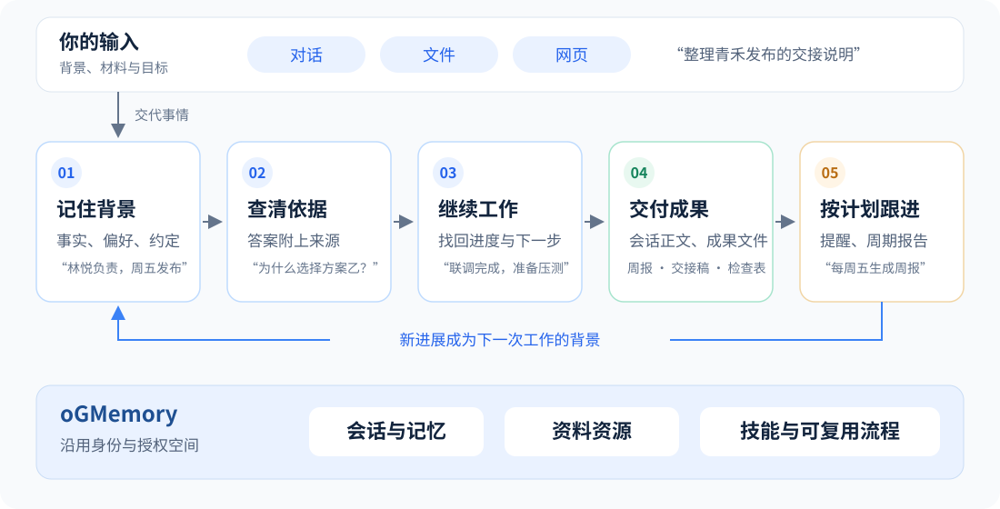
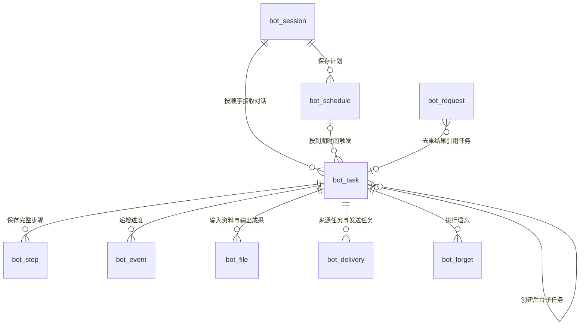

# oGMemory memoryBot 首版设计方案

## 1. 概述

**memoryBot 是有长期记忆的工作助手：记住背景、查清问题、接续工作、处理资料、交付成果，并按计划跟进。**

面向个人和团队的持续工作。oGMemory 提供身份与空间、会话上下文、记忆、资源和技能；memoryBot 将这些能力组织成可操作的聊天、资料处理、成果生成和定时计划。



| 首版范围 | 设计约定 |
|---|---|
| 使用入口 | oGMemory 前台、CLI、HTTP API；共用站内会话和任务记录 |
| 资料与成果 | 文本、Markdown、CSV、网页正文；成果以正文或文件交付 |
| 可执行任务 | 管理员发布的检查、统计、整理模板；每个模板列明输入、权限和输出 |
| 主动服务 | 一次提醒、周期报告；结果直接回到所属会话 |
| 部署 | 从首次部署支持多实例；任务、会话、计划和文件集中保存 |
| 建设基础 | 复用仓库中的身份权限、记忆检索、写入调度、技能与存储能力 |

以上为首版功能范围。模型账号和共享存储在首次部署时配置。

## 2. 功能与职责

### 2.1 用户功能

| 功能 | 用户输入／操作 | 完成的工作 | 用户结果 |
|---|---|---|---|
| 记住信息 | “青禾负责人是林悦，11月12日发布” | 提取事实、归属、时间；保存来源；接受后续更正 | 保存状态、最新事实；新会话仍能查询 |
| 查资料、问历史 | “为什么选方案乙？” | 查找决策记录，组织理由和比较 | 答案、来源标题、时间及原文入口 |
| 收集资料 | 粘贴记录、上传文件、提交网页 | 提取正文和摘要，保存到指定资料范围 | 处理进度、摘要、可查询资料 |
| 接续工作 | “继续青禾，上次做到哪了？” | 找回目标、决定、进展和待办 | 进展回顾、下一步清单及本次成果 |
| 生成成果 | “写周报”“把这些资料整理成交接手册” | 按主题、时间和模板整理内容，支持继续修订 | 周报、交接稿、手册；正文、下载文件及来源清单 |
| 执行任务 | “按发布清单检查”“按客户汇总CSV” | 按已发布模板处理指定材料 | 检查表、统计文件、处理说明 |
| 主动跟进 | “明早9点提醒”“每周五发周报” | 保存计划，到点读取最新资料并执行 | 计划卡、下次执行时间、提醒或报告 |
| 多入口使用 | Web记录，命令行继续查询 | 使用同一用户身份、授权范围和任务接口 | 一致的事实与来源、持久的会话结果 |
| 管理记忆 | “记住了什么”“更正这条”“忘记这条” | 查看来源，定位条目，更新或遗忘 | 有效记忆列表、操作结果和作用范围 |

### 2.2 页面与服务

Web入口位于现有主前台侧栏，地址为`/memory-viewer/#bot`，复用当前用户API Key、连接设置及主题。页面在主前台内容区打开；切换导航保留会话与任务进度，切换API Key时同步切换用户身份并重新加载。Bot的资料和任务归属当前凭据对应用户，前台账户下拉用于管理浏览。

| 页面 | 主要操作 | 对应服务职责 |
|---|---|---|
| 对话 | 提问、继续会话、停止回复、打开引用 | 接入服务：认证、保存输入、返回进度与结果 |
| 资料 | 上传、选取资料、修订、下载成果 | 执行服务：检索、调用模型、处理文件、保存成果 |
| 计划 | 创建、改期、暂停、取消、查看记录 | 执行服务：检查到期计划、生成任务、交付通知 |
| 记忆 | 独立选择本人／全部已授权范围，查看、更正、遗忘、打开来源 | oGMemory：管理记忆、索引和权限；Bot呈现类别、归属及操作结果，关键词查询显示“相关结果” |
| 对话内生成设置 | 选择周报、交接稿等模板及输出格式 | 执行服务：校验已发布模板、冻结工具范围并生成成果 |

主导航直接提供“对话、资料、计划、记忆”。模板及输出格式位于对话输入框的“生成设置”，报告、提醒和工具结果直接回到所属会话。

接入服务和执行服务是同一套Bot程序的两种启动职责，可分别扩容。执行服务内部区分对话、文件处理、计划检查和通知任务；记忆写入交给oGMemory现有调度能力。

### 2.3 原生能力与 Bot 业务的对应关系

| 业务对象 | oGMemory 原生能力 | memoryBot 新增用途 | 关联标识 |
|---|---|---|---|
| 身份与范围 | 租户、用户、Agent、角色和授权空间 | 会话选择已授权 Agent；每次取材及写入沿用原生权限 | `account_id/user_id/agent_id/owner_space` |
| 持续对话 | Session 保存消息缓冲、压缩上下文、提取状态和会话历史 | 聊天标题、列表、归档、消息顺序、实时回复与历史展示 | `bot_session.session_id`传给原生`sessionId` |
| 长期记忆 | 提取、合并、检索用户及 Agent 记忆，保存关系与来源 | 问答取材、展示引用、更正、遗忘、重新记住及保存状态 | 原生`ctx://` URI；`bot_step.operation_id`关联写入 |
| 资料 | `RESOURCE`节点保存可检索正文及索引 | 上传／网页收录、解析进度、选材、原件和成果下载 | `bot_file.file_id`关联资源 URI 与 AGFS 文件 |
| 技能与模板 | Agent 技能保存可复用流程及配套文件 | 从已发布技能的`memorybot_template`声明形成生成设置，冻结输入、工具与输出约定 | 技能 URI、版本、`template_id` |
| 执行任务 | 记忆服务与工具提供各项实际操作 | 一条消息对应一个`chat`任务；任务保存步骤、状态、结果，支持多实例接续 | `task_id/step_id/parent_task_id` |
| 定时计划 | 复用执行时有效的身份、记忆、资源和技能 | 保存触发时间；到点创建上述`chat`任务，结果回到所属会话 | `schedule_id/session_id/scheduled_at` |

“青禾发布”是对话主题；负责人、发布日期、进度和待办由原生记忆类别承载。`bot_task`表示一次程序执行，`bot_schedule`表示可自动触发的计划。

## 3. 核心设计

### 3.1 对话处理架构



图中组件名对应仓库已有类。运行时由同一进程内的对象组合构成；各执行实例共享 openGauss 与 AGFS。一次领取创建一个 `Execution`，会话取材、生成、工具调用和成果发布共用其执行身份、步骤序号与预算。

| 组件 | 输入与职责 | 输出与持久边界 |
|---|---|---|
| `BotService` | 校验身份、会话、资料与模板；登记幂等请求 | 保存 `bot_task`；立即返回任务标识，前台订阅事件 |
| `BotWorker` | 领取任务、维持租约，按 `kind` 分派 `chat/ingest/memory_write/delivery` | 按执行结果推进完成、重试、待确认或取消状态 |
| `Execution` | 每步复核执行权和授权；核算调用额度、超时；处理模型流 | `bot_step` 保存冻结输入与完整输出，`bot_event` 保存可回放进度 |
| `ConversationContext` | 加载最近对话、相关记忆、选中资料；应用范围与遗忘规则 | 本轮上下文、有效执行范围、`S1…` 来源映射 |
| `ChatRun` | 按模板选择处理路径；组织提示词；循环处理模型答复与工具请求 | 正文、CSV内容、已调用记忆动作标记 |
| `TemplateRegistry` | 校验已发布模板，冻结输入约束、权限、指令及工具集合 | CSV统计执行器、多资料手册或普通生成路径 |
| 工具分派与 `MemoryGateway` | 按名称路由，校验管理动作参数，复用原生记忆服务 | 结构化回执；管理动作业务写入与工具步骤一起提交 |
| `ConversationResult` | 汇总正文及引用，发布文件，登记后续工作 | 同事务保存任务结果、成果元数据及后续任务；记忆可用状态由后台推进 |

### 3.2 多实例如何协作

| 问题 | 设计机制 | 用户效果 |
|---|---|---|
| 请求到达不同实例 | 会话、任务和进度写入共享数据库；任意接入实例均可读取 | 换实例后仍可查看原会话 |
| 多个实例领取同一任务 | 在数据库事务内领取，记录执行实例、执行次数和占用截止时间 | 一个有效执行者提交结果 |
| 执行实例退出 | 每10秒续期，占用有效期30秒；到期后由其他实例接续；提交时核对执行次数及有效期 | 从最后保存的完整步骤继续 |
| 同一会话同时提交 | 领取时锁定会话记录，选择最早待处理任务；该会话当前任务完成后释放 | 回复顺序与提问顺序一致 |
| 回复连接中断 | 进度按任务内递增序号保存；重连提交已收到的最后序号 | 补齐进度；随时可读取最终结果 |
| 记忆写入后失去响应 | 保存稳定的操作标识；查询原操作回执并去重；结果不明时进入“待确认” | 已确认操作沿用原结果，待确认操作显示处理状态 |
| 扩容后资源争用 | 并发额度按整个Bot集群分配；会话、租户、模型与数据库分别设上限 | 扩容时仍遵守用户配额和模型额度 |

任务占用时间、续期间隔为起步配置，均按数据库时间判断。模型重新生成时替换对应未完成草稿；完整结果按任务保存。

### 3.3 资料、任务与成果

| 对象 | 处理方式 | 完成条件 |
|---|---|---|
| 粘贴文本 | 保留原文与来源会话，提取摘要和可记忆事实 | 摘要可见，资料能检索 |
| 文件／网页 | 校验用户范围，解析正文，保存原件或抓取副本及时间 | 展示实际读取范围、资料链接和索引状态 |
| 检查／统计任务 | 加载已发布技能及输入；执行声明的检索、模型整理或CSV统计 | 返回检查项或统计结果，并记录输入输出 |
| 周报／交接稿 | 用户指定主题、时间范围与结构，正文引用相关记录 | 事实、时间和事项状态与来源一致 |
| 多资料手册 | 保存所选资料清单，完整原文按上下文额度分段整理，逐份保存章节，再生成目录与汇总 | 展示“已处理／总数”、资料内分段进度；输出文件、章节与来源清单；接续复用已完成章节 |
| 修订 | 保留原成果，生成新的成果记录并关联上次任务 | 新旧稿件可分别查看，修订要求可追溯 |

文件先写入“任务＋本次执行次数”的临时位置，完成后保存到唯一文件位置，并记录内容摘要。登记成果时校验当前执行权；已登记文件保持内容不变。各实例通过同一文件存储访问资料和成果。

### 3.4 计划与通知

| 用户操作／场景 | 首版行为 |
|---|---|
| 创建提醒 | 将“明早9点”展开为绝对日期、时区和归属会话，展示后保存 |
| 周期报告 | 保存频率、主题、资料范围和输出模板；每次使用执行时的有效资料 |
| 多实例检查到期计划 | “计划＋本次到期时间”唯一；创建任务和推进下次时间在同一事务完成 |
| 服务恢复后存在错过的计划 | 一次提醒补发并标注原定时间；周期报告合并为最近一次 |
| 上次任务仍在运行 | 周期任务等待上次完成，再合并处理最近一次到期任务 |
| 改期、暂停、取消 | 事务内更新计划和相关排队任务；已执行的结果保留可查 |
| 会话结果 | 报告和提醒作为所属会话的新任务保存，正文、文件与运行记录直接可读 |

### 3.5 记忆管理

| 动作 | 用户看到的内容 | 保存规则 |
|---|---|---|
| 查看 | 事实、决定、待办及其来源 | 按当前用户可访问范围读取 |
| 更正 | 原值、新值、依据 | 新来源与原条目关联；后续采用有效值 |
| 遗忘 | 选中条目、记忆及索引的处理结果、原始资料保留范围 | 沿用oGMemory的归档语义；记录本次遗忘选择，召回及自动整理遵守该选择 |
| 重新记住 | 用户新输入及保存结果 | 用户明确要求后建立新的有效记录 |

档案类事实通过更正维护；遗忘入口按服务端`can_forget`显示。本人空间的其他记忆可遗忘；Agent空间的遗忘权限归ADMIN／ROOT。原始资料和聊天记录的保留范围在回执中列明。

#### 记忆类别与归属

| 原生类别 | 业务含义 | 保存空间与类型 | Bot 使用方式 |
|---|---|---|---|
| `profile/preference` | 用户档案、偏好 | `user:{user_id}`，`MEMORY` | 个性化回答、查看和更正 |
| `entity/event` | 人物或事物信息、带时间的事实与进展 | `user:{user_id}`，`MEMORY` | 查负责人、决策依据、进展及待办 |
| `pattern` | 从用户行为或对话中归纳的规律 | `user:{user_id}`，`SKILL` | 沿原生类型路由读取可复用规律 |
| `session_archive/session_summary` | 会话原文分块、会话摘要 | `user:{user_id}`，`MEMORY` | 补充结构化提取以外的历史细节；保留可打开的来源 |
| `case/tool/skill` | 解决问题的案例、工具使用经验、可复用技能 | `agent:{agent_id}`；case为`MEMORY`，tool/skill为`SKILL` | 在已授权 Agent 空间检索经验，读取已发布技能 |
| `document` | 上传文件或网页解析后的正文 | `user:{user_id}`，`RESOURCE` | 作为本次资料引用；文件原件及成果由`bot_file`关联 |

写入类别和归属由 oGMemory 提取及存储规则决定；调用时的`agent_id`用于 Agent 身份与空间授权。用户原文、摘要归档在同一用户的多会话、多 Agent 间复用。默认`search_memory(categories=None)`按查询类型检索，普通记忆查询可召回相关`session_archive/session_summary`；最终结果由权限、相关性和数量上限共同确定。

#### 归档名称与记忆可用性

| 操作／数据 | 保存位置或状态 | 后续行为 |
|---|---|---|
| 聊天列表归档 | `bot_session.archived=true` | 移入归档列表；原生记忆保持原状态，继续发消息时恢复会话 |
| Session历史归档 | 原生Session历史快照 | 按会话所属用户、Agent读取，用于恢复和查看会话历史 |
| 会话原文／摘要归档记忆 | 用户空间的`session_archive/session_summary`节点 | 有效节点按用户空间权限参与相关问题的召回 |
| 记忆遗忘／软归档 | 目标节点`status=ARCHIVED`，关联`bot_forget`记录 | 目标条目退出有效读取与检索；自动整理按遗忘回执约束来源使用 |

原生 Session 历史按会话所属用户、Agent读取；用户空间的归档记忆按用户空间权限读取。同一用户经其他 Agent 产生的有效归档，可成为当前 Bot 问答来源。

### 3.6 开发时的事务与执行顺序

下列字段与第四章保持一致。一次事务包含一行表中列出的全部数据库写入；模型、网页抓取、AGFS 文件读写和外部服务调用在事务外执行。

| 操作 | 必须按顺序完成 | 提交结果 |
|---|---|---|
| 接收用户任务 | 认证→登记`bot_request`请求摘要→锁定`bot_session`→分配`seq`并推进`next_seq`→写入`bot_task`和首条进度→保存原响应 | 同一请求返回同一`task_id`；受理响应对应已提交任务 |
| 领取对话任务 | 锁定会话→选取最早未结束的对话任务→检查状态及到期时间→设置`owner_id`、递增`attempt`、设置`lease_until` | 同会话按`seq`执行；不同会话并行 |
| 领取后台任务 | 按类型及`next_attempt_at`选取→原子更新执行权 | 记忆提交、资料导入和通知独立推进；后台结果关联`parent_task_id` |
| 续期或提交步骤 | 锁定任务→核对`owner_id`、`attempt`和`lease_until`→写入完整步骤输出及进度 | 新执行者取得资格后，数据库以新执行信息确认提交 |
| 完成对话 | 保存`result`及成果引用→创建需要的`memory_write/delivery`后续任务和通知记录→写入完成事件→更新终态 | 回复可见后，后续工作已有持久入口；按上游任务与动作去重创建 |
| 生成计划任务 | 锁定计划→检查`state/revision/next_run_at`→锁定会话并分配`seq`→创建该到期时间的任务→推进下次时间 | `(schedule_id,scheduled_at)`对应唯一任务；任务输入保存本次计划规则快照 |
| 更新计划 | 锁定计划并核对`expected_revision`→保存新规则并递增`revision`→处理相关排队任务 | 已执行任务沿用其冻结输入；新的到期任务采用新规则 |
| 记录进度 | 锁定任务→取`next_event_seq`→写入事件并推进序号 | 相同任务内序号连续递增，重连按序补读 |

| 执行规则 | 明确行为 |
|---|---|
| 重试 | 可恢复的读操作或已具备稳定回执的操作，按5秒、30秒、120秒重试，最多3次；`retry_count/next_attempt_at`持久保存 |
| 待确认 | 外部响应不明时，步骤进入`waiting_confirmation`；服务端查询原操作，已确认结果继续使用；用户可发起重新核验或停止 |
| 停止 | 立即保存`cancel_requested=true`；在步骤边界收敛为`cancelled`，已发布成果和已确认外部动作保留在结果中 |
| 会话顺序 | `queued/running/retry_wait/waiting_confirmation`都占据该会话的先后顺序；`succeeded/cancelled/failed`允许下一对话任务开始 |
| 调用预算 | 每个`bot_task`独立累计 Bot 显式`model/tool`步骤，默认分别8／12次；同一任务接续沿用累计值，新消息创建新任务。oGMemory上下文组装及记忆提取内部模型调用按核心服务单独统计 |
| 写入权限 | 任务受理时保存身份与输入；每次执行资料、记忆及工具动作前按当前授权复核 |
| 时间规则 | 按计划时区计算下一时刻，保存为带时区时间；夏令时跳过的本地时刻顺延到首个有效时刻，重复时刻取第一次 |
| 周期合并 | 上次仍在运行时保留最近到期点；完成后生成最近一次，记录实际覆盖时间；暂停和取消会收敛尚未开始的对应任务 |

### 3.7 意图识别与执行路径

意图处理采用**显式请求路由、管理动作词匹配、模型工具选择**三层机制。动作词匹配决定本轮可用的管理工具；模型结合问题、历史和来源，决定直接回答或提交工具名称与参数；实际动作由执行服务校验后完成。

| 判定层 | 输入与规则 | 决定的行为 |
|---|---|---|
| 任务路由 | 用户消息生成 `kind=chat`；上传、记忆管理和计划调度通过各自接口创建相应任务 | Worker按持久任务类型选择处理器 |
| 生成路径 | 前台生成设置、CLI或HTTP显式传入 `template_id`；计划任务沿用已保存输入 | 手册模板逐资料分段整理并汇总；`executor=csv_summary`的内置或已发布技能模板做确定性统计；其他模板及普通会话进入模型生成 |
| 创建计划候选 | 文本匹配“提醒、定时、每天、每周、每月、每隔、remind、schedule”等规则 | 向模型开放 `create_schedule` |
| 修改计划候选 | 同时匹配计划类对象词和“暂停、恢复、取消、修改”等动作规则 | 开放 `update_schedule`，保存本轮允许的 `pause/resume/cancel/update` 动作集合 |
| 记忆管理候选 | 匹配“记住、记下、更正、纠正、忘记、遗忘”等规则 | 开放 `memory_action`，保存本轮允许的 `remember/correct/forget` 动作集合 |
| 模型选择 | 当前消息、历史、资料与本轮工具声明 | 直接生成正文，或返回一个／多个结构化工具调用；下一轮结合回执继续回答 |

管理动作候选仅用于普通用户对话；模板和计划触发的对话使用各自读取范围。候选集合可同时包含多个动作。执行时再次核对工具名、动作枚举、参数结构、目标对象归属与当前权限。规则命中表示“允许模型考虑此工具”，实际完成状态以工具回执为准。

例：“暂停青禾提醒，并告诉我下次发布安排”先开放计划修改工具并提供已有计划标识；模型可读取发布安排，再携带 `schedule_id`、`expected_revision`、`action=pause` 提交修改；回复同时引用发布来源和计划变更回执。

### 3.8 Agent 执行循环

一个 `chat` 任务可以包含多个模型回合；一个回合可以请求多个工具。工具按返回顺序逐个执行并保存结果，全部回执加入消息后再进入下一模型回合。



| 循环要素 | 执行约定 |
|---|---|
| 初始上下文 | 系统指令＋授权资料及来源＋历史与本条消息；计划修改动作另补充已有计划快照 |
| 模型回合 | 发送当前完整消息和工具声明；结果统一为 `{text,calls:[{id,tool,input}]}` |
| 工具回合 | 先追加完整 `assistant.tool_calls`，再按顺序追加每个 `role=tool` 回执；调用关联使用同一个 `id/tool_call_id` |
| 完成条件 | 模型返回正文且 `calls` 为空，随后校验正文、提取引用并发布结果 |
| 运行边界 | 模型／工具步骤分别核算额度；普通对话默认8次模型、12次工具、120秒；任务接续使用已保存累计值 |
| 正文增量 | 模型生成期间写入 `answer.delta`；该回合转入工具执行且已输出草稿时发出 `answer.reset`，之后展示新的答复 |
| 断点恢复 | 新执行实例按同一步骤序列运行，复用已完成步骤的冻结输入和输出；重新构造消息及工具回执，再继续后续回合 |
| 后台记忆 | 明确记忆动作由工具创建后续任务；普通会话完成后按遗忘规则过滤用户输入，再创建自动记忆任务；各自跟踪写入及检索状态 |

多资料手册按“分段生成→单份资料章节→汇总”执行，章节生成另按资料核算额度；CSV统计使用确定性执行器。两者共用 `Execution.step` 保存过程及结果。选择模板或引用文件的任务按需生成成果，文件字节先发布到AGFS，最终事务保存成果元数据与任务关联。

### 3.9 工具注册与调用管理

工具声明统一采用 `{name,description,input_schema}`；模型适配层将其转换成服务商的工具调用协议。只读工具由 `READ_TOOLS` 定义；管理工具从 `ScheduleCreate`、`SchedulePatch`、`MemoryAction` 的字段约束生成 JSON Schema。工具选择、参数解释与实际执行分别由模型、协议适配层、服务端处理器负责。

| 工具 | 开放条件 | 参数要点 | 执行与回执 |
|---|---|---|---|
| `search_memory` | 普通会话；模板取已声明工具与有效范围交集 | `query` | 原生检索后应用会话范围及遗忘规则，返回 `sources` |
| `read_memory` | 普通会话；模板取已声明工具与有效范围交集 | `uri` | 授权读取原文，返回 `sources` |
| `list_schedules` | 普通会话及使用默认工具集合的计划对话 | `{}` | 返回当前用户最近100条计划及 `has_more` |
| `create_schedule` | 本条用户消息匹配创建计划候选 | `name,rule,task_input`；会话及时区可由服务端补齐 | 创建计划，返回 `{operation,status,data}`；相对提醒按数据库当前时间计算 |
| `update_schedule` | 本轮允许对应计划修改动作 | `schedule_id,expected_revision,action`及变更字段 | 复核目标及修订号，在事务内更新计划，返回实际记录 |
| `memory_action` | 本轮允许对应记忆管理动作 | `action,memory_uri,new_text`，按动作校验 | 受理后台记忆任务并关联当前任务；回执表示受理及后续任务状态 |

工具执行按“核对工具集合→核对动作及参数→复核当前身份／目标范围→保存结果”推进。读取类工具保存查询输出；管理动作使用 `Execution.step(atomic=True)`，在同一数据库事务中保存业务变更、后续任务与步骤回执。原生记忆的实际写入、索引确认由 `memory_write` 处理器继续执行。

模板的 `tools`、`permission_requirements` 与当前身份、会话范围共同形成 `execution_scope`。技能模板复用已注册工具；新增工具时同时维护工具声明、执行分派、参数与权限校验、步骤摘要及验收用例。

### 3.10 运行时状态与检查点

| 状态 | 保存位置 | 使用方式 |
|---|---|---|
| 执行资格 | `bot_task.owner_id/attempt/lease_until` | 续期、事件写入、步骤提交和最终发布均核对当前执行资格 |
| 本次执行状态 | `Execution.number/model_count/tool_count/deadline/partial` | 同一执行中的取材、生成、工具和发布共用；新领取按持久记录恢复 |
| 步骤身份与输入 | `bot_step.task_id/step_no/operation_id/input` | 按任务内步骤序号定位，复用稳定操作标识和首次冻结输入 |
| 步骤输出 | `bot_step.state/output/external_receipt` | 完成步骤直接返回保存结果；回执用于确认业务动作与接续 |
| 累计预算 | 第1步的 `output.used_seconds/model_calls/tool_calls` | 跨执行次数累计；手册另保存 `model_calls_by_scope` |
| 授权与材料 | `accepted_authz`、模板快照、取材步骤的 `authorization_fingerprint` | 执行时重验身份、来源范围及遗忘选择；`ConversationContext`组织本次材料与引用映射 |
| 展示状态 | `bot_event`、任务 `result/memory_status` | SSE回放正文与步骤；最终结果和记忆可用状态分别读取 |

普通对话的步骤顺序为：**预算→模板→上下文检索→逐份资料→模板执行判定→可选计划快照→模型／工具回合→可选成果发布**。每个步骤先保存运行状态；外部调用结束后保存完整输出和完成事件。管理动作在受执行资格保护的事务中提交；模型和AGFS调用在步骤事务外执行。

`step_no`是恢复定位依据，因此同一任务各次接续沿用相同处理分支与步骤顺序。内存计数约束重放中的逻辑回合；第1步累计值约束实际发生的模型／工具调用。首次生成与恢复执行共用这两项约束。

## 4. 数据模型

### 4.1 对象关系与数据归属

本章全部 `bot_` 表、字段和约束均为**首版新增设计**。建议采用与 oGMemory 共用的 openGauss，沿用仓库 SQL 适配及 PostgreSQL 兼容类型；所有 Bot 实例访问同一写入地址。记忆正文、关系和检索索引由 oGMemory 管理；Bot 表保存任务状态、文件元信息及处理回执。资料与成果的完整文件通过 AGFS 保存，存储配置见 4.14。



| 保存位置 | 数据 | 写入方／读取方 |
|---|---|---|
| openGauss：Bot 业务表 | 会话、任务、步骤、事件、文件元信息、计划、站内回执、遗忘、请求去重 | 接入实例受理和查询；执行实例领取与提交 |
| openGauss：既有 oGMemory 数据 | 记忆正文、关系；索引按现有数据库索引配置部署 | 通过既有服务写入、查询；Bot 以稳定操作标识关联 |
| AGFS：共享文件 | 上传原件、网页副本、解析内容、生成文件；底层为对象存储或共享卷 | 接入实例保存上传原件；执行实例处理并生成成果；接入实例鉴权下载 |

### 4.2 公共字段与类型约定

下表字段适用于各业务表；`bot_event` 为追加记录，仅使用 `account_id`、`user_id`、`created_at`。各表字典均继承公共字段，表内所有字段均属首版新增设计。

| 字段名 | 类型／长度 | 中文含义 | 空值／默认值 | 约束 |
|---|---|---|---|---|
| `account_id` | `VARCHAR(128)` | 租户标识 | 必填／认证注入 | 与当前认证租户一致；参与全部主键和外键 |
| `user_id` | `VARCHAR(128)` | 业务归属用户 | 必填／认证注入 | 继承父对象归属；查询、后台执行和下载重新校验 |
| `created_at` | `TIMESTAMPTZ` | 首次创建时刻 | 必填／数据库当前时间 | 统一 UTC；对外转换为带时区的 ISO 8601 |
| `updated_at` | `TIMESTAMPTZ` | 最近持久更新时刻 | 必填／数据库当前时间 | 每次状态或内容更新同时刷新 |

对象标识使用 `VARCHAR(64)`，生产值由服务生成不可预测唯一标识，示例 `s_qinghe` 为报文占位。请求键使用 1～64 个可打印字符。`TEXT` 的大小由应用按 UTF-8 字节校验；`JSONB` 是结构化JSON存储类型，必须通过下文结构校验；`TIMESTAMPTZ` 保存带时区时刻。字符串枚举使用 `VARCHAR` 加 `CHECK` 值域约束。外部 URI 上限 2048 字符，SHA-256 使用 64 位小写十六进制内容摘要。

外键一律包含 `account_id`；关联用户必须与父对象一致。下面给出的主键、唯一键、检查条件、索引和事务规则共同构成建表约束。可空外键为 `NULL` 时表示该关联尚未产生或该任务独立创建。

### 4.3 会话表 `bot_session`

用途：保存聊天标题、取材范围、归档状态及对话顺序；消息正文和执行过程由关联任务保存。主键 `(account_id,session_id)`。原生 Session 负责该聊天对应的上下文整理与记忆提取。

| 字段名 | 类型／长度 | 中文含义 | 空值／默认值 | 约束 |
|---|---|---|---|---|
| `session_id` | `VARCHAR(64)` | 会话标识 | 必填／服务生成 | 同租户唯一 |
| `title` | `VARCHAR(128)` | 会话标题 | 必填／请求参数 | 1～128 字符 |
| `scope` | `JSONB` | 记忆与授权资料范围 | 必填／公共 Scope 默认值 | `memory_scope`、`resource_ids` 结构见 4.12 |
| `agent_id` | `VARCHAR(128)` | 经授权的 Bot 身份 | 必填／`memorybot` | 创建时校验当前用户可使用此身份；会话内固定 |
| `session_generation` | `BIGINT` | 既有记忆会话代次 | 必填／`1` | `>=1`；首版固定为 1 |
| `next_seq` | `BIGINT` | 下次对话顺序号 | 必填／`1` | `>=1`；受理对话时在行锁内递增 |
| `revision` | `BIGINT` | 会话资料版本 | 必填／`1` | `>=1`；修改标题、归档状态时递增 |
| `archived` | `BOOLEAN` | 聊天列表归档状态 | 必填／`false` | 可恢复；继续发送消息时自动恢复；记忆节点保持各自状态 |

既有记忆接口的 `memory_session_id` 固定映射为 `session_id`，执行实例接续时沿用相同 `agent_id/session_id/session_generation`。会话消息由 `kind=chat` 的任务按 `seq` 生成：用户消息取 `input.text`，助手消息取 `result.text`，待处理状态直接取任务状态。

### 4.4 任务表 `bot_task`

用途：统一承载用户对话、资料处理、记忆提交和通知发送。主键 `(account_id,task_id)`；继承公共字段。

| 字段名 | 类型／长度 | 中文含义 | 空值／默认值 | 约束 |
|---|---|---|---|---|
| `task_id` | `VARCHAR(64)` | 任务标识 | 必填／服务生成 | 同租户唯一 |
| `session_id` | `VARCHAR(64)` | 所属会话 | 可空／`NULL` | 复合外键指向会话；`chat` 必填 |
| `parent_task_id` | `VARCHAR(64)` | 产生本任务的上游任务 | 可空／`NULL` | 复合外键指向任务；创建时继承父任务归属 |
| `kind` | `VARCHAR(16)` | 执行任务种类 | 必填／无 | `chat/ingest/memory_write/delivery` |
| `seq` | `BIGINT` | 会话内对话顺序 | 可空／`NULL` | `chat` 时 `>=1`；后台任务为 `NULL` |
| `request_id` | `VARCHAR(64)` | 受理请求追溯键 | 必填／请求键或稳定内部键 | 对话同会话唯一；后台键由父任务与动作生成 |
| `input` | `JSONB` | 冻结的执行输入 | 必填／无 | 结构按 `kind` 校验；完整对象≤256 KiB |
| `accepted_authz` | `JSONB` | 受理时授权、记忆身份与凭据引用快照 | 必填／服务端生成 | 继承上下文、资源、工具、配置版本及服务端凭据引用；结构见 4.12 |
| `state` | `VARCHAR(24)` | 执行状态 | 必填／`queued` | `queued/running/retry_wait/waiting_confirmation/succeeded/cancelled/failed` |
| `result` | `JSONB` | 完整结果和来源 | 可空／`NULL` | 公开 Result 结构；≤1 MiB；完成时必填 |
| `memory_status` | `VARCHAR(20)` | 本任务记忆处理状态 | 必填／`not_requested` | `not_requested/pending/stored/searchable/unchanged/failed`；`unchanged` 表示检查完成且无有效变化 |
| `memory_operation_id` | `VARCHAR(128)` | 记忆服务操作标识；当前使用步骤标识关联 | 可空／`NULL` | 当前为 NULL；稳定请求与原始回执存入步骤 |
| `schedule_id` | `VARCHAR(64)` | 触发本任务的计划 | 可空／`NULL` | 复合外键指向计划；仅计划触发的 `chat` 填写 |
| `scheduled_at` | `TIMESTAMPTZ` | 本次原定执行时间 | 可空／`NULL` | 与 `schedule_id` 同时为空或同时有值 |
| `schedule_revision` | `INTEGER` | 触发时计划修改版本 | 可空／`NULL` | 计划任务必填且 `>=1`，取计划当时 `revision` |
| `schedule_snapshot` | `JSONB` | 本次计划执行的冻结规则 | 可空／`NULL` | 计划任务必填；保存 `rule/timezone/condition/baseline` |
| `owner_id` | `VARCHAR(64)` | 当前执行进程启动标识 | 可空／`NULL` | 每次进程启动新生成；领取时赋值 |
| `attempt` | `INTEGER` | 累计领取代次 | 必填／`0` | `>=0`；每次领取或接管原子加 1 |
| `lease_until` | `TIMESTAMPTZ` | 当前执行权截止时间 | 可空／`NULL` | `running` 时与 `owner_id` 同时有值 |
| `retry_count` | `INTEGER` | 已安排的业务重试次数 | 必填／`0` | `>=0`；与进程接管次数分别统计 |
| `next_attempt_at` | `TIMESTAMPTZ` | 下次允许尝试时刻 | 可空／`NULL` | `retry_wait` 时必填；`queued` 的空值表示立即可领取 |
| `cancel_requested` | `BOOLEAN` | 用户请求停止 | 必填／`false` | 执行步骤边界检查并保存已完成结果 |
| `error` | `JSONB` | 可展示错误或待确认原因 | 可空／`NULL` | `{code,message,details}`；移除敏感凭据 |
| `next_event_seq` | `BIGINT` | 下次事件序号 | 必填／`1` | `>=1`；生成事件时锁定任务行并递增 |
| `finished_at` | `TIMESTAMPTZ` | 任务终结时刻 | 可空／`NULL` | `succeeded/cancelled/failed` 时必填 |

`chat` 覆盖普通问答、模板执行和计划生成内容；三者都领取会话顺序号。`ingest/memory_write/delivery` 作为独立后台工作领取，`seq=NULL`；由聊天结果产生时记录 `parent_task_id`。用户直接提交文件或记忆操作可创建独立后台任务，其记忆身份固定存入 `accepted_authz`。`schedule_id/scheduled_at/schedule_revision/schedule_snapshot` 四项同空或同有值，有值时要求 `kind=chat`。

公开 `last_event_seq=next_event_seq-1`；`event_floor_seq` 为当前最小留存序号，事件已清空时等于 `next_event_seq`。公开 `confirmation` 从待确认步骤派生为 `{operation_id,reason,actions:["recheck","cancel"]}`，其余状态为 `null`。任务详情仅为 `chat` 回显完整 `input`；后台任务的公开 `input=null`，数据库保存对应内部结构。

### 4.5 步骤表与事件表

`bot_step` 保存已完成步骤和外部操作依据。主键 `(account_id,task_id,step_no)`；`(account_id,task_id)` 外键指向任务。

| 字段名 | 类型／长度 | 中文含义 | 空值／默认值 | 约束 |
|---|---|---|---|---|
| `task_id` | `VARCHAR(64)` | 所属任务 | 必填／父任务 | 与父任务租户和用户一致 |
| `step_no` | `INTEGER` | 任务内步骤顺序 | 必填／从 1 递增 | `>=1`；同任务唯一 |
| `kind` | `VARCHAR(32)` | 本步骤动作 | 必填／无 | `retrieve/model/tool/file_publish/memory_apply/memory_submit/memory_poll` |
| `operation_id` | `VARCHAR(64)` | 稳定外部操作键 | 必填／首次建步生成 | `(account_id,operation_id)` 唯一；各次接续沿用 |
| `state` | `VARCHAR(24)` | 步骤状态 | 必填／`pending` | `pending/running/waiting_confirmation/succeeded/failed/cancelled` |
| `input` | `JSONB` | 本步骤冻结输入 | 必填／无 | 首次持久化后复用；含模板版本、工具名及参数 |
| `output` | `JSONB` | 完整步骤结果 | 可空／`NULL` | `succeeded` 时为完整对象；大文件使用文件引用 |
| `public_progress` | `JSONB` | 前台可读的步骤快照 | 必填／`{}` | 与步骤事件同事务更新，字段见下方公开步骤快照 |
| `external_receipt` | `JSONB` | 外部操作回执 | 可空／`NULL` | 含服务名、操作标识、确认状态、确认时间及结果引用 |

`bot_event` 保存供 SSE 补读的事件。主键 `(account_id,task_id,event_seq)`，复合外键指向任务；公共字段使用 `account_id/user_id/created_at`。

| 字段名 | 类型／长度 | 中文含义 | 空值／默认值 | 约束 |
|---|---|---|---|---|
| `task_id` | `VARCHAR(64)` | 所属任务 | 必填／父任务 | 同一任务的事件形成独立有序流 |
| `event_seq` | `BIGINT` | 任务内递增事件号 | 必填／任务计数器分配 | `>=1`；SSE `id` 为 `task_id:event_seq` |
| `type` | `VARCHAR(24)` | 事件种类 | 必填／无 | `progress/step.started/step.completed/step.updated/step.failed/step.cancelled/answer.delta/answer.reset/task.completed/task.updated/memory.updated/delivery.updated` |
| `payload` | `JSONB` | 进度、草稿或结果变化 | 必填／无 | ≤64 KiB；草稿事件含 `attempt`，结构见 4.12 |

真实步骤开始或完成时保存 `public_progress` 并追加对应步骤事件。

一次事务内锁定任务、取 `next_event_seq`、插入事件、递增计数并更新对应业务状态。重建草稿先追加 `answer.reset`，后续增量带新 `attempt`；完整答复以 `bot_task.result` 为准。

#### 公开步骤快照

任务详情及会话历史通过 `steps[]` 返回快照。SSE 的 `step.*` 事件直接以快照作为 `payload`。

| 字段 | 类型 | 含义 |
|---|---|---|
| `step_id`、`step_no` | string、integer | 稳定标识 `task_id:step_no` 与任务内顺序，从 1 开始 |
| `kind`、`label` | string | 步骤动作与前台展示名称 |
| `state` | string | `pending/running/retry_wait/waiting_confirmation/succeeded/cancelled/failed` |
| `attempt`、`event_seq` | integer | 执行代次和最近步骤事件序号；历史回填的事件序号为 0 |
| `started_at`、`finished_at` | datetime、datetime 或 null | 开始时间和状态结束时间；运行中 `finished_at` 为 null |
| `elapsed_ms` | integer 或 null | 非负耗时，单位毫秒；历史步骤无可计算耗时时为 null |
| `summary` | object | 按动作回显摘要，例如生成回复的 `character_count` 和 `tool_call_count` |

### 4.6 资料与成果表 `bot_file`

用途：管理上传资料、网页副本和生成文件的持久引用。主键 `(account_id,file_id)`；继承公共字段。

| 字段名 | 类型／长度 | 中文含义 | 空值／默认值 | 约束 |
|---|---|---|---|---|
| `file_id` | `VARCHAR(64)` | 文件标识 | 必填／服务生成 | 同租户唯一 |
| `purpose` | `VARCHAR(16)` | 文件用途 | 必填／无 | `source/artifact` |
| `source_kind` | `VARCHAR(16)` | 内容来源 | 必填／无 | `upload/url/generated`；成果使用 `generated` |
| `task_id` | `VARCHAR(64)` | 处理或生成该文件的任务 | 必填／关联任务 | 复合外键指向任务 |
| `previous_file_id` | `VARCHAR(64)` | 本次修订的上一版成果 | 可空／`NULL` | 复合外键指向同用户文件；首版文件为空 |
| `name` | `VARCHAR(255)` | 展示文件名 | 必填／上传名或服务生成 | 1～255 字符；存储路径由服务生成 |
| `mime_type` | `VARCHAR(128)` | 经内容检查确定的原件 MIME | 可空／`NULL` | 文件内容就绪时必填；网页原件为`text/html` |
| `size_bytes` | `BIGINT` | 完整文件字节数 | 可空／`NULL` | 有值时 0～52,428,800；单文件上限 50 MiB |
| `storage_key` | `VARCHAR(1024)` | 共享存储相对键 | 可空／`NULL` | 同租户唯一；完整对象发布后赋值 |
| `sha256` | `CHAR(64)` | 文件内容摘要 | 可空／`NULL` | 小写十六进制；文件发布后固定 |
| `source_url` | `VARCHAR(2048)` | 最终抓取来源地址 | 可空／`NULL` | `source_kind=url` 时必填 |
| `scope` | `JSONB` | 资料的记忆访问范围 | 必填／Scope 默认值 | 写入时校验并冻结；读取时再取当前授权交集 |
| `state` | `VARCHAR(16)` | 文件处理状态 | 必填／`processing` | `processing/ready/failed` |
| `metadata` | `JSONB` | 解析范围、摘要、来源与索引版本 | 必填／`{"summary":null,"source_time":null,"parsed_ranges":[],"memory_sources":[]}` | 结构见 4.12 |

`ready` 要求 `mime_type/size_bytes/storage_key/sha256` 全部有值。`source` 还要求实际解析范围已登记、所有目标记忆版本已检索可见；`artifact` 在完整文件发布后进入 `ready`。解析阶段即可在详情展示 `metadata.parsed_ranges` 和摘要。

### 4.7 计划表 `bot_schedule`

用途：保存一次提醒与周期报告。主键 `(account_id,schedule_id)`；继承公共字段。

| 字段名 | 类型／长度 | 中文含义 | 空值／默认值 | 约束 |
|---|---|---|---|---|
| `schedule_id` | `VARCHAR(64)` | 计划标识 | 必填／服务生成 | 同租户唯一 |
| `session_id` | `VARCHAR(64)` | 执行结果归属会话 | 必填／请求参数 | 复合外键指向会话 |
| `name` | `VARCHAR(128)` | 计划名称 | 必填／请求参数 | 1～128 字符 |
| `task_input` | `JSONB` | 每次任务的内容和交付位置 | 必填／请求参数 | 与 ChatInput 相同；当前计划版本冻结输入 |
| `accepted_authz` | `JSONB` | 计划受理时授权和后台凭据引用 | 必填／服务端生成 | 与任务快照同结构；每次触发继承并重新校验当前授权 |
| `rule` | `JSONB` | 一次、间隔或每周规则 | 必填／请求参数 | 互斥结构见 4.12 |
| `timezone` | `VARCHAR(64)` | 规则解释时区 | 必填／用户选择 | 有效 IANA 时区，如 `Asia/Shanghai` |
| `condition` | `JSONB` | 内部扩展字段 | 可空／`NULL` | 当前创建的普通计划保存NULL |
| `baseline` | `JSONB` | 内部扩展字段 | 必填／`{}` | 当前创建的普通计划保存空对象 |
| `state` | `VARCHAR(16)` | 计划状态 | 必填／`active` | `active/paused/cancelled/completed` |
| `next_run_at` | `TIMESTAMPTZ` | 下次到期时刻 | 可空／规则展开值 | `active` 必填；暂停、完成或取消后为空 |
| `revision` | `INTEGER` | 并发修改版本 | 必填／`1` | `>=1`；修改成功原子加 1 |

公开 `delivery` 投影自 `task_input.delivery`，`accepted_authz` 为内部字段。到期时锁定计划和会话，创建带 `schedule_id/scheduled_at/seq` 的 `chat` 任务，同时推进 `next_run_at`；`(account_id,schedule_id,scheduled_at)` 唯一。同计划上一任务终结后领取下一次到期任务。周期漏执行合并到最近一次原定时刻，一次提醒保留原定时刻补执行。

### 4.8 站内结果回执表 `bot_delivery`

用途：记录计划结果与所属会话之间的关联，以及负责确认站内可见性的后台任务。主键 `(account_id,delivery_id)`；继承公共字段。

| 字段名 | 类型／长度 | 中文含义 | 空值／默认值 | 约束 |
|---|---|---|---|---|
| `delivery_id` | `VARCHAR(64)` | 交付记录标识 | 必填／服务生成 | 同租户唯一 |
| `task_id` | `VARCHAR(64)` | 确认站内结果的后台任务 | 必填／新建 `delivery` 子任务 | 复合外键指向任务；与本记录一对一 |
| `source_task_id` | `VARCHAR(64)` | 产生成果的来源任务 | 必填／成果任务 | 复合外键指向任务；等于回执任务 `parent_task_id` |
| `channel` | `VARCHAR(16)` | 结果呈现方式 | 必填／`web` | 固定为 `web`，结果在会话内可见 |
| `target_id` | `VARCHAR(256)` | 结果所属会话 | 必填／服务端展开 | 取来源任务所属会话标识 |
| `operation_id` | `VARCHAR(64)` | 回执操作标识 | 必填／首次创建生成 | 同租户唯一 |
| `content` | `JSONB` | 冻结交付正文、来源与文件引用 | 必填／来源结果投影 | 完整 Result 结构及限制 |
| `state` | `VARCHAR(24)` | 交付状态 | 必填／`pending` | `pending/sending/sent/retry_wait/waiting_confirmation/cancelled/failed` |
| `provider_receipt` | `JSONB` | 会话结果可见回执 | 可空／`NULL` | `sent` 时有值；含消息标识和确认时间 |
| `retry_count` | `INTEGER` | 发送重试次数 | 必填／`0` | `>=0`；与对应发送任务同事务更新 |
| `next_attempt_at` | `TIMESTAMPTZ` | 发送重试时间 | 可空／`NULL` | `retry_wait` 时必填 |

唯一约束为 `(account_id,source_task_id,channel,target_id)`。回执任务持有执行租约，将回执及任务状态在同一事务推进；回执保存 `session_id`、成果任务标识和确认时间。取消待处理回执时，将对应记录和任务一起转为 `cancelled`；已确认的回执保留 `sent`。

### 4.9 身份与权限范围

沿用 oGMemory 的身份与空间模型；Bot 会话、任务、资料和计划以 `account_id/user_id` 归属同一用户。

| 对象／字段 | 来源 | 作用与约束 |
|---|---|---|
| `account_id` | 当前用户 API Key | 租户隔离；参与 Bot 表主键、外键和行级权限 |
| `user_id` | 当前用户 API Key | 业务对象归属；后台每次执行重新解析有效用户身份 |
| `agent_id` | 经授权的会话身份，默认 `memorybot` | 选择既有 Agent 身份、技能及经验空间；记忆归属仍由原生类别规则决定 |
| `owner_space` | 既有记忆节点 | `user:{user_id}` 或 `agent:{agent_id}`，由 oGMemory 校验访问权 |
| `visible_owner_spaces` | 既有鉴权上下文 | 当前用户获授权的空间集合 |
| `Scope.memory_scope` | 会话或资料请求 | `user` 读取本人空间；`authorized` 扩展到当前已授权 Agent 空间；均沿用原生查询类型路由 |
| `Scope.resource_ids` | 会话或资料请求 | 显式加入取材的资源 URI；与`memory_scope`共同限定读取范围，受理和执行均校验访问权 |

发布主题、负责人和进展作为对话或资料内容检索；用户通过资料选择及上述权限范围限定取材。

### 4.10 遗忘记录表 `bot_forget`

用途：关联记忆归档操作与来源过滤规则，使后续对话、召回和自动整理遵循用户选择。主键 `(account_id,forget_id)`；继承公共字段。

| 字段名 | 类型／长度 | 中文含义 | 空值／默认值 | 约束 |
|---|---|---|---|---|
| `forget_id` | `VARCHAR(64)` | 遗忘操作记录 | 必填／服务生成 | 同租户唯一 |
| `task_id` | `VARCHAR(64)` | 执行遗忘的记忆后台任务 | 必填／新建任务 | 复合外键指向 `kind=memory_write` 的任务 |
| `memory_uri` | `VARCHAR(2048)` | 选中的记忆条目 | 必填／用户选择 | 执行时检查条目权限及当前内容 |
| `source_refs` | `JSONB` | 关联原始来源 | 必填／`[]` | 最多 100 个 SourceRef；用于来源保留和过滤 |
| `fact_scope` | `JSONB` | 用户选定的遗忘范围 | 必填／`{"mode":"entry"}` | 首版为整条记忆及其被记录的来源事实 |
| `state` | `VARCHAR(16)` | 遗忘执行状态 | 必填／`pending` | `pending/effective/superseded/failed` |
| `operation_id` | `VARCHAR(64)` | 稳定归档操作键 | 必填／首次创建生成 | 同租户唯一；对应归档步骤 |
| `relearn_request_id` | `VARCHAR(64)` | 明确重新记录的请求键 | 可空／`NULL` | `superseded` 时必填，追溯新输入 |

归档和对应索引更新均确认后转为 `effective`。原始文件、聊天和遗忘范围一并保留在操作回执；取上下文、召回和自动整理均过滤有效记录对应内容。用户明确重新记录时，以新输入生成新记忆，在同一 Bot 提交中将旧遗忘记录转为 `superseded` 并保存 `relearn_request_id`。

### 4.11 请求去重表 `bot_request`

用途：让任何接入实例为同一次变更返回相同受理结果。主键 `(account_id,user_id,operation,request_id)`；继承公共字段。

| 字段名 | 类型／长度 | 中文含义 | 空值／默认值 | 约束 |
|---|---|---|---|---|
| `operation` | `VARCHAR(256)` | 业务动作与目标资源 | 必填／服务端规范化 | 如 `POST:/sessions/s_qinghe/tasks`；包含路径中的具体资源 |
| `request_id` | `VARCHAR(64)` | `Idempotency-Key` | 必填／请求头 | 1～64 个可打印字符；与主体和动作共同唯一 |
| `request_hash` | `CHAR(64)` | 规范化请求摘要 | 必填／SHA-256 | 同一主键重复请求校验相同摘要 |
| `response_status` | `SMALLINT` | 原受理 HTTP 状态码 | 必填／受理结果 | 100～599；与原响应一起提交 |
| `response_body` | `JSONB` | 原受理完整 JSON 回显 | 必填／受理结果 | 包含原 `request_id/data`，对象引用长期可追溯 |
| `expires_at` | `TIMESTAMPTZ` | 最早允许清理时间 | 必填／创建后 90 天 | 保留覆盖关联任务存续期和请求重试期限 |

摘要输入为“规范化动作＋规范化 JSON”。JSON 对象键排序、忽略空白、补齐接口默认值；有序数组保持顺序，集合字段先排序去重；明确区分缺省与有意义的 `null`。上传摘要包含文件 SHA-256、文件名、内容类型和规范化 Scope。计划任务以计划标识及本次到期时间生成稳定请求键。

### 4.12 关键 JSON 结构

下表为数据库结构约束；第五章请求和响应沿用相同名称。对象包含的 ID、URI、时间、大小均遵循本章类型规则。

| 对象／字段 | 类型、默认值和约束 |
|---|---|
| Scope | `{memory_scope:"user",resource_ids:[]}`；`memory_scope=user/authorized`；`resource_ids` 为≤100 项已授权 oGMemory URI，每项≤2048 字符 |
| ChatInput | `{text:"",file_ids:[],template_id:null,output_format:"markdown",delivery:{channel:"web",target_id:null}}`；`text`≤32768 UTF-8 字节；`file_ids`≤20；模板标识≤64 字符；文本、文件、模板至少提供一项 |
| `ChatInput.output_format` | `markdown/csv`，并属于模板声明的输出格式；`delivery.channel=web`；空目标展开为所属会话 |
| Result | `{text:"",citations:[],file_ids:[]}`；`text`≤524288 UTF-8 字节；引用≤100、文件≤20，完整对象≤1 MiB |
| `Result.citations[]` | `{id,uri,title,quote,source_time}`；`id` 为正文采用的来源编号，如S1；`uri` 必填≤2048，`title` 必填≤128，`quote` 默认空串且≤1024 字符，`source_time` 默认空值、表示来源原始时间；读取版本在检索步骤 `output.sources[]` 中记录 |
| SourceRef | `{file_id:null,task_id:null,uri:null,quote:""}`；前三项恰好一项非空；`quote` 为≤1024 字符的字符串，默认空串；读取文件或任务来源时再校验归属 |
| `accepted_authz` | `{agent_id,memory_session_id,session_generation,resource_ids,tool_ids,config_revision,credential_ref}`；身份分别为≤128 字符、≤64 字符、≥1 整数；`resource_ids`冻结资料URI，`tool_ids`记录所选模板标识，实际工具集合由模板快照和本轮动作规则确定；配置版本为≥1 整数；凭据引用为≤512 字符的服务端密钥存储键 |
| 后台 `ingest.input` | `{file_id,scope}`；文件记录保存上传或网页来源，步骤保存解析范围和写入目标 |
| 后台 `memory_write.input` | `{action,memory_uri,new_text,source_refs,fact_scope}`；`action=capture/correct/forget/remember`，`capture` 为聊天结果产生；更正及遗忘带条目 URI，记录及更正带文本 |
| 定点更正／归档的 `step.input` | `{memory_uri,target_version,target_sha256,new_text,source_refs}`；版本为≥1整数，摘要为64位SHA-256；归档的`new_text=null`；冻结后按原版本和内容摘要条件提交。成功回执含`uri/node_version/index_event_id` |
| 后台 `delivery.input` | `{delivery_id}`；正文与目标从同事务创建的通知记录读取 |
| `step.external_receipt` | `{provider,operation_id,state,confirmed_at,result_ref}`；`state=accepted/confirmed/unknown`；`confirmed_at` 在确认后赋值，原始服务返回值保存于 `result_ref` |
| `event.payload.progress` | `{phase,completed,total,message}`；`phase=context/model/tool/ingest/generate/memory/delivery`，`message`≤512 字符；计数可空或非负整数，有值时 `completed<=total` |
| `event.payload`（步骤事件） | 公开步骤快照，字段见 4.5；与 `bot_step.public_progress` 同事务保存 |
| `event.payload.answer` | `answer.delta={attempt,text}`，`attempt>=1`、单片文本≤8192 UTF-8 字节；`answer.reset={attempt,replaced_attempt}`，两者均为≥1 的执行代次 |
| `event.payload.task` | `task.completed={state,result_url,error}`，状态为三种终态；`result_url=/api/v1/bot/tasks/{task_id}`；`task.updated={state,confirmation}`，沿用公开 Task 状态及确认结构 |
| `event.payload.memory`／`delivery` | `memory.updated={memory_status,memory_operation_id}`；`delivery.updated={delivery_id,state,channel,target_id}`；字段沿用对应表类型和枚举 |
| `file.metadata` | `{summary,source_time,parsed_mime_type?,parsed_ranges:[],memory_sources:[]}`；解析类型≤128字符，模板按此类型校验输入，网页正文为`text/plain`；摘要≤4096 字符，来源时间可空；范围项 `{unit,start,end}`；行／页从 1 计数且使用闭区间，字节从 0 计数且使用 `[start,end)`；端点为整数，`end>=start` |
| `file.metadata.memory_sources[]` | `{uri,node_version,indexed_version}`；`node_version` 为≥1 的整数，`indexed_version` 可空或为≥1 的整数；本次目标的 `indexed_version>=node_version` 表示该来源索引达到目标版本 |
| `schedule.rule` | 一次 `{type:"once",at:"2026-11-06T17:02:00+08:00"}`，创建时为未来时刻；间隔 `{type:"interval",interval_seconds:120}`，整数范围 60～31,536,000；每周 `{type:"weekly",weekdays:[5],local_time:"17:00:00"}`，周一为 1、周日为 7，星期数组 1～7 个去重值 |
| `task.schedule_snapshot` | `{rule,timezone,condition,baseline}`，各字段类型及默认值沿用计划；创建本次任务时冻结，执行和接续均读取该快照，任务正文与交付位置读取已冻结的 `input` |
| `delivery.provider_receipt` | `{provider,message_id,confirmed_at}`；包含 `session_id/source_task_id` 及会话结果可见时间；API 仅回显允许公开字段 |
| Error | `{code,message,details:{}}`；`code`≤64 字符，`message`≤1024 字符；`details` 仅含业务可见字段 |

无会话的独立后台任务取 `memory_session_id=task_id`、`session_generation=1`，并冻结已授权的 `agent_id`；子任务沿用父任务的记忆身份。实际执行范围取“受理快照 ∩ 当前授权 ∩ 会话或文件 Scope”，工具还需与已发布模板的工具范围取交集。后台执行通过 `credential_ref` 解析当前用户有效 API Key，并重新验证用户归属及权限；密钥轮换保持引用稳定，API 公开响应移除该快照。

### 4.13 约束、索引与事务

外键使用 `ON DELETE RESTRICT / ON UPDATE RESTRICT`，按依赖顺序清理；JSON 中的文件、资源和来源引用由写入事务检查，并由清理任务重新扫描核对。以下索引均为首版新增 B-tree，字段顺序即建索引顺序。

| 索引名 | 字段／条件 | 唯一 | 对应查询或约束 |
|---|---|---|---|
| `bot_session_recent` | `account_id,user_id,archived,updated_at DESC,session_id DESC` | 否 | 按用户、归档状态和最近活动分页列会话 |
| `uq_bot_task_seq` | `account_id,session_id,seq` | 是 | 会话对话顺序；后台 `seq=NULL` |
| `uq_bot_task_chat_request` | `account_id,session_id,request_id`，`kind='chat'` | 是 | 同会话重复对话返回原任务 |
| `uq_bot_task_child` | `account_id,parent_task_id,kind,request_id` | 是 | 后台子任务按稳定内部请求键去重 |
| `uq_bot_task_schedule` | `account_id,schedule_id,scheduled_at` | 是 | 同一计划到期时间只产生一个任务 |
| `ix_bot_task_claim` | `account_id,state,next_attempt_at,created_at,task_id` | 否 | 租户内领取待执行任务 |
| `ix_bot_task_lease` | `account_id,state,lease_until,task_id` | 否 | 查找可接续执行的任务 |
| `ix_bot_task_parent` | `account_id,parent_task_id,kind` | 否 | 聚合后台状态、取消关联任务 |
| `uq_bot_step_operation` | `account_id,operation_id` | 是 | 外部步骤稳定去重 |
| `ix_bot_event_retention` | `created_at,account_id,task_id,event_seq` | 否 | 详细事件到期清理；补读使用事件主键 |
| `ix_bot_file_owner` | `account_id,user_id,purpose,created_at,file_id` | 否 | 资料与成果列表 |
| `uq_bot_file_storage` | `account_id,storage_key` | 是 | 一条文件记录对应一个不可变对象 |
| `ix_bot_schedule_due` | `account_id,state,next_run_at,schedule_id` | 否 | 领取到期计划 |
| `uq_bot_delivery_target` | `account_id,source_task_id,channel,target_id` | 是 | 一份成果对同一位置形成一条交付 |
| `uq_bot_delivery_task`／`uq_bot_delivery_operation` | 分别 `account_id,task_id`／`account_id,operation_id` | 是 | 发送任务与操作键均唯一 |
| `ix_bot_forget_effective` | `account_id,user_id,state,memory_uri` | 否 | 查询用户有效遗忘选择 |
| `uq_bot_forget_operation` | `account_id,operation_id` | 是 | 归档操作去重 |
| `ix_bot_request_expiry` | `expires_at,account_id,user_id` | 否 | 去重记录保留清理 |

| 事务边界 | 锁定与写入步骤 | 提交后结果 |
|---|---|---|
| 变更受理 | 按去重主键加事务锁，查询已有记录；新请求锁定业务对象，执行变更并保存完整响应 | 相同正文返回原响应；异正文返回 409 |
| 对话排队 | 锁定会话，读取 `next_seq`，插入任务并将计数加 1，与请求去重记录一起提交 | 用户消息和 `seq` 同时可见 |
| 对话领取 | 锁定会话，再取最小未终结 `seq`；到期可执行时锁定任务并递增 `attempt` | 同会话保留一个有效执行任务；重试与待确认维持原顺序 |
| 后台领取 | 锁定到期后台任务行，写入 `owner_id/attempt/lease_until` | 记忆、资料、通知各自独立推进 |
| 步骤与结果 | 锁定任务，校验当前 `owner_id/attempt/lease_until`，保存完整步骤、事件和结果 | 成果、后续子任务、通知记录与完成事件一次提交 |
| 计划触发 | 按“计划→会话→任务”的顺序锁定，检查计划版本、到期时间和上次任务，冻结版本与规则快照，再创建对话任务 | 创建本次任务与推进计划时间原子完成 |
| 记忆确认 | 查询既有操作，确认保存与目标索引版本后，更新子任务、来源任务 `memory_status` 和事件 | 保存与可查询状态分别可见 |
| 操作待确认 | `recheck` 按冻结操作标识查询真实服务回执，已确认则继续；原生记忆完成状态与精简写入回执原子保存，待完成提取沿原检查点接续；`cancel` 封存已有结果并终结任务 | 用户读取确定状态和已知处理范围 |
| 用户取消 | 保存 `cancel_requested`；在执行边界保存已完成部分，终结任务和未开始子任务 | 已完成外部效果保留原回执 |

事务隔离级别采用 `READ COMMITTED`。业务变更、任务领取与提交、计划触发、维护及建表先取得同一数据库事务咨询锁，再按计划、会话、任务锁定所需行，避免跨功能锁顺序交叉。租约为 30 秒、每 10 秒续租，均使用数据库时间；续租采用单行带条件更新，提交时再次核对执行次数和有效租约。事务仅覆盖短时数据库操作；模型、文件和外部服务调用在事务之间并行执行。

### 4.14 文件存储选型、配置与保留

**首版建议：openGauss 保存表和记忆正文；AGFS 提供文件访问，底层挂载对象存储。已有共享卷时可改挂共享卷。**

记忆存储与 Bot 文件存储独立选择。已有 `storage.backend=sql` 将记忆正文、摘要、关系等存入数据库；新增 `bot.files` 决定上传原件、解析副本和成果文件的存放方式。AGFS 是文件访问服务，跨机器共享由其挂载的存储提供。

| 部署条件 | 文件访问链路 | 多实例共享条件 | 选择依据 |
|---|---|---|---|
| 已有 S3 兼容对象存储，如 MinIO | Bot → AGFS 的 `s3fs` → 对象存储 | AGFS 实例连接同一服务、存储桶及路径前缀 | 推荐；复用现有插件，文件容量独立扩展 |
| 已有 NFS／CephFS 共享卷 | Bot → AGFS 的 `localfs` → 共享卷 | 每个 AGFS 实例的 `local_dir` 挂载同一共享目录 | 复用既有文件设施 |
| 环境仅提供 openGauss | Bot → 新增数据库文件适配 → 二进制文件表 | Bot 实例连接同一数据库，按租户和文件标识读取字节 | 备选；需开发通用文件表与流式读写，文件流量、日志和备份容量由数据库承担 |

下表定义推荐方案的配置契约。`storage.*`、AGFS 插件配置为仓库已有配置；`bot.files.*` 为**首版新增字段**。全部实例采用同一配置，首次部署确定文件存储位置。

| 所在配置／字段 | 类型／必填 | 示例值 | 作用 |
|---|---|---|---|
| oGMemory：`storage.backend` | string／是 | `sql` | 选择记忆正文存储 |
| oGMemory：`storage.connection_string` | string／是 | 部署注入的 openGauss 连接串 | 既有记忆表与新增 Bot 表共用数据库 |
| oGMemory：`vector_db.type`、`vector_db.connection_string` | string／是 | `opengauss`、与正文存储相同的连接配置 | 向量索引共享；词法索引沿用 `retrieval.lexical.provider=opengauss_native` 配置；正文版本、索引结果及Bot完成状态同库核验 |
| oGMemory：`auth.role_control_enabled` | bool／是 | `true` | 启用用户 API Key 鉴权 |
| Bot：`bot.enabled` | bool／是 | `true` | 启用 memoryBot；默认值为 `false` |
| Bot：`bot.files.backend` | string／是 | `agfs` | 文件访问后端；本方案配置值为 `agfs` |
| Bot：`bot.files.base_url` | string／是 | `https://agfs.internal` | AGFS 服务地址，生产环境指向负载均衡 |
| Bot：`bot.files.mount_prefix` | string／是 | `/memorybot` | 文件挂载根路径；租户路径由服务端追加 |
| AGFS：`plugins.s3fs[].enabled` | bool／是 | `true` | 启用该 S3FS 挂载实例 |
| AGFS：`plugins.s3fs[].path` | string／是 | `/memorybot` | 与 Bot 挂载根路径一致 |
| AGFS：`plugins.s3fs[].config` | object／是 | `endpoint=https://objects.internal`，`bucket=ogmemory`，`prefix=memorybot/`，`region=us-east-1`，`cache_enabled=false` | 同一对象命名空间；关闭实例内目录和属性缓存，确保读取已发布文件的最新状态 |
| AGFS：对象存储凭据 | 部署密钥／按环境提供 | `AWS_ACCESS_KEY_ID`、`AWS_SECRET_ACCESS_KEY` | 由部署环境注入 AGFS 进程 |

在 oGMemory 中为租户用户签发 API Key。调用会话等 Bot 接口时，通过 `X-API-Key` 请求头传入该用户的 API Key。

文件适配直接按 `bot.files` 创建独立 `AGFSClient`，与记忆的 SQL 存储分别初始化。采用共享卷时，AGFS 使用 `localfs`，挂载路径仍为 `/memorybot`，`config.local_dir` 指向已挂载的共享卷目录。Bot 的数据表、下载接口及相对文件键保持同一契约。

#### 文件位置与发布

```text
执行实例本地工作目录：
  work/{task_id}/{attempt}/...                可由持久输入重新生成
AGFS 挂载路径：
  /memorybot/{account_id}/files/{file_id}/{sha256}/content
  /memorybot/{account_id}/files/{file_id}/{sha256}/parsed.json
```

`storage_key` 保存 `files/.../content` 相对键；完整路径为 `bot.files.mount_prefix/account_id/storage_key`。AGFS 将挂载路径映射到桶前缀或共享卷目录。发布后按内容摘要保持不可变，修订创建新 `file_id` 并填写 `previous_file_id`。

资料检索正文存入用户授权空间 `ctx://{account_id}/users/{user_id}/memories/documents/bot_{file_id}_{chunk}`，类型为 `RESOURCE`、分类为 `document`。节点的 `bot_source_refs` 保存文件来源；原件与解析副本保存在 AGFS。

| 操作 | 文件与数据库的顺序 | 对外可见条件 |
|---|---|---|
| 上传资料 | 接收并计算摘要 → 保存24小时上传意图及唯一文件位置 → 完整写入 AGFS 并校验 → 同一 SQL 事务核验意图、保存 `bot_file`、处理任务及去重响应、移除意图 | 返回 202 时原件已共享可读，文件状态为 `processing`；解析及索引完成后为 `ready` |
| 抓取或生成文件 | 执行实例在本地工作目录处理 → 写入唯一最终键并校验 → 在有效执行权事务内登记文件、步骤与结果 | 原件等待解析与索引；成果完成发布后为 `ready` |
| 下载文件 | 接入实例查询 `bot_file` 并校验当前授权 → 按确定路径从 AGFS 读字节／范围 → 返回文件流 | HTTP 200／206；ETag 取已登记的 SHA-256 |

对象上传与 SQL 发布分步完成，发布点是数据库提交。恢复按文件键、字节数及摘要确认已上传对象；未登记对象进入引用核对后的清理流程。所有 AGFS 实例读写同一底层存储，Bot 接入实例和执行实例均可访问；跨实例即时读取纳入验收。

#### 保留与回收

| 数据 | 默认保留建议 | 清理依据 |
|---|---|---|
| 会话、已终结任务、成果、计划执行历史 | 最近有效活动后 90 天 | 同时检查文件、成果、计划、通知和来源引用 |
| 步骤与外部回执 | 覆盖所属任务保留期、业务重试期和请求重试期 | 任务终结且所有依赖解除后清理 |
| 详细事件 | 7 天 | 保留最终结果；重连通过事件下界判断补读范围 |
| 启用或暂停计划、有效绑定 | 对象仍被使用期间持续保留 | 取消或撤销后进入 90 天保留期 |
| 有效遗忘记录与其来源标识 | 遗忘选择持续生效期间保留 | 被明确重新记录替代后按审计保留策略处理 |
| 原始资料及其解析副本 | 有效记忆、计划或未完成任务引用期间持续保留 | 所有引用解除后进入 90 天保留期 |
| 去重记录 | 至少 90 天并覆盖关联操作生命周期 | 清理前重新检查任务与请求重试期限 |
| 临时文件和未登记最终对象 | 执行租约失效并结束后至少 24 小时 | 核对活跃任务、步骤和文件引用后回收 |

清理在租户内锁定候选文件记录，扫描任务输入和结果、计划输入、记忆来源及遗忘来源中的引用；新引用写入同样锁定该文件记录。清理事务确认零引用后移除文件记录并保存审计摘要，提交后由共享存储扫描回收孤立对象。数据库备份关联该恢复点的不可变文件清单，清单内对象保护至备份保留期结束；恢复后按 `file_id/storage_key/sha256` 逐项校验内容。
