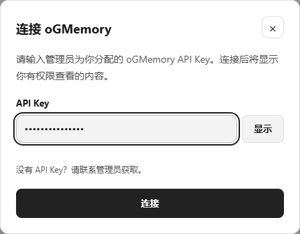
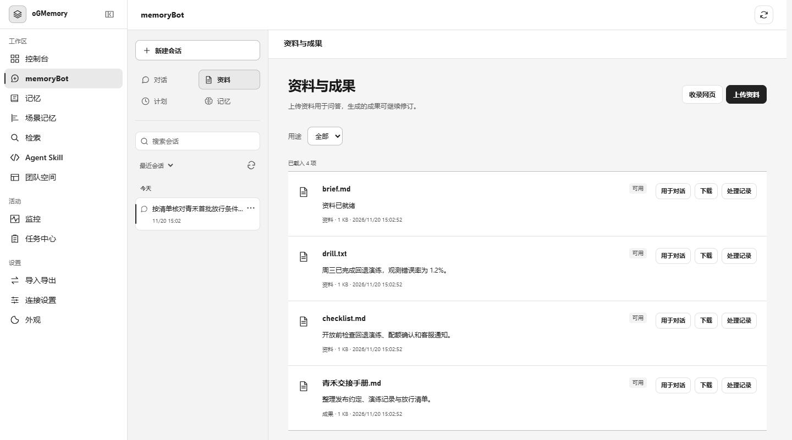
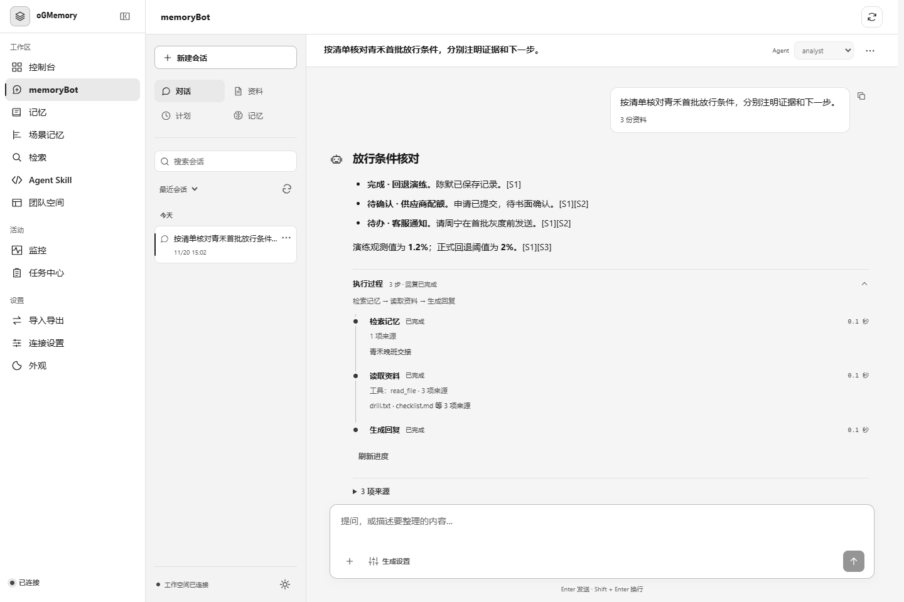
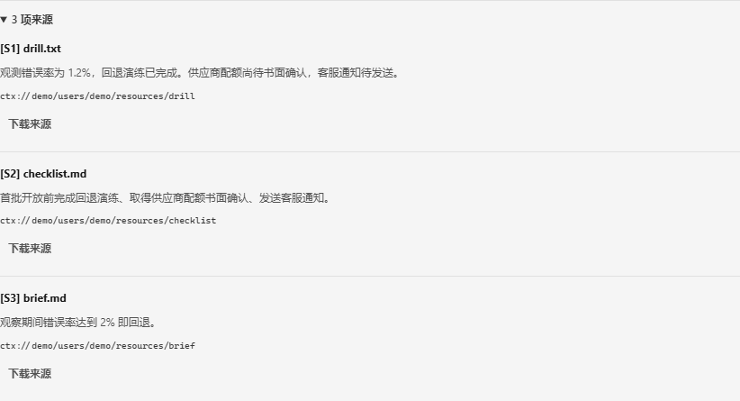
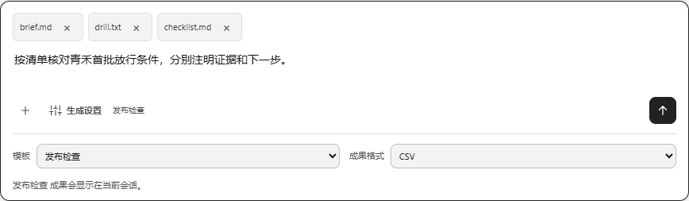
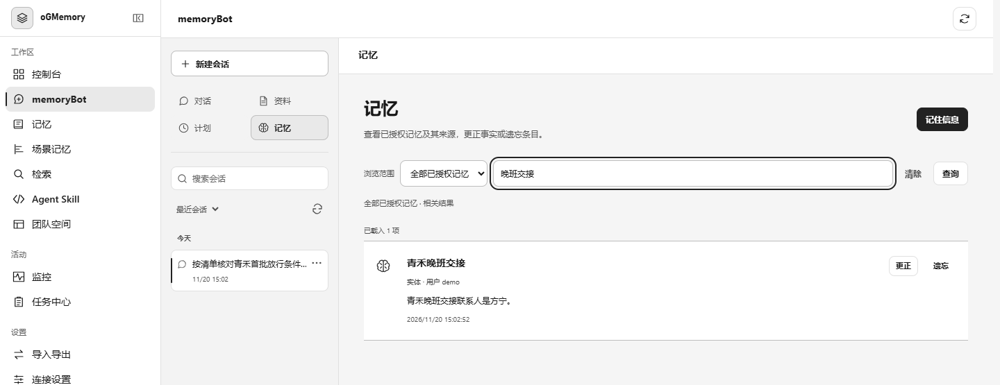
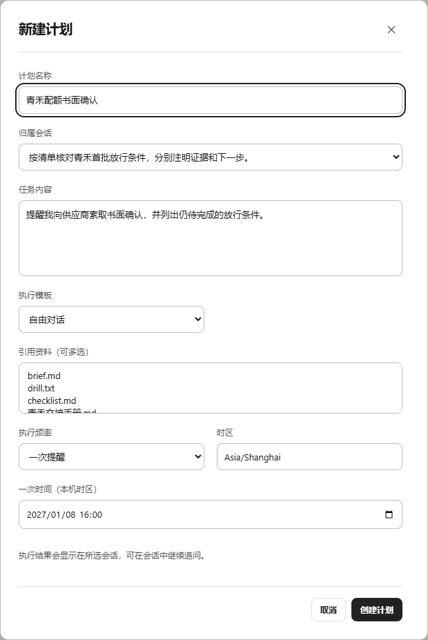
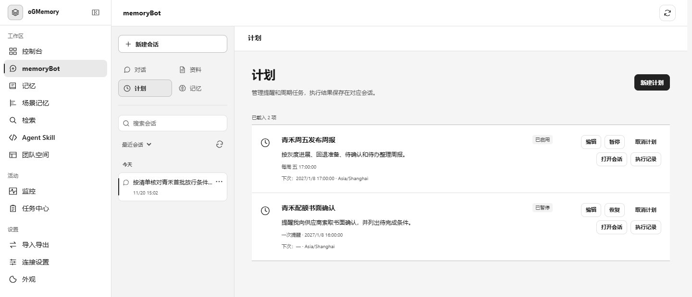

# memoryBot 特性说明与使用指南

## 1. 功能概览

memoryBot 是 oGMemory 前台内置的长期记忆助手。你可以让它记住决定，在新会话中找回依据，把资料整理成可下载的文件，再安排下次跟进。

| 特性能力 | 使用场景 | 预期结果 | 操作案例 |
|---|---|---|---|
| 跨会话问答 | 告诉它“请记住，青禾发布由林悦负责”。等记忆可用于后续问答后，新建会话问“谁负责青禾发布？” | 回答负责人，可展开来源核对原话 | [跨会话决策检索](#跨会话问答在新会话中召回发布决策及其依据) |
| 资料问答 | 上传 TXT、Markdown、CSV，或收录公开网页，选入会话后提问 | 针对资料内容的答复、来源引用和可下载原件 | [发布放行条件核对](#多资料问答引用三份资料逐项核对放行条件) |
| 撰写与修订 | 用周报、交接稿、多资料手册或发布检查模板整理资料，再选中已有成果提出修改要求 | 可下载的稿件。多资料手册按来源分章，修订稿保留与原稿的关联 | [成果生成与修订](#成果生成与修订用同一组资料生成四种成果并保留手册原稿) |
| 表格汇总 | 选择费用表，按部门分组汇总金额 | 每个部门的小计和总计，可下载 CSV 或 Markdown | [前台费用核对](#csv-分组统计合并冲销记录并计算各部门净额) · [HTTP 对账](#批量费用汇总通过-http-提交两份账单并下载汇总表) |
| 提醒与周期任务 | 指定一次提醒、固定间隔或每周计划，例如每周五生成周报 | 到点后结果进入指定会话，可追问、查看执行记录、暂停或调整计划 | [一次催办](#一次性提醒到时在指定会话中催办配额确认) · [维护周期计划](#周期任务调度定时生成周报并管理执行时间) |
| 维护记忆 | 查询事实、查看归属和来源，更正负责人，遗忘旧条目或明确重新记住 | 后续问答使用更新后的有效记忆 | [更正、遗忘与重新记住](#长期记忆维护更正联系人遗忘并重新记住临时约定) |
| 管理会话与任务 | 搜索、重命名、归档或恢复会话，展开回复的执行过程，按需停止任务 | 刷新后仍能查看历史消息、引用与成果 | [查找归档会话](#跨会话问答在新会话中召回发布决策及其依据) · [停止与核对](#任务控制停止生成或核对待确认任务的结果) |
| 共用业务模板 | 管理员通过 oGMemory 的 Agent Skill 发布整理要求 | 获授权用户可在前台、HTTP 或 CLI 选择同一模板 | [自定义模板发布与调用](#自定义模板发布检查清单并按授权调用) |

**检索范围。** “我的记忆”读取本人空间，包括本人会话的原文与摘要。“全部已授权记忆”还可检索已获授权的 Agent 空间。归档会话会将其收入“已归档”列表，原文与摘要仍可作为后续问答的来源。

**多实例使用。** 同一用户可通过不同接入实例继续会话、查看任务和下载成果。执行实例退出后，其他实例可接续任务。同一个计划触发时间只创建一次执行任务。[执行节点接管](#跨实例任务接续执行节点退出后继续生成同一份手册)

前台、HTTP 和 CLI 共用用户身份。同一用户可以在不同入口继续会话或下载成果。[CLI 续接会话与修订手册](#跨入口会话接续用-cli-修订前台手册并核对原稿关联)

## 2. 配置与部署

### 单机与多实例部署

| 部署方式 | 服务配置 | 适用场景 |
|---|---|---|
| 单机 | 在同一台主机运行一个 oGMemory HTTP 服务和一个 memoryBot 执行服务 | 个人使用或小团队共用 |
| 多实例 | 多个 HTTP 实例接在同一服务地址后，分别启动一个或多个执行实例。所有实例使用同一数据库、用户注册表和 AGFS 文件挂载 | 多人并发，希望实例退出后其他实例接续工作 |

| 记忆部署 | 记忆正文 | 检索索引 | Bot 会话、计划和任务 |
|---|---|---|---|
| `storage.backend: sql` | openGauss | 同库 openGauss | 同库 SQL 表 |
| `storage.backend: agfs` | 沿用现有 AGFS 挂载 | 沿用 `vector_db` 指定的向量数据库 | `storage.connection_string` 指定的 SQL 表 |

上传原件、解析正文和生成文件均通过 `bot.files` 指定的 AGFS 挂载保存。多实例共享 Bot 状态库、向量数据库和相关 AGFS 挂载。

### memoryBot 启用条件与配置项

在已经可以写入和检索记忆的 oGMemory 部署上操作。管理员先启用角色控制，配置管理凭据，为使用者分配用户 API Key 和可访问的 Agent。

1. 在应用目录安装依赖，运行 `uv sync --extra bot`。
2. 核对 `ogmem.yaml` 中的配置。下表列出需要合并的字段，保留现有业务配置。

   | 配置项 | 取值要求 |
   |---|---|
   | `auth.role_control_enabled` | `true`，沿用已配置的 `auth.root_api_key` 或 `auth.admin_api_keys` |
   | `storage.backend` | `sql` 或 `agfs`，沿用部署的记忆正文存储 |
   | `storage.connection_string` / `storage.dialect` | 提供 Bot 状态库连接配置及方言。使用 openGauss 时，数据库采用 `PG` 兼容模式 |
   | `vector_db` | SQL 路径配置同库 openGauss。AGFS 路径沿用现有向量库配置，状态库可独立配置 |

3. 添加以下 `bot` 配置，将示例域名替换为服务地址。`mount_prefix` 填 AGFS 实际对外提供的挂载路径。数据库账号需要在首次启动时创建业务表和索引的权限。

```yaml
bot:
  enabled: true
  files:
    backend: agfs
    base_url: https://agfs.example.com
    mount_prefix: /memorybot
```

在 AGFS 配置中将插件的 `path` 设为同一挂载路径，按文件保存方式选择插件。`bot.files.base_url` 指向 AGFS 的 HTTP 服务地址。即使 oGMemory 的核心存储使用原生 AGFS 模式，memoryBot 工作文件仍通过该地址读写。

| 文件保存方式 | AGFS 配置 |
|---|---|
| 持久目录或共享卷 | 使用 `plugins.localfs`，将 `config.local_dir` 指向持久目录。多个 AGFS 实例使用同一共享卷 |
| S3 兼容对象存储 | 使用 `plugins.s3fs`，设置 `config.endpoint`、`bucket`、`prefix` 和 `region`。各 AGFS 实例访问同一桶和前缀，设置 `cache_enabled: false` |

### 服务启动

**单机。** 先启动 openGauss 和配置好的 AGFS。在应用目录分别打开两个终端，两个命令都使用同一份 `ogmem.yaml`。

```bash
# 终端一，启动 HTTP 服务和前台
uv run ogmem start local -d -c ./ogmem.yaml
```

```bash
# 终端二，运行后台任务和定时计划
uv run ogmem bot worker -c ./ogmem.yaml
```

**多实例。** 在每个接入节点启动 HTTP 服务，通过同一负载均衡地址提供访问。在每个执行节点启动执行进程。各节点使用同一数据库和共享文件存储。

```bash
# 接入节点，Linux
export OGMEM_CONFIG=/etc/ogmemory/ogmem.yaml
uv run gunicorn -c python:server.gunicorn_config -w 2 --threads 16 -b 0.0.0.0:8090 server.app:app
```

```bash
# 执行节点
uv run ogmem bot worker -c /etc/ogmemory/ogmem.yaml
```

在 `bot` 下可分别设置 `worker_concurrency`、`cluster_concurrency`、`tenant_concurrency`，控制每个执行进程、整个集群及单个租户的并发数。两种部署都从服务地址的 `/memory-viewer/#bot` 打开前台，从 `/api/v1/bot` 接入 HTTP 或 CLI。

### 数据库与共享文件的备份恢复

暂停写入及执行服务，等待当前事务完成。为每个租户导出文件清单，在同一时间窗口备份 openGauss，并对 AGFS 的共享卷或对象存储留存文件副本，再恢复服务。将数据库、共享文件和清单恢复到对应位置后，用恢复配置校验，再启动执行服务。

```bash
uv run ogmem bot backup export -c ./ogmem.yaml --account-id '<租户编号>' --backup-id '<备份编号>' --manifest ./files.json
uv run ogmem bot backup verify -c ./restored.yaml --manifest ./files.json
```

`verified=true` 表示清单所列文件已通过大小和摘要校验。备份保留期结束后，可执行 `uv run ogmem bot backup release -c ./ogmem.yaml --manifest ./files.json` 解除此次文件保护。

## 3. 操作指南与应用案例

以下案例围绕同一次“青禾发布”。发布负责人需要决定能否开始灰度，值班人需要拿到交接稿，财务需要核对费用，下一班还要跟进未完成事项。前台、HTTP、CLI 示例可分别体验，也可以用同一用户接续前一步的会话。

### 发布案例与示例数据

将前三行分别保存为对应的 UTF-8 文件。下文凡引用这些文件，均以此处内容为准。

| 文件 | 完整内容 |
|---|---|
| `brief.md` | 青禾发布由林悦协调，陈默负责灰度。周五 10:00 开放首批 20%，观察 30 分钟。观察期间错误率达到 2% 即回退。采用分批发布，是为先观察付款回调重试。 |
| `drill.txt` | 周三演练记录：观测错误率为 1.2%，回退演练已完成，陈默已保存记录。供应商配额申请已提交，尚待书面确认。客服通知待发送，周宁负责。 |
| `checklist.md` | 青禾首批开放前，由林悦汇总三项结果：完成回退演练、取得供应商配额书面确认、发送客服通知。 |

费用分为原始入账和随后收到的调整单。两表第一列都是部门，第二列都是金额。保留负号，按同一币种计算。

**`expenses.csv`**

```csv
部门,金额
研发,1200.00
运营,300.50
研发,180.25
客服,99.90
```

**`adjustments.csv`**

```csv
部门,金额
研发,-80.25
运营,49.50
客服,-9.90
```

### 3.1 前台操作

打开 oGMemory 前台，点 **连接设置**，填入管理员分配的用户 API Key，点 **连接**。连接后从左栏进入 **memoryBot**。窄屏下点对话区顶部的 **会话**，展开会话列表与功能导航。



*在连接设置中输入用户 API Key，连接后进入 memoryBot。*

多份资料可逐份通过 **资料 → 上传资料 → 选择文件 → 上传并处理** 添加。资料显示 **可用** 后点 **用于对话**。每次选择后会回到对话，继续到 **资料** 选择下一份。发送前核对输入框上方的附件名。



*点右上角上传资料。处理完成后，从各行选择用于对话、下载或查看处理记录。*

#### 跨会话问答（在新会话中召回发布决策及其依据）

1. 点 **新建会话**，选择已授权 Agent，点右上角 **会话设置**，名称填“青禾发布决策”，记忆范围选 **我的记忆**。发送：“请记住，青禾由林悦负责。周五 10 点先开放 20%，观察 30 分钟，因为要先看付款回调重试。陈默负责灰度。”
2. 回复出现后展开 **执行过程**，等到 **记忆可用于后续问答**。在会话列表点 **… → 归档会话**，再点 **新建会话**。新会话命名为“青禾发布交接”。
3. 在新会话只问：“接着青禾上次的决定写一条值班便笺。几点开始、谁看灰度、为什么分批、多久后复核？”核对回答中的 **周五 10:00、陈默、付款回调重试、30 分钟**，再展开 **N 项来源** 阅读对应记录。这样可以区分“当时决定的原因”和事后的推测。
4. 要查原话，在会话列表将 **最近会话** 切为 **已归档**，搜索“青禾发布决策”，打开原会话。点 **… → 恢复会话** 可继续使用原讨论。

**授权范围检索（区分本人记忆与 Agent 经验）。** 如果所选 Agent 已有一条你获准读取的灰度处置经验，在 **记忆** 页选择 **全部已授权记忆**，用该经验中的特有词查询，查看条目的 Agent 归属。切回 **我的记忆**，用“青禾”查本人决定，查看用户归属。要在问答中同时使用两类背景，新建会话，在首次发送前用 **会话设置 → 记忆范围** 选择 **全部已授权记忆**，问“结合已记录的处置经验，列出这次灰度要观察的事项，并分别注明决定和建议的依据”。

#### 多资料问答（引用三份资料逐项核对放行条件）

打开“青禾发布交接”，选入 `brief.md`、`drill.txt` 和 `checklist.md`，在 **生成设置 → 自由对话** 输入下列要求。

> 根据发布约定和周三演练记录，按清单给我一张放行表。每行写条件、当前证据、状态和下一步。最后区分演练观测值与正式回退阈值，注明各自来源。

| 核对事项 | 判断依据 | 来源文件 |
|---|---|---|
| 是否演练过回退 | **完成**。陈默已保存演练记录 | `drill.txt` |
| 供应商配额是否已获确认 | **待确认**。现有证据是已提交申请，下一步是取得书面确认 | `drill.txt`、`checklist.md` |
| 谁需发客服通知 | **待办**。周宁负责发送 | `drill.txt` |
| 是否触发正式回退条件 | **1.2%** 是周三演练观测值，**2%** 是正式灰度的回退阈值。判断正式灰度是否触发回退，还需当时的实际观测值 | `drill.txt`、`brief.md` |



*在回复下方展开执行过程，查看本次读取的资料和各步骤状态。*



*点三项来源，按回复中的 S1、S2、S3 查证对应原文，也可下载引用资料。*

**网页收录与引用（对照公开公告和内部申请记录）。** 在 **资料 → 收录网页** 填入业务允许访问的一份公开供应商公告，点 **收录**。就绪后将公告和 `drill.txt` 一起 **用于对话**，问“公告说明了哪些通用配额规则？我们的申请进度是什么？各给一条原文依据。”在回复的来源区打开对应原文或下载来源，核对公告与申请记录各自支持哪项结论。把这两份证据区分开，才知道是否该继续催办。

#### 成果生成与修订（用同一组资料生成四种成果并保留手册原稿）

继续使用上述三份资料。每次生成前重新选入附件，在 **生成设置** 选择对应模板。可先做手册及修订，再按需要体验其他三种输出。

| 使用对象 | 模板与示例指令 | 成果核对要点 |
|---|---|---|
| 发布负责人 | **周报**：“按已完成、风险、下周行动整理，每项保留负责人和依据。” | 回退演练在已完成中，配额确认和客服通知列为后续行动。下载 Markdown |
| 下一班值班人 | **交接稿**：“开头写接班后先做哪两件事，再写灰度窗口、阈值和联系人。” | 接班人知道先核实书面配额、找周宁确认通知，再按 20% 和 30 分钟观察。正文可回查材料 |
| 首次参与的同事 | **多资料手册**：“每份资料独立成章，在目录后解释约定、演练和清单之间的关系。” | 展开 **执行过程** 查看逐份进度。下载 Markdown，核对三个来源都有对应章节，演练结果与正式条件分开 |
| 发布评审人 | **发布检查**，成果格式选 **CSV**：“按清单逐项输出条件、状态、依据。” | 下载的表包含三项条件。与上一案例的放行表逐项对照，能定位每个判断的来源 |



*展开生成设置，选发布检查和 CSV，核对附件后发送。*

**成果修订（核对新旧手册的关联）。** 在 **资料 → 用途 → 成果** 找到刚生成的手册，点 **用于对话**，切换至 **自由对话**，发送：“保留三个来源章节，在开头增加接班行动表，列事项、负责人、完成依据。供应商配额的当前进度写‘待书面确认’。”下载修订稿，看行动表是否移到开头、三个章节是否保留。回到成果列表，新卡片显示 **修订自** 和原文件编号。分别下载两版即可比对。

#### CSV 分组统计（合并冲销记录并计算各部门净额）

1. 在新的“青禾费用”会话只选 `expenses.csv`，点 **生成设置 → CSV 分组统计**，成果格式选 **CSV**，发送“按部门汇总初账”，下载保存为 `initial.csv`。初账总计为 **1,780.65**。
2. 分别从资料卡把 `expenses.csv`、`adjustments.csv` 选入输入框，仍选 **CSV 分组统计**，发送“合并原始入账与调整单，按部门生成最终账单”。下载为 `final.csv`。
3. 对照下表。**调整额合计为 −40.65**。若结果正好是 −40.65，应先检查输入框所选附件是否只有调整单，再用两份源文件重新生成。

| 部门 | 初账 | 调整 | 最终 |
|---|---:|---:|---:|
| 研发 | 1,380.25 | −80.25 | 1,300.00 |
| 运营 | 300.50 | +49.50 | 350.00 |
| 客服 | 99.90 | −9.90 | 90.00 |
| **总计** | **1,780.65** | **−40.65** | **1,740.00** |

#### 长期记忆维护（更正联系人、遗忘并重新记住临时约定）



*在记忆页选定范围并查询，再从匹配条目右侧进入更正或遗忘。*

| 业务变化 | 前台操作 | 结果核对 |
|---|---|---|
| 晚班交接联系人由方宁换成许青 | **记忆 → 记住信息**，保存“青禾晚班交接联系人是方宁”。可查询后用“晚班交接”搜索，打开该条目的 **更正**，填写“青禾晚班交接联系人改为许青”，保存 | 等记忆更新后，在新会话问“青禾晚班交接应该找谁？”答复应为许青。发布负责人和灰度负责人仍按各自记录回答 |
| 演练结束，撤下临时集合点 | 用 **记住信息** 保存“青禾演练临时集合点是南门”。查询该事件，点可遗忘条目的 **遗忘**。先复制弹窗显示的原记忆 URI，再点 **确认遗忘** | 确认前阅读弹窗中对后续问答、上下文与自动整理的影响说明。完成回执应显示“已遗忘这条记忆，原始资料保留。” |
| 下周复演，明确恢复这项安排 | **记住信息** 的“信息内容”填“下周青禾复演的集合点确定为南门”，将刚才复制的地址填入 **重新记住的原记忆 URI**，点 **保存** | 待记忆可用后，新会话问“下周青禾复演在哪里集合？”核对“南门”及对应的新确认内容 |

#### 会话管理（按标题查找交接会话并重看执行记录）

在会话列表搜索“青禾发布交接”，用 **… → 重命名** 将标题改为“青禾发布交接·晚班”。刷新后重新打开，展开手册回复的 **执行过程**，对照来源数、逐份处理结果和最终文件。后续 CLI 案例按会话标题查找，使用改名后的实际标题。

#### 任务控制（停止生成或核对待确认任务的结果）

在另一条草稿会话提交多资料手册，生成期间点输入框的 **停止**。展开执行过程查看停止状态，重新选入正确的资料再发送。资料处理中的后台任务从资料卡 **处理记录 → 执行过程 → 停止任务** 操作。任务显示 **待核对** 时，点 **核对结果** 查询原操作的结果。对话显示 **记忆待核对** 时，展开 **执行过程**，选择 **核对记忆** 或 **停止记忆整理**。核对成功并完成索引后，状态变为 **记忆可用于后续问答**。

#### 一次性提醒（到时在指定会话中催办配额确认）

点 **计划 → 新建计划**，名称填“青禾配额书面确认”，**归属会话** 选改名后的“青禾发布交接·晚班”，任务内容填“提醒我向供应商索取书面确认，并列出仍待完成的放行条件”。**执行频率** 选 **一次提醒**，填一个未来时间，点 **创建计划**。到点后从计划卡点 **执行记录**，点这次执行即可进入会话追问。也可直接从计划卡点 **打开会话**。每周出稿和固定间隔跟进见[周期计划](#周期任务调度定时生成周报并管理执行时间)。



*新建计划时选择通知要进入的会话，核对执行频率、时区和执行时间后创建。*



*在计划列表查看下次执行时间，从执行记录回到所属会话。*

### 3.2 HTTP API 调用

准备好 curl 和 jq，在存放示例资料的目录打开 Bash，设置服务地址和用户 API Key，选取已授权的 Agent。下面两个案例可分别执行。

```bash
set -euo pipefail
export OGMEM_HTTP_BASE_URL='https://memory.example.com'
export OGMEM_BOT_API_KEY='<用户 API Key>'
ROOT=$(printf '%s' "$OGMEM_HTTP_BASE_URL" | sed 's:/$::')
API="$ROOT/api/v1/bot"
AUTH="Authorization: Bearer $OGMEM_BOT_API_KEY"
RUN_ID="$(date +%s)-$$"
get() { curl -fsS -H "$AUTH" "$API$1"; }
post() {
  curl -fsS "$API$1" -H "$AUTH" -H 'Content-Type: application/json' \
    -H "Idempotency-Key: $RUN_ID-$2" --data-binary "$3"
}
AGENT_ID=$(get /agents | jq -er '.data.default_agent_id')
AGENT_Q=$(jq -rn --arg id "$AGENT_ID" '$id|@uri')
SESSION_ID=$(post /sessions session "$(jq -n --arg a "$AGENT_ID" \
  '{title:"青禾发布",agent_id:$a,scope:{memory_scope:"user",resource_ids:[]}}')" \
  | jq -er '.data.session_id')
```

会话创建成功返回 `201`。上传和消息提交返回 `202`，任务在后台运行。下面两个函数用于等待结果和上传资料。同一次写操作重试时沿用 `RUN_ID` 与操作名，新操作使用新名称。

```bash
wait_task() {
  local id=$1 row state deadline=$((SECONDS + 1000))
  while (( SECONDS < deadline )); do
    row=$(get "/tasks/$id" | jq -ec '.data') || return 1
    state=$(jq -r '.state' <<<"$row")
    case "$state" in
      succeeded) printf '%s\n' "$row"; return 0 ;;
      failed|cancelled|waiting_confirmation)
        jq '{task_id,state,error,confirmation}' <<<"$row" >&2; return 1 ;;
    esac
    sleep 2
  done
  printf '可继续查询任务 %s\n' "$id" >&2; return 1
}
upload() {
  local receipt
  receipt=$(curl -fsS "$API/files?agent_id=$AGENT_Q" -H "$AUTH" \
    -H "Idempotency-Key: $RUN_ID-upload-$2" -F "file=@$1") || return 1
  wait_task "$(jq -er '.data.task.task_id' <<<"$receipt")" >/dev/null || return 1
  jq -er '.data.file.file_id' <<<"$receipt"
}
```

#### 批量费用汇总（通过 HTTP 提交两份账单并下载汇总表）

`expenses.csv` 是青禾发布的原始费用，`adjustments.csv` 是补录和冲销。两表均以部门为第一列、金额为第二列，冲销行使用负数。分别上传，在同一条任务里传入两个文件编号。

```bash
EXPENSE_ID=$(upload expenses.csv expenses)
ADJUST_ID=$(upload adjustments.csv adjustments)
RECON_TASK=$(post "/sessions/$SESSION_ID/tasks" reconcile \
  "$(jq -n --arg e "$EXPENSE_ID" --arg a "$ADJUST_ID" \
    '{text:"合并两批费用，按部门对账，计入补录和负数冲销",file_ids:[$e,$a],template_id:"csv_summary",output_format:"csv"}')" \
  | jq -er '.data.task_id')
RECON=$(wait_task "$RECON_TASK")
CSV_ID=$(jq -er '.result.file_ids[0]' <<<"$RECON")
curl -fsS -H "$AUTH" "$API/files/$CSV_ID/content" -o reconciliation.csv
cat reconciliation.csv
```

下载结果应包含 **研发 1300.00、运营 350.00、客服 90.00，总计 1740.00**。要核对某笔冲销，可用原始上传编号访问 `GET /api/v1/bot/files/{file_id}/content` 下载对应批次。

#### 自定义模板（发布检查清单并按授权调用）

青禾发布复核需要三份证据。`checklist.md`列出检查项，`drill.txt`记录演练结果，`brief.md`给出负责人和时限。每次选入 Markdown 清单，再附上相关证据。模板接受 1 至 5 份 Markdown 或纯文本资料。

将以下声明和整理要求保存为 `SKILL.md`。技能名 `release-review` 用于发布和更新，模板编号 `release_review` 用于提交任务。

```markdown
---
name: release-review
description: 依据清单、演练记录和发布约定复核发布准备情况
memorybot_template:
  id: release_review
  name: 发布清单复核
  input: {text_required: true, file_min: 1, file_max: 5, accepted_mime_types: [text/markdown, text/plain]}
  output: {formats: [markdown], mime_types: [text/markdown]}
  permission_requirements:
    - {action: memory.read, scope: user}
    - {action: resource.read, scope: user}
    - {action: file.write, scope: user}
    - {action: tool.execute, scope: read_memory}
  tools: [read_memory]
---
按上传的 Markdown 清单逐项复核。结合演练记录和发布约定，输出“检查项、状态、依据、负责人、时限”表。
状态使用“完成、待办、待确认”。缺少事实依据时标待确认。每条依据注明资料名及对应来源编号，如 [S1]。
```

由有技能发布权限的账户发布到同一 Agent。首次发布返回 `201`。更新已发布内容时使用 `PUT /api/v1/skills/release-review?agent_id=…`，报文相同。再用普通用户的凭据查询可用模板。

```bash
export OGMEM_SKILL_PUBLISHER_KEY='<有技能发布权限的 API Key>'
jq -Rs '{data:.}' SKILL.md | curl -fsS "$ROOT/api/v1/skills?agent_id=$AGENT_Q" \
  -H "Authorization: Bearer $OGMEM_SKILL_PUBLISHER_KEY" \
  -H 'Content-Type: application/json' --data-binary @- | jq '{name,action,version}'
TEMPLATE=$(get "/templates?agent_id=$AGENT_Q&memory_scope=user&q=release_review&output_format=markdown" \
  | jq -ec '.data.items[] | select(.id=="release_review")')
jq '{id,name,input,output,permission_requirements}' <<<"$TEMPLATE"
```

用户应看到“发布清单复核”和约定的输入格式。任务按用户授权、会话范围和模板声明共同允许的范围取材。提交清单、演练记录和发布约定，下载复核表。

```bash
CHECK_ID=$(upload checklist.md checklist)
DRILL_ID=$(upload drill.txt drill)
BRIEF_ID=$(upload brief.md brief)
REVIEW_TASK=$(post "/sessions/$SESSION_ID/tasks" review \
  "$(jq -n --arg c "$CHECK_ID" --arg d "$DRILL_ID" --arg b "$BRIEF_ID" \
    --arg t "$(jq -er '.id' <<<"$TEMPLATE")" \
    '{text:"复核青禾发布清单，区分已完成、待办和缺少证据的事项",file_ids:[$c,$d,$b],template_id:$t,output_format:"markdown"}')" \
  | jq -er '.data.task_id')
REVIEW=$(wait_task "$REVIEW_TASK")
REVIEW_ID=$(jq -er '.result.file_ids[0]' <<<"$REVIEW")
curl -fsS -H "$AUTH" "$API/files/$REVIEW_ID/content" -o release-review.md
jq -r '.result.citations[] | [.id,.title,.uri,.quote] | @tsv' <<<"$REVIEW"
```

**检查结论与引用核对。** 从表中选一个“完成”项，在回显中找到它标注的来源编号。按该条 `uri` 读取原文，对照演练结论、负责人或时限。资料尚缺的检查项应列为“待确认”。下面默认打开第一条引用，也可将 `CITED_URI` 设为其他条目的地址。

```bash
CITED_URI=$(jq -er '.result.citations[0].uri' <<<"$REVIEW")
curl -fsSG "$API/memories" -H "$AUTH" --data-urlencode "agent_id=$AGENT_ID" \
  --data-urlencode "uri=$CITED_URI" | jq '.data.items[] | {title,text,source_refs}'
```

**模板共享（授权用户从前台或 CLI 调用同一模板）。** 同事用获授权的用户密钥进入同一 Agent，上传自己的三份资料，在 **生成设置** 选择 **发布清单复核**。从 CLI 也可查看并使用同一模板。以下命令沿用上文当前用户已上传的文件编号。

```bash
uv run ogmem bot template list --agent-id "$AGENT_ID" --memory-scope user --query release_review
uv run ogmem bot chat "$SESSION_ID" '根据清单制作下一班的三项放行表' \
  --template-id release_review --file-id "$CHECK_ID" --file-id "$DRILL_ID" --file-id "$BRIEF_ID" --follow
```

| 后续操作 | 调用与回显 |
|---|---|
| 边生成边显示 | `GET /api/v1/bot/tasks/{task_id}/events` 返回 SSE。重连携带最后收到的 `Last-Event-ID: {task_id}:{event_seq}`。收到 410 时，按[设计说明](memorybot-design.md)第 5.4 节读取快照并恢复 |
| 修订生成的复核表 | 向同一会话提交 `{"text":"在开头加入待办摘要","file_ids":["旧成果编号"]}`。读取新成果详情，`previous_file_id` 指向旧稿 |
| 停止或核对任务 | `POST /tasks/{id}/cancel` 发送 `{}`。从任务详情读取 `confirmation.operation_id`。自动记忆整理从对话详情的 `pending_memory_confirmations` 读取子任务编号和确认信息。向待确认任务的 `POST /tasks/{id}/confirm` 发送 `{"operation_id":"原编号","decision":"recheck"}`。两个路径均位于 `/api/v1/bot` 下 |

### 3.3 命令行操作（CLI）

#### 跨入口会话接续（用 CLI 修订前台手册并核对原稿关联）

沿用前台同一用户的 API Key。在 Bash 中设置 `OGMEM_HTTP_BASE_URL` 为服务地址、`OGMEM_BOT_API_KEY` 为用户密钥。下面用 `jq` 取出服务返回的真实编号。

**通过 CLI 创建会话与手册初稿**

在案例文件所在目录运行。三份资料全部就绪后提交初稿。如果中途失败，终端会显示需要检查的文件和已就绪数量。

```bash
bot() { uv run ogmem bot "$@"; }
AGENT=$(bot agent list | jq -er '.data.default_agent_id')
SID=$(bot session create '青禾发布交接' --agent-id "$AGENT" | jq -er '.data.session_id')
SOURCE_FILES=(brief.md drill.txt checklist.md)
INPUTS=()
for name in "${SOURCE_FILES[@]}"; do
  upload=$(bot file upload "$name" --agent-id "$AGENT") || break
  file=$(jq -er '.data.file.file_id' <<<"$upload") || break
  task_id=$(jq -er '.data.task.task_id' <<<"$upload") || break
  bot task events "$task_id" >/dev/null || break
  bot file show "$file" | jq -e '.data.state=="ready"' >/dev/null || break
  INPUTS+=(--file-id "$file")
done
READY_FILES=$(( ${#INPUTS[@]} / 2 ))
if (( READY_FILES == ${#SOURCE_FILES[@]} )); then
  bot chat "$SID" '按来源分章整理青禾交接手册，保留灰度阈值及待办。' \
    --template-id handbook "${INPUTS[@]}" --follow
else
  printf '资料未就绪：%s（已就绪 %d/%d 份）。请检查文件或处理记录后重试。\n' \
    "$name" "$READY_FILES" "${#SOURCE_FILES[@]}" >&2
fi
```

```bash
bot() { uv run ogmem bot "$@"; }
bot session list --query '青禾发布交接' | jq -r '.data.items[] | [.title,.agent_id,.session_id] | @tsv'
read -rp '选择前台会话编号：' SID
HISTORY=$(bot session show "$SID" --history-order desc --limit 100)
jq -r '.data.messages[] | select(.input.template_id=="handbook" and .state=="succeeded") | [.seq,.task_id,.result.file_ids[0]] | @tsv' <<<"$HISTORY"
read -rp '选择要修订的手册任务编号：' BOOK_TASK
BOOK=$(jq -ec --arg t "$BOOK_TASK" '.data.messages[] | select(.task_id==$t)' <<<"$HISTORY")
OLD=$(jq -er '.result.file_ids[0]' <<<"$BOOK")
FILES=()
while read -r id; do
  bot file show "$id" | jq -c '.data | {name,file_id,state}'
  FILES+=(--file-id "$id")
done < <(jq -r '.input.file_ids[]' <<<"$BOOK")
```

确认列出 `brief.md`、`drill.txt`、`checklist.md`，三份均为 `ready`。手册在更早的历史页时，用响应的 `data.next_cursor` 作为 `session show --cursor` 的值继续查。接着在原会话提问，再把原稿和三份依据一起交给修订任务。

```bash
bot chat "$SID" '接着上次的发布交接，灰度谁负责？首批放量多少？演练观测值与回退阈值分别是多少？请列出处。' "${FILES[@]}" --follow
REV=$(bot chat "$SID" '修订原手册，在开头加值班交接表：发布负责人、灰度负责人、首批比例、回退阈值与演练观测值、演练结果、未决事项。保留逐章来源。' \
  --file-id "$OLD" "${FILES[@]}" --output-format markdown | jq -er '.data.task_id')
bot task events "$REV" >/dev/null
NEW=$(bot task show "$REV" | jq -er '.data | select(.state=="succeeded") | .result.file_ids[0]')
bot file show "$NEW" | jq --arg old "$OLD" '.data | {file_id,previous_file_id,"关联原稿":(.previous_file_id==$old)}'
bot file download "$NEW" -o qinghe-handoff-v2.md
```

打开下载的新稿，发布负责人为林悦，灰度负责人为陈默，首批放量 20%，演练观测值 1.2% 低于回退阈值 2%。回退演练已完成，供应商配额待确认，客服通知待办。`关联原稿` 应为 `true`。回到前台打开同一会话，可看到刚才的问答和新稿。

#### 周期任务调度（定时生成周报并管理执行时间）

沿用刚才的 `SID` 和三份 `FILES`。计划保存文件编号、模板和写作要求，每次触发都会在这个会话产生一条新任务。

```bash
PLAN=$(bot schedule create "$SID" '青禾周五发布周报' \
  '按灰度进展、回退准备、待确认和待办四栏整理；注明负责人、比例及来源。' \
  --template-id weekly_report "${FILES[@]}" --weekdays 5 --local-time 17:00:00 \
  --timezone Asia/Shanghai | jq -er '.data.schedule_id')
bot schedule show "$PLAN" | jq '.data | {state,timezone,rule,next_run_at,"资料":.task_input.file_ids}'
bot schedule update "$PLAN" --weekdays 5 --local-time 16:30:00 --timezone Asia/Shanghai | jq '.data | {rule,next_run_at,revision}'
bot schedule pause "$PLAN" | jq '.data | {state,next_run_at,revision}'
bot schedule resume "$PLAN" | jq '.data | {state,next_run_at,revision}'
bot schedule runs "$PLAN" | jq '.data.items[] | {scheduled_at,state,task_id,"成果":.result.file_ids}'
```

改期后，上海时间每周五 16:30 触发。暂停结果为 `paused` 且 `next_run_at` 为空，恢复后为 `active` 并返回下次执行时间。`scheduled_at` 是计划触发时间，接口以 UTC 显示。首次触发前，执行记录为空；完成后可凭记录里的 `task_id` 查看正文与来源，凭成果编号下载周报。多人同时改期时，可给变更命令加 `--revision`，填刚查到的修订号。

| 计划类型 | 创建命令的时间参数 | 适用场景 |
|---|---|---|
| 固定间隔 | `--interval 3600` | 每小时跟进供应商配额。单位为秒，最短 60 秒 |
| 一次提醒 | `--at '2027-01-08T16:00:00+08:00'` | 将示例替换为未来交接时间。到点在所属会话触发一次，随后计划为 `completed` |

#### 跨实例任务接续（执行节点退出后继续生成同一份手册）

管理员可在独立演练部署中使用这个案例。按第二章配置两个 HTTP 接入地址 A、B，各自连接同一数据库和 AGFS。在同一 Bash 中沿用本节的 `bot`、`SID` 和 `FILES`，用户凭据相同。先只运行执行实例 A，执行实例 B 准备就绪。

```bash
A='https://access-a.example.com'
B='https://access-b.example.com'
T1=$(bot --base-url "$A" chat "$SID" '逐份整理青禾手册，保留每章依据。' \
  --template-id handbook "${FILES[@]}" | jq -er '.data.task_id')
T2=$(bot --base-url "$B" chat "$SID" '接着手册，列出两项仍需跟进的事情。' | jq -er '.data.task_id')
bot --base-url "$A" task show "$T1" | jq '.data | {task_id,seq,state,last_event_seq,steps}'
```

1. **在 A 观察。** 手册仍在执行，且已有一个“生成手册章节”步骤为 `succeeded` 时，记下该步骤的 `step_id`、`finished_at` 和任务的 `last_event_seq`。短资料已全部完成时，可改用较长的手册资料重新体验。
2. **在 B 接续。** 启动执行实例 B，再由管理员用进程管理器中断本次演练中正在运行的执行实例 A。旧租约到期后，B 接续原手册。用户在 B 查询同一任务，从已收到的事件序号继续读取。
3. **检查结果和顺序。** 同一 `step_id` 的完成时间应与接管前一致，手册在原 `T1` 下完成。下一条消息 `T2` 在同一会话中的 `seq` 更大，随后完成。通过两个接入地址下载 `T1` 的同一成果，摘要应相同。

```bash
read -rp '填入 A 上记录的 last_event_seq：' CURSOR
bot --base-url "$B" task events "$T1" --after "$CURSOR" |
  jq -c 'select(.event and .data.event_seq) | [.data.event_seq,.event]'
SNAP=$(bot --base-url "$B" task show "$T1")
jq '.data | {task_id,seq,state,steps:[.steps[] | {step_id,state,finished_at}]}' <<<"$SNAP"
bot --base-url "$B" task events "$T2" >/dev/null
bot --base-url "$B" task show "$T2" | jq '.data | {task_id,seq,state,finished_at}'
OUTPUT=$(jq -er '.data.result.file_ids[0]' <<<"$SNAP")
bot --base-url "$A" file download "$OUTPUT" -o handoff-a.md
bot --base-url "$B" file download "$OUTPUT" -o handoff-b.md
sha256sum handoff-a.md handoff-b.md
```

#### 计划触发去重（两个执行实例对同一到期提醒只生成一次任务）

重新启动执行实例 A，保持 B 运行。按前例在同一会话新建一条未来的一次提醒。到点后分别从 A 和 B 查询 `bot --base-url "$A" schedule runs '<计划编号>'` 与 `bot --base-url "$B" schedule runs '<计划编号>'`。同一个 `scheduled_at` 应各查到同一个 `task_id`，会话中也只有一条对应提醒。
