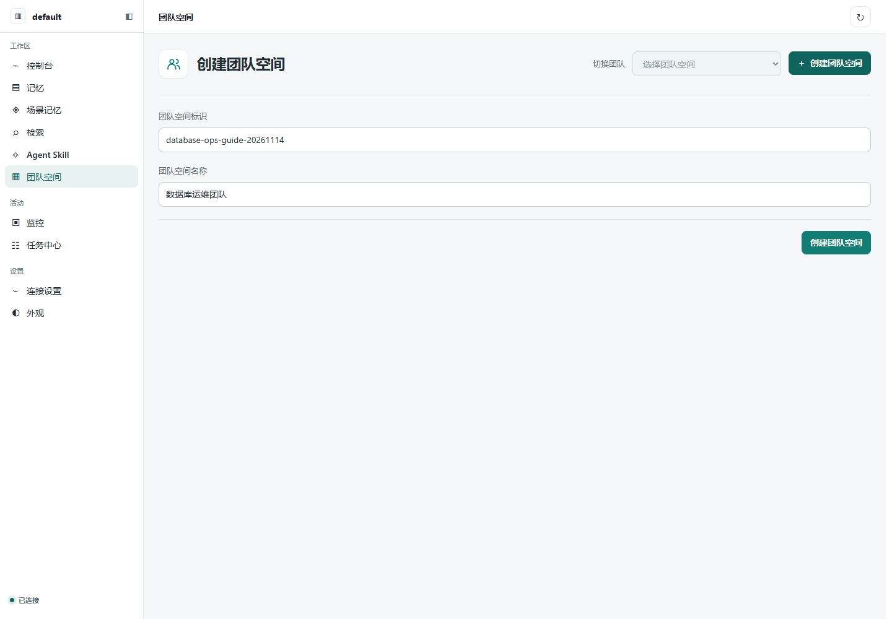
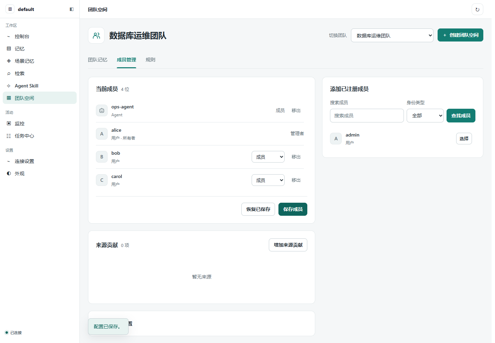
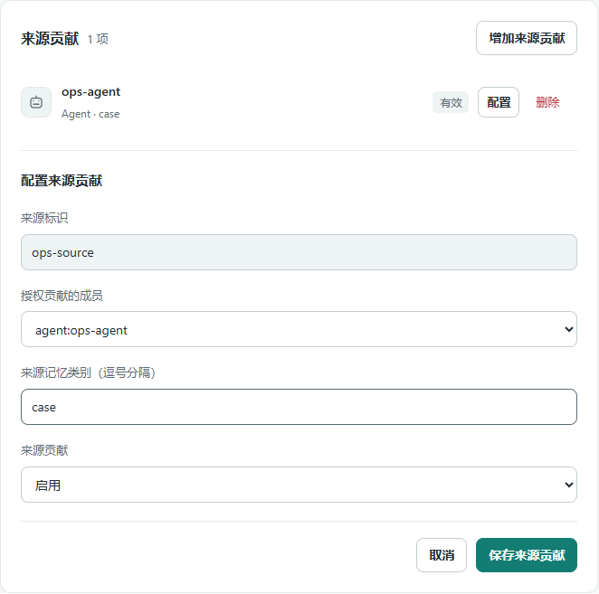
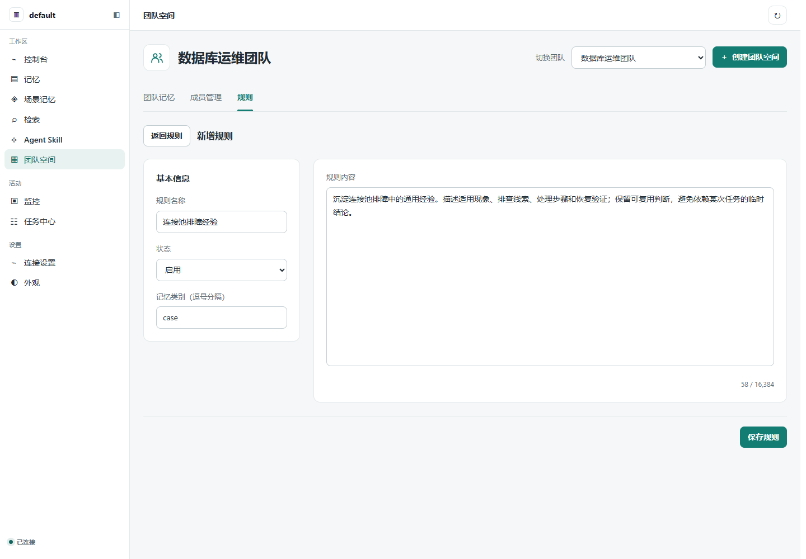
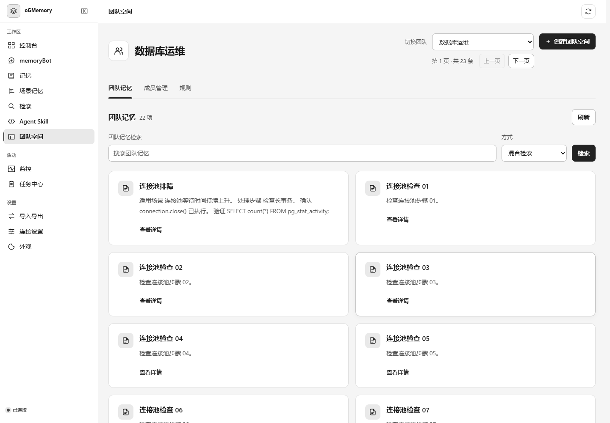
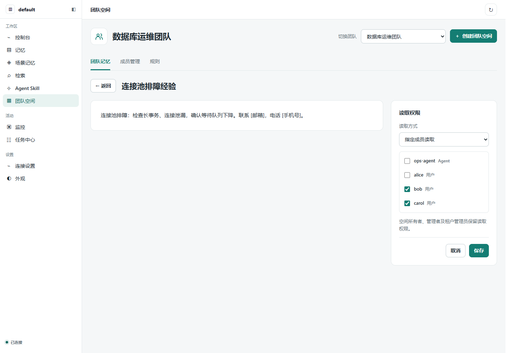

# 团队空间使用指南

团队空间属于租户，成员来自已注册的用户和 Agent。来源所有者授权贡献记忆，系统按规则生成团队记忆，再按成员关系和单条记忆的读取权限返回结果。

“成员管理”决定谁可加入团队；“来源贡献”决定系统可处理哪些记忆；“团队记忆”详情里的“读取权限”决定谁可读取生成结果。加入团队不会开放成员的原始记忆。

## 配置与启动

先按[快速开始](QUICKSTART.md)安装项目，准备 openGauss、AGFS、生成模型及 Embedding。openGauss 使用 PostgreSQL 兼容模式和已安装的向量能力，向量维数与 Embedding 一致。

在现有 `ogmem.yaml` 中合并以下配置。保留已配置的模型、租户及认证密钥；连接串由环境变量提供：

```yaml
shared_spaces:
  enabled: true
storage:
  backend: agfs
  dialect: opengauss
  pool_size: 5
agfs:
  base_url: http://127.0.0.1:1833
  mount_prefix: /local/plugin
vector_db:
  type: opengauss
  dimension: 1024
  table_name: vector_index
  pool_size: 5
auth:
  role_control_enabled: true
```

```bash
export OGMEM_CONFIG=./ogmem.yaml
export STORAGE_DB_CONNECTION_STRING='host=127.0.0.1 port=5432 dbname=ogmemory user=ogmemory password=YOUR_PASSWORD'
export VECTOR_DB_CONNECTION_STRING="$STORAGE_DB_CONNECTION_STRING"
export OG_ROOT_API_KEY='YOUR_ROOT_KEY'
python -m server.management_app
```

YAML 中的值优先于环境变量。使用上述环境变量时，`storage.connection_string`、`vector_db.connection_string`、`auth.root_api_key` 留空或省略。模型与认证配置详见[配置参考](OGMEMORY_ENV.md)。多副本部署配置相同的 `OGMEM_SPACE_CURSOR_SECRET`，用于签名分页游标。

打开 `http://127.0.0.1:8091/memory-viewer/`，点击“连接设置”，填入当前租户已注册用户的“API Key”，点击“连接”。此管理入口同时提供前台、`/management/spaces`、注册接口和 `/api/spaces/search`。需要独立公共服务时，以相同配置启动 `python -m server.app`，默认端口 `8090`；管理入口通过管理网络或同源网关访问。

openGauss 保存注册目录、权限、任务、节点目录和向量索引，AGFS 保存正文版本。已有 AGFS 部署切换到团队空间时，应将现有身份与节点目录迁入 SQL 控制面，并核对正文版本指针。

## 注册准备

使用已有租户的管理员密钥注册用户和 Agent。请求携带 `X-API-Key`、`Content-Type: application/json`。

| 方法与路径 | 请求体 |
| --- | --- |
| `POST /api/v1/admin/accounts/{account_id}/users` | `{"user_id":"alice","role":"user"}` |
| `POST /api/v1/admin/accounts/{account_id}/users` | `{"user_id":"bob","role":"user"}` |
| `POST /api/v1/admin/accounts/{account_id}/users` | `{"user_id":"carol","role":"user"}` |
| `POST /api/v1/admin/accounts/{account_id}/agents` | `{"agent_id":"ops-agent","owner_user_id":"alice"}` |

用户响应中的 `user_key` 用于连接前台和检索，保存在该用户的私有配置中。Agent 的所有者决定谁可授权其来源。以下示例由 Alice 创建“数据库运维团队”，Bob、Carol 和 ops-agent 加入团队。

## 前台操作

### 1. 创建团队空间

进入“团队空间”，点击“创建团队空间”，填写“团队空间标识”和“团队空间名称”。标识以字母或数字开头，可使用字母、数字、点、下划线和短横线，最长 64 字符；名称最长 128 字符。



名称去除首尾空白后在租户内唯一；归档保留名称，删除释放名称。创建者自动成为所有者。顶部“切换团队”用于选择团队，列表支持分页。

### 2. 成员管理

进入“成员管理”。右侧“添加已注册成员”加载当前租户有效的用户和 Agent。可填写“搜索成员”、选择“身份类型”，点击“查找成员”，也可翻页。点击“选择”后，在“当前成员”设置用户的“团队成员”或“团队管理员”角色。Agent 作为成员加入。点击“保存成员”生效。



选择结果跨页保留。“恢复已保存”恢复服务器中的成员集合。后台保存时批量复核注册状态、Agent 所有者和团队归属。邮箱、中文等注册 ID 按原值匹配。

### 3. 来源贡献

在“来源贡献”点击“增加来源贡献”，填写“来源标识”，选择“授权贡献的成员”，填写“来源记忆类别（逗号分隔）”，将“来源贡献”设为“启用”，点击“保存来源贡献”。图中是保存后点击来源行“配置”的界面。



Alice 可授权自己的记忆及所属 ops-agent 的记忆；租户管理员可代为授权。选择来源中实际存在的类别：原生用户记忆常用 `case, event, entity`，原生 Agent 经验使用 `experience`。本指南的截图和接口示例都使用 ops-agent 的 `case` 记忆，实际配置以来源节点的归属及类别为准。

来源范围是“身份 + 类别”。规则只处理有效授权范围内的记忆。来源所有者可编辑、暂停或删除自己的贡献；团队管理员可删除团队中的来源贡献。

### 4. 规则

进入“规则”，点击“新增规则”，填写“规则名称”“记忆类别（逗号分隔）”和“规则内容”，将“状态”设为“启用”，点击“保存规则”。团队管理员可从列表点击“查看规则”进入编辑。例如：

> 沉淀连接池排障中的通用经验。描述适用现象、排查线索、处理步骤和恢复验证；保留可复用判断，避免依赖某次任务的临时结论。



规则以自由文本表达需要沉淀的内容与整理要求，结果可使用自然段落和 Markdown。规则归团队管理，成员及来源变更更新生成输入，规则本身保持原修订，直到团队管理员显式保存。

### 5. 团队记忆

已授权来源通过现有记忆写入流程产生内容后，后台自动生成、更新和索引团队记忆。在“团队记忆”点击“刷新”查看列表；或在“搜索团队记忆”输入问题，从“方式”选择检索方式，再点击“检索”。点击“全部记忆”返回列表。



| 检索方式 | 适用场景 |
| --- | --- |
| 关键词检索 | 按术语、报错内容或明确名称查找；使用全文与中文子串匹配 |
| 语义检索 | 用自然语言描述问题，按 Embedding 相似度查找 |
| 混合检索 | 同时召回关键词与语义结果，按排名融合 |

点击“查看详情”阅读正文。列表按页加载；修改搜索条件从第一页开始。系统维护生成、重算、有效期、归档及清理，外部应用通过共享检索读取结果。

### 6. 读取权限

点击“查看详情”。有管理权限时，可在“读取权限”点击“编辑”，通过“读取方式”选择“继承团队权限”或“指定成员读取”。后一种方式需要勾选读者；图中选择 Bob、Carol。点击“保存”生效；“查看我的权限”显示当前身份能否读取这条记忆。



| 操作 | 可操作身份 |
| --- | --- |
| 读取继承团队权限的记忆 | 当前有效成员；团队所有者、团队管理员、租户管理员 |
| 读取指定成员记忆 | 指定的当前有效成员；团队所有者、团队管理员、租户管理员 |
| 管理成员、规则、记忆读取权限、团队名称 | 团队所有者、团队管理员、租户管理员 |
| 授权或编辑来源贡献 | 来源用户、Agent 所有者、租户管理员 |
| 删除来源贡献 | 来源所有者、团队所有者、团队管理员、租户管理员 |
| 归档、转移所有者、删除团队 | 团队所有者、租户管理员 |

受托 Agent 检索须同时满足用户和 Agent 的团队关系与读取权限。团队成员读取的是已生成团队记忆，个人原始记忆仍按自身归属管理。

手工设置的读取权限随对应记忆更新继承。同主题新增记忆会合并已有手工读取权限，受限读者取交集；团队管理员可继续调整当前记忆的读者。界面、详情接口和三种检索均由后台复核权限。

### 7. 删除与移出

在“成员管理”点击“移出”，确认后点击“保存成员”生效。成员移出后，其来源贡献暂停，系统按剩余有效来源更新团队记忆。

“来源贡献”行提供“删除”；从规则列表点击“查看规则”后可选择“删除规则”；“团队空间配置”中提供“删除团队空间”。确认框显示对象及影响，确认后执行并刷新列表。删除规则或团队后，相关生成任务停止，团队记忆由系统维护后续归档与清理。

## 后台接口示例

前台与后台接口是两种操作入口。接口示例独立演示相同流程，执行前选用租户内尚未使用的团队标识与名称。以下 Python 代码块在同一会话中顺序执行，使用标准库。准备环境变量 `OGMEM_URL`（如 `http://127.0.0.1:8091`）、`ACCOUNT_ID`、`ADMIN_KEY`。注册段用于新示例身份；已有 Alice、Bob 时直接从私有配置读取其密钥。

### 注册、创建、授权与规则

```python
import json
import os
from urllib.parse import quote
from urllib.request import Request, urlopen
from uuid import uuid4

BASE = os.environ['OGMEM_URL'].rstrip('/')
ACCOUNT = quote(os.environ['ACCOUNT_ID'], safe='')
ADMIN_KEY = os.environ['ADMIN_KEY']

def api(method, path, body=None, *, key, revision=None, create=False,
        request_id=None, agent_id=None):
    headers = {'X-API-Key': key, 'Content-Type': 'application/json'}
    if method in {'POST', 'PUT', 'PATCH', 'DELETE'} and path.startswith('/management/'):
        headers['Idempotency-Key'] = request_id or uuid4().hex
    if revision is not None:
        headers['If-Match'] = f'"{revision}"'
    elif create:
        headers['If-None-Match'] = '*'
    if agent_id:
        headers['X-Agent-Id'] = agent_id
    data = None if body is None else json.dumps(body, ensure_ascii=False).encode('utf-8')
    with urlopen(Request(BASE + path, data=data, headers=headers, method=method),
                 timeout=600) as response:
        return json.load(response)

users = {}
for user_id in ('alice', 'bob', 'carol'):
    users[user_id] = api('POST', f'/api/v1/admin/accounts/{ACCOUNT}/users',
                        {'user_id': user_id, 'role': 'user'}, key=ADMIN_KEY)
alice_key, bob_key = users['alice']['user_key'], users['bob']['user_key']
api('POST', f'/api/v1/admin/accounts/{ACCOUNT}/agents',
    {'agent_id': 'ops-agent', 'owner_user_id': 'alice'}, key=ADMIN_KEY)

SPACE = 'database-ops'
PATH = f'/management/spaces/{SPACE}'
created = api('POST', '/management/spaces',
              {'space_id': SPACE, 'name': '数据库运维团队'}, key=alice_key)
candidates = api('GET', f'/management/spaces/principals?space_id={SPACE}&limit=20',
                 key=alice_key)
members = api('PUT', PATH + '/members', {'members': [
    {'principal': 'user:alice', 'role': 'manager'},
    {'principal': 'user:bob', 'role': 'member'},
    {'principal': 'user:carol', 'role': 'member'},
    {'principal': 'agent:ops-agent', 'role': 'member'},
]}, key=alice_key, revision=created['authz_rev'])
source = api('PUT', PATH + '/sources/ops-source', {
    'principal': 'agent:ops-agent', 'memory_types': ['case'], 'state': 'ACTIVE',
}, key=alice_key, create=True)
rule = api('PUT', PATH + '/rules/pool', {
    'name': '连接池排障经验', 'state': 'ACTIVE',
    'spec': {
        'description': '沉淀连接池排障的适用现象、排查线索、处理步骤和恢复验证。',
        'memory_types': ['case'], 'output_kind': 'experience',
    },
}, key=alice_key, create=True)
```

创建团队返回 `space_id`、`authz_rev` 和团队详情；来源返回 `grant_rev`；规则返回 `rule_id`、`rule_rev`、`spec_hash`、`state`。成员请求是完整成员集合，包含当前所有者。

已有授权来源会进入后台处理；后续写入继续使用[原生记忆写入](features.md#记忆写入)，系统按实际产生的身份与类别纳入规则。团队管理员可查询处理进度：

```python
jobs = api('GET', PATH + '/jobs?rule_id=pool&limit=20', key=alice_key)
items = api('GET', PATH + '/items?state=ACTIVE&limit=20', key=alice_key)
```

### 检索、分页与读取权限

生成并完成索引后，Bob 检索团队经验：

```python
query = {
    'query': '连接池耗尽怎么排查', 'space_ids': [SPACE], 'kind': 'experience',
    'mode': 'hybrid', 'top_k': 100, 'limit': 20, 'max_context_tokens': 8192,
}
page = api('POST', '/api/spaces/search', query, key=bob_key)
if page['next_cursor']:
    next_page = api('POST', '/api/spaces/search',
                    {**query, 'cursor': page['next_cursor']}, key=bob_key)
```

`mode` 可选 `hybrid`、`keyword`、`semantic`。`top_k` 是相关结果窗口，最大 100；`limit` 是页大小，最大 50。保持查询、模式、窗口、页大小和正文预算，传入 `next_cursor` 翻页。授权或查询条件变更后读取首页。

Alice 在“读取权限”选择“指定成员读取”，勾选 Bob 和 Carol。对应请求是：

```python
item = api('GET', PATH + '/items?state=ACTIVE&limit=1', key=alice_key)['items'][0]
space = api('GET', f'/management/spaces?space_id={SPACE}', key=alice_key)['space']
acl = api('PUT', PATH + '/acl', {
    'item_id': item['item_id'], 'acl_mode': 'restricted', 'readers': ['user:bob', 'user:carol'],
}, key=alice_key, revision=space['authz_rev'])
permission = api('GET', PATH + '/permissions?item_id=' + item['item_id'], key=bob_key)
assert permission['can_read'] is True
```

选择“继承团队权限”时提交 `{"item_id":"...","acl_mode":"inherit","readers":[]}`。受托 Agent 检索加 `X-Agent-Id`；指定读者模式下，将调用用户和 Agent 都加入读者范围。MCP 对应工具为 `search_shared_memory`，使用相同查询参数。

### 修订、重试与删除

| 操作 | 修订来源 | 请求头 |
| --- | --- | --- |
| 创建团队 | 服务端初始化 | `Idempotency-Key` |
| 新建规则、来源 | 新对象 | `Idempotency-Key`、`If-None-Match: *` |
| 更新团队配置、成员、读取权限 | 团队 `authz_rev` | `Idempotency-Key`、`If-Match: "数字"` |
| 更新、删除规则 | 规则 `rule_rev` | 同上 |
| 更新、删除来源 | 来源 `grant_rev` | 同上 |
| 删除团队 | 团队 `authz_rev` | 同上 |

一次逻辑操作生成一个幂等键。网络重试复用原键、正文和修订；新的修改使用新键。响应提供 `request_id`，有顶层修订时同时返回 `ETag`。遇到修订变化，重新读取当前对象再保存；记忆被新版本替换时，重新打开当前记忆编辑“读取权限”。

以下示例在使用完示例团队后删除空间：

```python
space = api('GET', f'/management/spaces?space_id={SPACE}', key=alice_key)['space']
delete_request_id = uuid4().hex
deleted = api('DELETE', PATH, key=alice_key, revision=space['authz_rev'],
              request_id=delete_request_id)
assert deleted['deleted'] is True
```

规则删除路径为 `DELETE /management/spaces/{space_id}/rules/{rule_id}`，来源删除路径为 `DELETE /management/spaces/{space_id}/sources/{binding_id}`，分别携带当前 `rule_rev`、`grant_rev`。

## 后台处理：隐私与生命周期

生成前的来源摘录、生成后的标题、摘要和正文经过脱敏后发布。默认匹配邮箱、中国大陆手机号及 18 位身份证号，替换为对应占位符。后台可在规则 `spec.privacy_policy.redact_terms` 中配置业务敏感词，界面与检索也应用当前遮蔽词：

```json
{"privacy_policy":{"redact_terms":["示例客户公司","张某（客户联系人）"]}}
```

将此字段放入完整规则 `spec`，按当前 `rule_rev` 保存。隐私规则由后台维护，前台显示处理后的正文。规则生成时按角色概括身份，原始记忆继续留在其原有归属空间。

任务按来源分页，模型调用位于数据库事务外；来源变更通过事件触发，并由定时对账补偿。任务、版本指针、来源账本和索引事件持久化，支持服务重启后继续处理。只有索引就绪且来源、版本、权限均有效的当前内容进入共享检索。

检索先批量核验授权与版本，再读取当前页 AGFS 正文，最多 8 路并发；返回前再次复核权限。系统按规则的后台生命周期政策处理失效、重算、归档及清理。多进程使用数据库租约领取任务。

## 验证与复测

安装浏览器测试依赖，配置浏览器路径后运行单元与协议测试：

```bash
npm install --prefix ./.test-tools --no-save puppeteer playwright-core
export NODE_PATH="$PWD/.test-tools/node_modules"
export CHROME_PATH=/usr/bin/google-chrome
python -m pytest tests/unit/service/test_space_definition.py tests/unit/service/test_shared_memory.py tests/unit/fs/test_agfs_space_bridge.py -q
node --test tests/e2e/shared_spaces_browser.cjs
```

将 `CHROME_PATH` 换成已安装的 Chrome 路径。PowerShell 使用 `$env:NODE_PATH`、`$env:CHROME_PATH` 设置同名变量。

openGauss + AGFS 使用隔离测试环境，私有 JSON 包含 `dsn`、`agfs_url`、`agfs_mount_prefix`。设置 `OGMEM_SPACE_TEST_CONFIG` 指向该文件，`OGMEM_SPACE_TEST_DSN` 指向同一隔离数据库：

```bash
python -m pytest tests/integration/test_shared_space_agfs.py tests/integration/test_shared_space_acceptance.py tests/integration/test_shared_space_lifecycle.py tests/integration/test_memory_service_resource_lifecycle.py -q
python scripts/shared_space_agfs_qa.py --credentials ./private/space-qa.json --port 18091
```

QA 网关将注册身份凭据写入指定的私有 JSON。设置 `SPACE_QA_CONFIG` 指向该文件，再运行真实服务浏览器用例：

```bash
node --test tests/e2e/shared_spaces_live_browser.cjs
```

此用例需要 Alice、Bob、ops-agent，以及已注册的 `qa-page-01` 至 `qa-page-21` 用户；QA 网关初始化前三个身份及案例来源，分页用户由测试环境预先注册。多用户权限用例还需在配置中提供同租户 `carol_key`、另一租户 `other_key`，以及 `playwright-core`：

```bash
node --test tests/e2e/shared_spaces_permissions.cjs
```

集成和真实浏览器用例覆盖持久化、注册成员选择、来源授权、生成发布、三种检索、读取权限、成员变更、版本恢复、删除及服务重启。QA 网关使用固定生成模型与 64 维测试 Embedding，验收的是控制、存储和检索链路；生成内容质量、语义相关性另用生产模型与业务语料评测。

授权读取与 AGFS 回源性能可独立复测：

```bash
python scripts/bench_shared_space_read.py --config ./private/storage-test.json --output ./benchmark-results --items 10000 --candidates 50 --concurrency 8 --requests 400 --warmup 24
```

该基准统计密钥解析、SQL 授权和 AGFS 正文读取；完整搜索时延还包含召回与 Embedding。容量结论按部署环境的实测结果确定。
