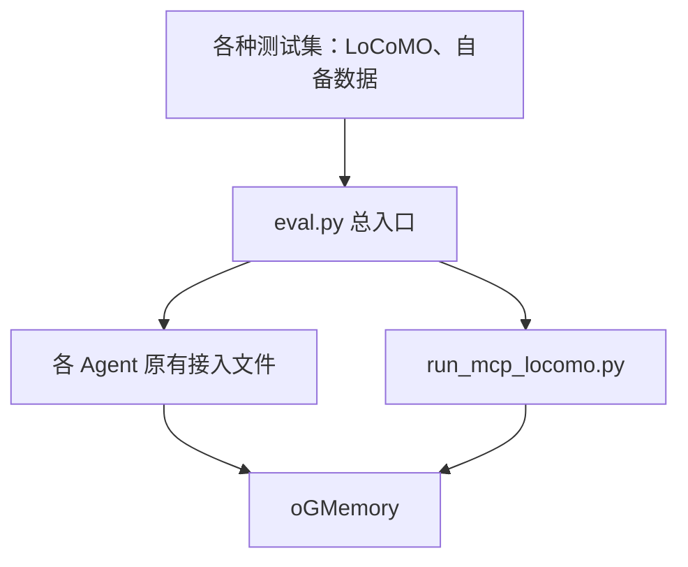

# oGMemory 记忆评测教程

通过真实 Agent 宿主和记忆插件执行 `ingest → qa → judge → stat`：注入会话原文、跨会话检索问答、模型判分、统计准确率。使用 `eval.py` 选择数据集和接入方式。

完成环境与数据准备后，在同一 Bash 终端加载四阶段函数，再运行对应宿主或 MCP 的执行命令。

## 1. 总入口与接入方式



`tests/e2e/eval.py` 负责数据加载、会话注入、问答、判题和统计。接入文件负责启动真实宿主、加载记忆插件、传递输入及取得输出。所有接入执行相同的四阶段流程。

| 选择参数 | 接入文件 | 调用方式 |
| --- | --- | --- |
| `--agent openclaw --transport plugin` | `run_openclaw_plugin_locomo.py` | OpenClaw CE 插件 |
| `--agent opencode --transport plugin` | `run_opencode_plugin_locomo.py` | OpenCode 原生插件 |
| `--agent claude-code --transport plugin` | `run_claude_code_plugin_locomo.py` | Claude Code Hooks |
| `--agent hermes --transport plugin` | `run_hermes_plugin_locomo.py` | Hermes MemoryProvider |
| `--agent dsh --transport plugin` | `run_dsh_plugin_locomo.py` | DeepSeek Harness 插件 |
| `--agent codex --transport plugin` | `run_codex_plugin_locomo.py` | Codex 插件与 Hooks |
| `--agent qwenpaw --transport plugin` | `run_qwenpaw_plugin_locomo.py` | QwenPaw 官方中间件与 HTTP API |
| `--agent openclaw --transport mcp` | `run_mcp_locomo.py` | Agent 通过 MCP 工具读写记忆 |
| `--agent openclaw --transport ce` | `run_openclaw_plugin_locomo.py` | 已有 OpenClaw CE Gateway |
| `--agent openclaw --transport gateway` | `run_mcp_locomo.py` | 已有 MCP Gateway |

所有命令从仓库根目录执行。总入口用法：

```bash
python tests/e2e/eval.py --help
python tests/e2e/eval.py ingest --help
```

各接入文件支持相同的四阶段参数，例如 `python tests/e2e/run_claude_code_plugin_locomo.py ingest --help`。

## 2. 准备依赖、服务与数据

### 2.1 评测程序与服务

代码块使用 Bash，从仓库根目录执行。评测程序需要 Python 3.11+、Git、curl；宿主依赖见第 4 节。

```bash
python3 --version
git --version
python3 -m venv .venv-eval
source .venv-eval/bin/activate
python -m pip install -e '.[e2e]'
mkdir -p results tests/e2e/data
```

按[快速开始](../QUICKSTART.md)或[部署入口](../deployment.md)准备运行中的 oGMemory，包含数据库、抽取模型、embedding 和 HTTP API。MCP 评测另需 Streamable HTTP MCP 服务，配置见 [MCP 接入](../integrations/mcp.md)。

对比运行时固定源码版本、数据集、抽取方式、抽取阈值、检索 TopK、上下文预算及模型配置。`memory.extraction.mode` 的 `eager` / `lazy` 由服务配置决定。抽取、宿主回答、Judge 分别记录模型及 thinking 配置。

提供方支持 `thinking.type=disabled` 时，抽取模型可在服务 YAML 中配置：

```yaml
llm:
  extra_body:
    thinking:
      type: disabled
```

宿主模型 thinking 由宿主及 provider 配置决定；托管 OpenClaw CE 配置 `thinking: off`、`reasoning: off`。Judge 的 `--judge-disable-thinking` 适用于支持该扩展字段的 Chat Completions 提供方。实际参数以对应服务支持范围为准。

### 2.2 数据范围

从 [LoCoMO 上游](https://github.com/snap-research/locomo)下载数据，再提取 `conv-26` 第 1–4 段及证据全部位于这四段的 35 道 category 1–4 题。下载文件与生成子集保存在 Git 忽略的 `tests/e2e/data/`。

```bash
mkdir -p tests/e2e/data
curl -fL https://raw.githubusercontent.com/snap-research/locomo/main/data/locomo10.json \
  -o tests/e2e/data/locomo10.json
export DATA="$PWD/tests/e2e/data/conv26-4sessions.json"
python - <<'PY'
import hashlib, json, os, re
from pathlib import Path
source = json.loads(Path('tests/e2e/data/locomo10.json').read_text(encoding='utf-8'))
sample = next(row for row in source if row['sample_id'] == 'conv-26')
keys = {'speaker_a', 'speaker_b'} | {
    key for i in range(1, 5) for key in (f'session_{i}', f'session_{i}_date_time')
}
subset = {
    'sample_id': sample['sample_id'],
    'conversation': {key: value for key, value in sample['conversation'].items() if key in keys},
    'qa': [q for q in sample['qa'] if str(q.get('category', '')) != '5'
           and q.get('evidence')
           and all(re.fullmatch(r'D[1-4]:\d+', evidence) for evidence in q['evidence'])],
}
assert all(f'session_{i}' in subset['conversation'] for i in range(1, 5))
assert len(subset['qa']) == 35
output = Path(os.environ['DATA'])
output.write_text(json.dumps([subset], ensure_ascii=False, indent=2) + '\n', encoding='utf-8')
print('sample=0 id=conv-26 sessions=4 questions=35')
print('sha256=' + hashlib.sha256(output.read_bytes()).hexdigest())
PY
SELECT=(--sample 0 --sessions 1-4 --count 35)
DATASET_FORMAT=locomo
JUDGE_PROFILE=locomo
```

完整数据沿用上一步下载的文件：

```bash
export DATA="$PWD/tests/e2e/data/locomo10.json"
SELECT=(--sample 0)
```

完整数据的 `sample 0` 为 `conv-26`，包含 19 段、152 道 category 1–4 题。选择全部 10 个 sample 时设置 `SELECT=(--all-samples)`，共 272 段、1540 道 category 1–4 题。数据使用遵循上游 [CC BY-NC 4.0 许可](https://github.com/snap-research/locomo/blob/main/LICENSE.txt)。

LoCoMO 按日期、说话人、正文、图片 URL 和图片说明生成每段输入，末尾默认追加 `[]`；QA 先排除 category 5，再从 1 编号。sample 顺序执行，每个 sample 内默认并发 2。`--count` 作用于每个 sample 的有效题目。

### 2.3 连接与凭据

替换地址、模型和已授权的身份，密钥从环境变量读取：

```bash
export MEMORY_URL='http://127.0.0.1:8090'
export MEMORY_ACCOUNT='locomo-eval'
export MODEL_BASE='https://provider.example/v1'
export MODEL_NAME='model-name'
export JUDGE_BASE="$MODEL_BASE"
export JUDGE_MODEL="$MODEL_NAME"
read -rsp '宿主模型 API Key: ' OGMEM_API_KEY; printf '\n'
export OGMEM_API_KEY
read -rsp '记忆服务 API Key: ' OGMEM_LOCOMO_OGMEMORY_API_KEY; printf '\n'
export OGMEM_LOCOMO_OGMEMORY_API_KEY
export OGMEM_JUDGE_API_KEY="$OGMEM_API_KEY"
export OGMEM_AUTO_CAPTURE=true
export OGMEM_AUTO_RECALL=true
curl -fsS "$MEMORY_URL/api/v1/health"
JUDGE_OPTIONS=(--judge-api-mode chat)
```

独立 Judge 可重新设置 `JUDGE_BASE`、`JUDGE_MODEL`、`OGMEM_JUDGE_API_KEY`。Responses 使用 `JUDGE_OPTIONS=(--judge-api-mode responses)`；支持关闭 thinking 的 Chat Completions 使用 `JUDGE_OPTIONS=(--judge-api-mode chat --judge-disable-thinking)`。

评测账户的 Admin 或 Root 密钥用于注册每轮的用户和 Agent；身份与权限配置见 [MCP 鉴权](../integrations/mcp.md#3-mcp-鉴权)。

## 3. 预检与四阶段脚本

复制以下函数到同一 Bash 终端。每次 `begin_run` 生成新的运行 ID、记忆用户、记忆 Agent、结果目录和宿主 runtime。启用角色控制时，函数先注册该用户及其 Agent。所有 sample 在本轮共用这一身份；比较各宿主时分别执行 `begin_run`。

```bash
set -Eeuo pipefail
umask 077

begin_run() {
  RUN_ID="${1}-$(date +%Y%m%d-%H%M%S)-$(python -c 'import uuid; print(uuid.uuid4().hex[:8])')"
  MEMORY_USER="eval-$RUN_ID"
  MEMORY_AGENT="agent-$RUN_ID"
  export MEMORY_USER MEMORY_AGENT
  OUT="$PWD/results/$RUN_ID"
  mkdir -p "$OUT"
  python - <<'PY'
import os, requests
base = os.environ['MEMORY_URL'].rstrip('/')
account = os.environ['MEMORY_ACCOUNT']
headers = {'X-API-Key': os.environ['OGMEM_LOCOMO_OGMEMORY_API_KEY'],
           'X-Account-ID': account}
endpoint = f'{base}/api/v1/admin/accounts/{account}'
roles = requests.get(f'{endpoint}/roles', headers=headers, timeout=30)
control_disabled = (roles.status_code == 503 and roles.json().get('error') ==
                    'Admin API is unavailable when role control is disabled')
if control_disabled:
    print('角色控制关闭：使用本轮隔离身份')
else:
    roles.raise_for_status()
    user = os.environ['MEMORY_USER']
    for route, body in [('users', {'user_id': user}),
                        ('agents', {'agent_id': os.environ['MEMORY_AGENT'], 'owner_user_id': user})]:
        response = requests.post(f'{endpoint}/{route}', headers=headers, json=body, timeout=30)
        response.raise_for_status()
    print('本轮用户和 Agent 已注册')
PY
  git rev-parse HEAD > "$OUT/source-commit.txt"
  sha256sum "$DATA" > "$OUT/dataset.sha256"
  printf 'stage\texit_code\telapsed_seconds\n' > "$OUT/stages.tsv"
  COMMON=(
    --user "$MEMORY_USER" --account-id "$MEMORY_ACCOUNT" --memory-agent-id "$MEMORY_AGENT"
    --run-id "$RUN_ID" --ogmemory-url "$MEMORY_URL"
    --ogmemory-api-key-env OGMEM_LOCOMO_OGMEMORY_API_KEY
    --llm-api-key-env OGMEM_API_KEY --llm-base-url "$MODEL_BASE" --llm-model "$MODEL_NAME"
    --dataset-format "$DATASET_FORMAT" --verify-writes --agent-attempts 1
    --parallel 2 --agent-timeout 1200 --write-wait-timeout 1200
  )
  QA_POLICY=(--read-only-qa)
}

run_stage() {
  local stage="$1" started="$SECONDS" status=0
  shift
  "$@" || status=$?
  printf '%s\t%s\t%s\n' "$stage" "$status" "$((SECONDS-started))" >> "$OUT/stages.tsv"
  return "$status"
}

run_suite() {
  local agent="$1" entry=tests/e2e/eval.py
  shift
  local route=(--agent "$agent" --transport plugin)
  if [[ "$agent" == mcp ]]; then
    route=(--agent openclaw --transport mcp)
  fi
  run_stage preflight python "$entry" ingest "$DATA" "${route[@]}" "${COMMON[@]}" "${SELECT[@]}" "$@" \
    --runtime-root "$OUT/preflight-runtime" --output-dir "$OUT/preflight" --preflight-only || return
  run_stage qa-preflight python "$entry" qa "$DATA" "${route[@]}" "${COMMON[@]}" "${SELECT[@]}" "$@" \
    "${QA_POLICY[@]}" --runtime-root "$OUT/qa-preflight-runtime" \
    --output-dir "$OUT/qa-preflight" --preflight-only || return
  run_stage ingest python "$entry" ingest "$DATA" "${route[@]}" "${COMMON[@]}" "${SELECT[@]}" "$@" \
    --runtime-root "$OUT/runtime" --output-dir "$OUT/artifacts" \
    --ingest-record "$OUT/ingest-record.json" --output "$OUT/ingest.txt" || return
  run_stage qa python "$entry" qa "$DATA" "${route[@]}" "${COMMON[@]}" "${SELECT[@]}" "$@" \
    "${QA_POLICY[@]}" --runtime-root "$OUT/runtime" --output-dir "$OUT/artifacts" --output "$OUT/qa" || return
  run_stage judge python "$entry" judge "$OUT/qa.csv" \
    --judge-api-key-env OGMEM_JUDGE_API_KEY --api-base "$JUDGE_BASE" \
    --judge-model "$JUDGE_MODEL" --judge-profile "$JUDGE_PROFILE" "${JUDGE_OPTIONS[@]}" \
    --judge-parallel 1 --judge-max-attempts 1 \
    --output-dir "$OUT/artifacts" --output "$OUT/qa_judged.csv" || return
  run_stage stat python "$entry" stat "$OUT/qa_judged.csv" \
    --output-dir "$OUT/artifacts" --output "$OUT/summary.json"
}
```

预检检查数据、可执行文件、宿主启动和插件配置；托管 MCP 还检查认证、工具发现和 Gateway 可用性，预检产物单独保存。CE / gateway 的 `--preflight-only` 准备连接参数，已有 Gateway 按第 5 节核对。

| 阶段 | 执行与完成条件 |
| --- | --- |
| `ingest` | 每段原文进入真实宿主；插件按用户原文指纹匹配成功的 after_turn，取得来源会话并等待后台处理；全部来源完成 dispose、抽取和索引收尾 |
| `qa` | 每题使用新逻辑会话，统一提问 `Answer the question directly: {question}`；插件召回或 MCP query/read 提供记忆；答案逐题写入 CSV |
| `judge` | 用指定 Judge 模型和评分配置，将宿主答案判为 CORRECT / WRONG |
| `stat` | 汇总全部 CSV 行，输出覆盖、准确率、分类统计及宿主 token 合计 |

`--verify-writes` 核对来源写入证据、后台 idle、outbox 完成、`dispose` 结果、来源缓冲归零及持久化归档；plugin 按本段原文指纹匹配写入回执，MCP 按本次原生会话日志核对逐字原文、completed 回执和实际来源 SID，并在 QA 核对成功的 query 回执。收尾通过 `compact` 抽取并归档剩余内容，等待索引完成后销毁来源会话；完成核验后将注入账本标记为成功。续跑可继续收尾已受理且核验匹配的来源。错误与中间结果写入本轮目录，阶段失败返回非零，脚本随即停止后续阶段。

`--read-only-qa` 在 plugin 接入中拦截 QA 生命周期写入，在托管 MCP 中只开放 query/read 和资源读取。召回与 Trace 继续记录；插件 QA 写入观察见 `artifacts/qa-write-observations.json`。

## 4. 七个宿主与 MCP

托管评测按仓库插件准备隔离配置、工作目录和会话状态。插件源码分别位于 `plugins/openclaw`、`plugins/opencode`、`plugins/claude-code`、`plugins/hermes`、`plugins/deepseek-harness`、`plugins/ogmemory`、`plugins/qwenpaw`；其他接入说明见 [Agent 插件](../integrations/agent-plugins.md)。

### 4.1 OpenClaw CE 插件

按 [OpenClaw 接入](../integrations/openclaw.md)准备支持 Context Engine 的 OpenClaw：

```bash
curl -fsSL --proto '=https' --tlsv1.2 https://openclaw.ai/install.sh \
  | bash -s -- --version 2026.6.9 --no-onboard
openclaw --version
node --version
begin_run openclaw-plugin
run_suite openclaw \
  --transport plugin --openclaw-command "$(command -v openclaw)" \
  --openclaw-port 18791 --openclaw-provider-api openai-completions
```

托管 Gateway 使用 remote CE、`prefetchTopK=5`、`shortTermIndexMode=sync`。`18791` 须为空闲端口。模型使用 Responses API 时，将 `--openclaw-provider-api` 改为 `openai-responses`。

### 4.2 OpenCode

需要 OpenCode 1.15.11+、Node.js 18+，模型端点提供 OpenAI 兼容接口。安装与插件说明见 [OpenCode 接入](../integrations/opencode.md)。

```bash
npm install -g opencode-ai
opencode --version
node --version
begin_run opencode
run_suite opencode \
  --opencode-command "$(command -v opencode)" --disable-host-tools \
  --compose-timeout-ms 60000 --trace-timeout-ms 60000
```

`--disable-host-tools` 通过 OpenCode 原生配置关闭宿主内置模型工具；记忆插件的召回、写入及 Trace 按生命周期执行。两个超时参数设置插件 compose 与 Trace 的请求时限，单位毫秒。

### 4.3 Claude Code

需要支持插件和 Hooks 的 Claude Code，以及 Python 3。宿主模型使用 Anthropic 兼容端点，Judge 使用 Chat Completions 或 Responses 端点。详见 [Claude Code 接入](../integrations/claude-code.md)。

```bash
npm install -g @anthropic-ai/claude-code
claude --version
python --version
export CLAUDE_BASE='https://provider.example/anthropic'
begin_run claude-code
run_suite claude-code \
  --claude-command "$(command -v claude)" --claude-base-url "$CLAUDE_BASE"
```

宿主密钥取自 `--llm-api-key-env` 指向的变量，并传给 `ANTHROPIC_API_KEY`。提供方使用 Bearer Token 时追加 `--claude-auth-token`，改用 `ANTHROPIC_AUTH_TOKEN`。

### 4.4 Hermes

当前官方安装使用 Python 3.14（`>=3.14,<3.15`），安装器管理其 Python 和工具依赖，见 [Hermes 官方安装说明](https://hermes-agent.nousresearch.com/docs/getting-started/installation)。评测程序与 Hermes 可使用各自的 Python 环境。Provider 配置见 [Hermes 接入](../integrations/hermes.md)。

```bash
curl -fsSL https://hermes-agent.nousresearch.com/install.sh | bash
export PATH="$HOME/.local/bin:$PATH"
hermes --version
hermes doctor
begin_run hermes
run_suite hermes --hermes-command "$(command -v hermes)"
```

模型端点须支持 Chat Completions。所用 Hermes 需支持 `memory status`、`--usage-file`、`--resume` 和 `-z`；预检会调用 `memory status` 检查原生 MemoryProvider。

### 4.5 DeepSeek Harness

插件对应 DSH CLI / 核心包 `0.1.5-rc.2` 和 Cordis `4.0.2`；Node.js 要求为 `^22.19.0 || >=24.0.0`。以下使用独立的 Node.js `24.17.0` 和 DSH 安装目录。仓库环境文件通过 overrides 将所有 `@deepseek-ai/dsh-*` 依赖固定为 `0.1.5-rc.2`，Cordis 固定为 `4.0.2`。依赖关系见 [DSH 接入](../integrations/deepseek-harness.md)及[插件安装说明](../../plugins/deepseek-harness/INSTALL-ZH.md)。

```bash
case "$(uname -m)" in
  x86_64) DSH_ARCH=x64 ;;
  aarch64|arm64) DSH_ARCH=arm64 ;;
  *) printf '请安装适用于当前架构的 Node.js 24.17.0\n' >&2; exit 1 ;;
esac
DSH_ROOT="$HOME/.local/share/ogmemory-eval-dsh"
mkdir -p "$DSH_ROOT/node" "$DSH_ROOT/packages"
curl -fL "https://nodejs.org/dist/v24.17.0/node-v24.17.0-linux-$DSH_ARCH.tar.xz" \
  | tar -xJ --strip-components=1 -C "$DSH_ROOT/node"
export PATH="$DSH_ROOT/node/bin:$DSH_ROOT/packages/node_modules/.bin:$PATH"
cp tests/e2e/environments/dsh/package.json "$DSH_ROOT/packages/package.json"
npm install --prefix "$DSH_ROOT/packages"
npm install -g pnpm
node --version
pnpm --version
dsh --version
npm ls --prefix "$DSH_ROOT/packages" @deepseek-ai/dsh @deepseek-ai/cordis
begin_run dsh
run_suite dsh \
  --dsh-command "$(command -v dsh)" --disable-host-tools
```

预检使用 pnpm 打包仓库插件并装入隔离的 `headless` profile。模型端点须支持 Chat Completions。`--disable-host-tools` 通过 DSH 官方 `--patch` 将内置工具 provider 的 `disabled` 设为 `true`；记忆生命周期继续执行。

### 4.6 Codex

需要支持 `plugin marketplace`、插件和生命周期 Hooks 的 Codex CLI，以及 Python 3.11+；模型端点须支持 Responses API。安装说明见 [Codex 接入](../integrations/codex.md)。

```bash
npm install -g @openai/codex
codex --version
codex plugin --help
python --version
begin_run codex
run_suite codex --codex-command "$(command -v codex)"
```

评测在隔离的 Codex home 中安装本仓库 marketplace 和 `ogmemory@ogmemory`，通过原生 Hooks 完成召回与写回。

### 4.7 QwenPaw

需要 QwenPaw 2.1 或沿用相同插件接口的后续版本，Python 版本按所安装 QwenPaw 的要求选择，模型端点使用 Chat Completions。安装与服务连接见 [QwenPaw 对接](../integrations/qwenpaw.md)。

评测进程与 QwenPaw 可使用不同的 Python 环境，通过 `--qwenpaw-command` 指定宿主环境中的可执行文件。

```bash
qwenpaw --version
begin_run qwenpaw
run_suite qwenpaw --qwenpaw-command "$(command -v qwenpaw)" --qwenpaw-port 18891
```

预检将仓库插件安装到独立 QwenPaw 工作目录，启动 Console API。四阶段复用上面的数据选择、身份、完成核验与判分流程。模型、服务地址、凭据和输出目录均由公共参数提供。可通过 `LOCOMO_CHAT_EXTRA_BODY` 指定提供方扩展 JSON。

### 4.8 MCP：托管 OpenClaw Gateway

先按第 4.1 节安装 OpenClaw。按 [MCP 接入](../integrations/mcp.md)配置并启动 MCP 服务；测试所用服务配置开放读写工具：

```yaml
mcp:
  enabled: true
  host: 127.0.0.1
  port: 8091
  path: /mcp
  default_toolset: read-write
```

在服务终端运行：

```bash
ogmem mcp --transport streamable-http --config "$PWD/config/ogmem.yaml" \
  --host 127.0.0.1 --port 8091 --path /mcp
```

在测试终端设置 MCP 连接和独立 OpenClaw 模型配置。已有配置时可将 `LOCOMO_OPENCLAW_CONFIG` 指向对应文件；以下命令创建测试配置：

```bash
export LOCOMO_OPENCLAW_STATE_DIR="$PWD/.locomo-mcp-config"
export LOCOMO_OPENCLAW_CONFIG="$LOCOMO_OPENCLAW_STATE_DIR/openclaw.json"
export OGMEMORY_MCP_URL='http://127.0.0.1:8091/mcp'
export OGMEMORY_MCP_ACCOUNT_ID="$MEMORY_ACCOUNT"
export OGMEMORY_MCP_API_KEY="$OGMEM_LOCOMO_OGMEMORY_API_KEY"
export LOCOMO_MCP_TIMEOUT_SECONDS=1200
mkdir -p "$LOCOMO_OPENCLAW_STATE_DIR"
python - <<'PY'
import json, os
from pathlib import Path
model = os.environ['MODEL_NAME']
config = {
    'agents': {
        'defaults': {'model': {'primary': f'locomo/{model}'}, 'timeoutSeconds': 1200},
        'list': [{'id': 'main', 'model': f'locomo/{model}'}],
    },
    'models': {'providers': {'locomo': {
        'baseUrl': os.environ['MODEL_BASE'], 'apiKey': '${OGMEM_API_KEY}',
        'api': 'openai-completions', 'models': [{'id': model, 'name': model}],
    }}},
    'gateway': {'mode': 'local', 'bind': 'loopback', 'port': 18792},
}
p = Path(os.environ['LOCOMO_OPENCLAW_CONFIG'])
p.write_text(json.dumps(config, indent=2), encoding='utf-8')
p.chmod(0o600)
PY
begin_run mcp
run_suite mcp \
  --openclaw-command "$(command -v openclaw)" --openclaw-port 18792
```

模型使用 Responses API 时，将配置中的 `api` 改为 `openai-responses`。托管 MCP 宿主模型来自 `LOCOMO_OPENCLAW_CONFIG`，Judge 模型来自 `--judge-model`。`MEMORY_URL` / `--ogmemory-url` 指向 HTTP 基址，用于权限检查与来源完成核验；`OGMEMORY_MCP_URL` 指向 MCP 工具端点。

预检发现 query/read/write 工具；注入提示词通过字面 JSON 提供完整原文，要求 `ogmemory__ogm_write_memory` 逐字保存并使用 `wait=true`、`force_extract=true`，每段完成抽取后继续。QA 先使用 `ogmemory__ogm_query_memory`，按需使用 `ogmemory__ogm_read_memory` 获取细节。托管 Gateway 自动管理可读取的原生会话日志；`--openclaw-port` 须空闲。

## 5. 已有 OpenClaw Gateway

已有 CE Gateway 按 [OpenClaw 接入](../integrations/openclaw.md)配置插件；已有 MCP Gateway 按 [MCP 接入](../integrations/mcp.md)配置认证请求头与工具。Gateway 开启 `gateway.http.endpoints.responses.enabled: true`。记忆账户、用户和 Agent 与评测命令一致；`--agent-id` 选择宿主 Agent，`--memory-agent-id` 选择记忆 Agent。

先执行以下初始化，将生成的 `MEMORY_USER`、`MEMORY_AGENT` 写入插件身份配置，或 MCP 的 `X-User-ID`、`X-Agent-ID`，重新加载 Gateway 后执行 ingest：

```bash
begin_run existing-gateway
export OPENCLAW_STATE_DIR="$HOME/.openclaw"
read -rsp 'Gateway Token: ' OPENCLAW_GATEWAY_TOKEN; printf '\n'
export OPENCLAW_GATEWAY_TOKEN
GATEWAY=(--base-url http://127.0.0.1:18789 --agent-id main)
ENTRY=tests/e2e/eval.py
ROUTE=(--transport ce)
```

```bash
python "$ENTRY" ingest "$DATA" "${COMMON[@]}" "${SELECT[@]}" "${GATEWAY[@]}" "${ROUTE[@]}" \
  --output-dir "$OUT/artifacts" --ingest-record "$OUT/ingest-record.json" --output "$OUT/ingest.txt"
```

QA 前，在已有 Gateway 的插件配置中开启自动召回、关闭自动写入；MCP QA 工具列表保留 query/read 和资源读取。重新加载 Gateway 后依次执行：

```bash
python "$ENTRY" qa "$DATA" "${COMMON[@]}" "${SELECT[@]}" "${GATEWAY[@]}" "${ROUTE[@]}" \
  --output-dir "$OUT/artifacts" --output "$OUT/qa"
python "$ENTRY" judge "$OUT/qa.csv" --judge-api-key-env OGMEM_JUDGE_API_KEY \
  --api-base "$JUDGE_BASE" --judge-model "$JUDGE_MODEL" --judge-profile "$JUDGE_PROFILE" \
  "${JUDGE_OPTIONS[@]}" --judge-parallel 1 --judge-max-attempts 1 --output "$OUT/qa_judged.csv"
python "$ENTRY" stat "$OUT/qa_judged.csv" --output "$OUT/summary.json"
```

已有 MCP Gateway 将 `ENTRY` 设为 `tests/e2e/run_mcp_locomo.py`、`ROUTE=(--transport gateway)` 后执行相同四阶段。`OPENCLAW_STATE_DIR` 指向可读取该 Gateway 原生 `sessions.json` 和会话 `.jsonl` 的状态目录，供 MCP 工具回执核验、CE 来源定位及会话 token 读取。远端 MCP Gateway 将状态目录只读挂载到评测进程可访问的路径，再通过 `--gateway-state-dir` 指定该路径。部署脚本自动将同一原生状态目录挂载到 Gateway 和评测容器。

会话键使用账户、用户、记忆 Agent、`--run-id` 和样本标识的摘要，原始样本标识保留在结果字段中。续跑使用相同身份和运行参数；QA 保留已成功回答，重试并替换失败行。程序在复用 CSV 前核对数据 SHA256、sample/count 选择范围、核验策略、模型、接入方式和记忆配置。托管 MCP 同时核对 OpenClaw 模型路由、合并 `models.json` 后的 provider 配置及实际 MCP 端点摘要。上述配置发生变化时使用新的输出目录。开启 `--verify-writes` 的注入续跑要求旧记录已核验且包含来源 SID；从普通注入切换到严格核验时，使用新身份、新目录及 `--force-ingest`。

## 6. 自备记忆数据

JSON 顶层为数组，每个 sample 包含唯一 `sample_id`、`sessions` 和 `questions`：

```json
[
  {
    "sample_id": "release-window",
    "sessions": [
      {
        "session_id": "planning-1",
        "message": "Alice: Atlas 的代码冻结时间为每周三 18:00。",
        "date_time": "2026-10-19 10:00"
      }
    ],
    "questions": [
      {
        "question": "Atlas 的代码冻结时间是什么时候？",
        "answer": "每周三 18:00",
        "category": "release",
        "evidence": ["planning-1"]
      }
    ]
  }
]
```

`sample_id`、`session_id`、`message`、`question` 为非空字符串，`answer` 为字符串或数值；`date_time`、`category`、`evidence` 可选。`message` 是提交给宿主的原文，日期可直接写入正文；`date_time` 用于来源元数据。通用格式保留所有 category，默认尾部为空。`--sessions` 按 `sessions` 数组从 1 开始的顺序选择，`--count` 按 `questions` 数组顺序选择。

将文件保存为 `tests/e2e/data/my-memory.json` 后，在第 2、3 节的同一终端设置：

```bash
export DATA="$PWD/tests/e2e/data/my-memory.json"
DATASET_FORMAT=memory
JUDGE_PROFILE=locomo
SELECT=(--all-samples)
begin_run my-memory-opencode
run_suite opencode --disable-host-tools \
  --compose-timeout-ms 60000 --trace-timeout-ms 60000
```

`--dataset-format auto` 自动识别 LoCoMO 或通用格式。所有接入使用相同的 Judge 提示词：按标准答案与生成答案的主题一致性宽松判分，接受等价日期表达，温度为 0。数据集扩展通过转换为上述 sessions/questions 格式接入。

## 7. 全部公开参数

各入口支持 `--help`。时间默认以秒计，带 `-ms` 的参数使用毫秒；表中为 CLI 默认值，第 3 节脚本另显式设置严格核验和单次尝试。

### 7.1 阶段、数据与输出

| 参数 | 默认值 | 用途 |
| --- | --- | --- |
| `mode` | 必填 | `ingest`、`qa`、`judge`、`stat` |
| `dataset` | 必填 | ingest/qa：JSON；judge：QA CSV；stat：判题 CSV |
| `--dataset-format` | `auto` | ingest/qa：`auto`、`locomo`、`memory` |
| `--output` | 自动路径 | ingest：文本及同名 `.json`；qa：前缀，生成 `.csv` 和前缀同名 JSON；judge：CSV；stat：JSON |
| `--output-dir` | 从 output 推导 | 证据目录；指定 output 时为 `<output目录>/<output主名>-artifacts`，否则为 `tests/e2e/result` |
| `--sample N` | 全部 | 选择 JSON 数组下标，从 0 开始 |
| `--all-samples` | 默认已全量 | 显式选择全部 sample，与 sample 互斥 |
| `--sessions RANGE` | 全部 | ingest：`1-4` 或 `3`，闭区间；通用格式按数组顺序 |
| `--count N` | 全部 | qa：每 sample 前 N 道有效题，N > 0 |
| `--tail TEXT` | 随格式 | LoCoMO 为 `[]`；memory 为空；显式值追加到每段原文 |
| `--delay SECONDS` | `0` | qa：题目提交间隔 |
| `--ingest-record PATH` | `.ingest_record.json` | 成功注入和来源记录，建议置于本轮目录 |
| `--force-ingest` | 关闭 | 重新提交已有成功记录的输入 |
| `--clear-ingest-record` | 关闭 | 执行前清空指定注入记录 |
| `--resume` | 关闭 | plugin：续写宿主 invocation 日志；QA 行续跑由 CSV 控制 |
| `--preflight-only` | 关闭 | ingest/qa：准备配置；plugin/mcp 启动预检；ce/gateway 准备连接参数 |

### 7.2 接入、身份与完成核验

| 参数 | 默认值 | 用途 |
| --- | --- | --- |
| `--agent` | 入口宿主 | eval.py 可选 `openclaw`、`opencode`、`claude-code`、`hermes`、`dsh`、`codex`、`qwenpaw`；专用入口固定宿主 |
| `--transport` | 入口决定 | `ce`、`plugin`、`mcp`、`gateway`；支持范围见第 1 节；ce/mcp/gateway 使用 OpenClaw |
| `--account-id` | `locomo-agent-eval` | 记忆账户；托管 MCP 采用 MCP 认证配置账户 |
| `--user` / `--user-id` | `eval-1` | 本轮记忆用户与 Gateway 请求 user |
| `--memory-agent-id` | 入口宿主 | 记忆服务中已授权的 Agent 身份 |
| `--run-id` | 随机 8 位十六进制 | 托管 profile 和会话命名标识；续跑保留 |
| `--ogmemory-url` | `http://127.0.0.1:8090` | HTTP 基址，插件请求、MCP 权限检查、完成核验使用 |
| `--ogmemory-api-key-env` | `OGMEM_LOCOMO_OGMEMORY_API_KEY` | 记忆服务密钥变量名 |
| `--base-url` | `http://127.0.0.1:18789` | ce/gateway：已有 Gateway 基址 |
| `--token` | `OPENCLAW_GATEWAY_TOKEN` 或空 | ce/gateway：Gateway Bearer Token，优先使用环境变量 |
| `--agent-id` | `main` | ce/gateway：宿主 Agent 路由和会话定位 |
| `--runtime-root` | output-dir 下 runtime | 托管配置、会话、插件副本及工作目录 |
| `--verify-writes` | 关闭 | plugin 原文写入核验、来源收尾；ce 来源收尾；mcp/gateway 核对原生 write/query 回执、逐字原文及实际来源完成 |
| `--gateway-state-dir` | 使用本地 OpenClaw 状态目录 | 已有 MCP Gateway 的可读原生状态目录，包含 `agents/<agent-id>/sessions/` |
| `--write-wait-timeout` | `1200` | 写入确认、idle 和来源收尾等待上限 |
| `--read-only-qa` | 关闭 | plugin/mcp：QA 生命周期写入拦截或 MCP 工具过滤 |

### 7.3 宿主模型、工具与命令

| 参数 | 默认值 | 用途 |
| --- | --- | --- |
| `--llm-api-key-env` | `OGMEM_API_KEY` | plugin：宿主模型密钥变量；也是 Judge 密钥回退来源 |
| `--llm-base-url` | `https://api.openai.com/v1` | plugin：宿主模型端点 |
| `--llm-model` | `gpt-4o-mini` | plugin：宿主模型名 |
| `--agent-timeout` | `1200` | plugin：单次宿主调用超时；托管 OpenClaw Agent 超时 |
| `--agent-attempts` | `3` | qa：每题宿主调用尝试上限，N > 0；四阶段脚本设为 1 |
| `-p` / `--parallel` / `--qa-parallel` | `2` | qa：每 sample 并发，N > 0 |
| `--disable-host-tools` | 关闭 | OpenCode/DSH：通过原生配置关闭宿主内置模型工具 |
| `--compose-timeout-ms` | `60000` | OpenCode/QwenPaw：插件 compose 请求超时，100–60000 毫秒 |
| `--trace-timeout-ms` | `60000` | OpenCode/QwenPaw：插件 Trace 请求超时，100–60000 毫秒 |
| `--openclaw-command` | `openclaw` | plugin/mcp：可执行文件名或路径 |
| `--openclaw-port` | `18791` | plugin/mcp：测试 Gateway 端口 |
| `--openclaw-provider-api` | `openai-responses` | OpenClaw plugin：`openai-responses` 或 `openai-completions` |
| `--opencode-command` | `opencode` | OpenCode 可执行文件名或路径 |
| `--claude-command` | `claude` | Claude Code 可执行文件名或路径 |
| `--claude-base-url` | llm-base-url 去末尾 `/v1` | Claude：Anthropic 兼容端点 |
| `--claude-auth-token` | 关闭 | Claude：密钥传给 `ANTHROPIC_AUTH_TOKEN`，默认传给 `ANTHROPIC_API_KEY` |
| `--hermes-command` | `hermes` | Hermes 可执行文件名或路径 |
| `--dsh-command` | `dsh` | DSH 可执行文件名或路径 |
| `--codex-command` | `codex` | Codex 可执行文件名或路径 |
| `--qwenpaw-command` | `qwenpaw` | QwenPaw 可执行文件名或路径 |
| `--qwenpaw-port` | `18891` | QwenPaw Console 测试端口 |

ce/gateway 的 HTTP 请求超时为 1800 秒，模型来自已有 Gateway；托管 MCP 的模型来自指定 OpenClaw 配置。

### 7.4 Judge

| 参数 | 默认值 | 用途 |
| --- | --- | --- |
| `--judge-api-key-env` | `OGMEM_API_KEY` | Judge 密钥变量；空时回退至 llm-api-key-env |
| `--api-base` / `--judge-base-url` | `https://api.openai.com/v1` | Judge 端点 |
| `--judge-model` | `gpt-4o-mini` | Judge 模型 |
| `--judge-profile` | `locomo` | 使用统一的 LoCoMO Judge 提示词 |
| `--judge-api-mode` | `chat` | `chat` 或 `responses` |
| `--judge-disable-thinking` | 关闭 | chat：附加 `thinking.type=disabled`，提供方须支持 |
| `--judge-parallel` | `1` | 判题并发，N > 0 |
| `--judge-max-attempts` | `1` | 每题判题尝试上限，N > 0 |
| `--rate-limit-retry-delay` | `30` | 判题重试间隔 |
| `--stop-on-rate-limit` | 关闭 | 遇限流后停止后续判题并保留结果 |
| `-h` / `--help` | — | 查看完整用法 |

## 8. 环境变量

| 变量 | 用途 |
| --- | --- |
| `OGMEM_API_KEY` | 默认宿主/Judge 密钥，可通过对应 `*-api-key-env` 选择其他变量 |
| `OGMEM_LOCOMO_OGMEMORY_API_KEY` | 默认记忆服务密钥 |
| `OGMEM_JUDGE_API_KEY` | 独立 Judge 密钥，通过 judge-api-key-env 指定 |
| `OPENCLAW_GATEWAY_TOKEN` | 已有 CE/MCP Gateway 认证 |
| `OPENCLAW_STATE_DIR` | 已有 Gateway 可读状态目录，MCP 原生工具回执、CE 来源定位及会话用量读取 |
| `LOCOMO_OPENCLAW_STATE_DIR` | MCP 原状态目录；亦为 CE 状态目录回退值 |
| `LOCOMO_OPENCLAW_CONFIG` | 托管 MCP 原配置，默认 `~/.openclaw/openclaw.json` |
| `OGMEMORY_MCP_URL` | 托管 MCP 地址，优先于配置中的 ogmemory URL |
| `OGMEMORY_MCP_API_KEY` | 托管 MCP 密钥，优先于原配置请求头 |
| `OGMEMORY_MCP_ACCOUNT_ID` | 托管 MCP 账户，优先于原配置请求头 |
| `LOCOMO_MCP_TIMEOUT_SECONDS` | 托管 MCP 工具超时，默认 1200 |
| `LOCOMO_API_LOG_DIR` | Gateway API 日志目录，默认位于输出目录 |
| `OGMEM_AUTO_CAPTURE` / `OGMEM_AUTO_RECALL` | 自动采集/召回开关，四阶段脚本设为 true；QA 写入策略由评测入口控制 |

## 9. 会话、结果与指标

### 9.1 会话与续跑

同一 sample 的来源段按顺序进入逻辑会话 `ingest-<sample_id>`；每题使用独立逻辑会话 `qa-<sample_id>-q<题号>`。OpenClaw、OpenCode、Claude Code、Hermes、Codex、QwenPaw 保存逻辑 key 到原生会话的映射；DSH 每次调用建立原生会话。ingest 和 QA 的配置、会话状态分别保存。记忆账户、用户和 Agent 将新 QA 会话关联到本轮已写入记忆。

续跑保持 `OUT`、`RUN_ID`、身份、runtime 和输入数据：

- ingest 按 `ingest-record.json` 跳过成功输入，保留已有注入明细并追加本次完成的段；`--force-ingest` 重新提交选中输入。
- qa 按现有 CSV 的 `(sample_id, qi)` 保留已有记录；重答指定题目时，先归档原 CSV，再移出对应行后执行 qa。
- judge 按问题、标准答案、宿主答案和判题签名复用已完成结果；更换评分配置会重新判题。
- `--resume` 续写插件宿主 invocation 日志；会话映射由 runtime 保存。

修改数据、范围或提示词后创建新运行目录。记录模型、服务配置和选中数量，核对成功注入段数、来源完成记录、QA 行数及已判数。

### 9.2 文件

| 文件 | 内容 |
| --- | --- |
| `source-commit.txt`、`dataset.sha256` | 四阶段脚本记录的源码版本、数据校验值 |
| `stages.tsv` | 四阶段脚本记录的预检和四阶段退出码、墙钟秒数 |
| `ingest.txt`、`ingest.txt.json` | 宿主回复、来源、usage、每段 write_seconds |
| `ingest-record.json` | 成功输入和来源会话记录 |
| `qa.csv` | 问题、标准答案、宿主回答、证据、类别、宿主 token、qa_seconds |
| `qa` | QA 题数、错误数、空回复数 JSON |
| `qa_judged.csv` | 原始 QA 记录、is_correct、reasoning、判题签名 |
| `summary.json` | 全部题数、已判/未判、正确/错误、准确率、分类统计、宿主 token 合计 |
| `artifacts/ingest-manifest.json`、`qa-manifest.json` | 协议、数据 SHA256、参数、会话策略 |
| `artifacts/ingest-timing.json`、`qa-timing.json` | 对应阶段计时 |
| `artifacts/ingest.json` | 注入明细 |
| `artifacts/source-completion.json` | 来源收尾、idle/outbox 和缓冲完成证据 |
| `artifacts/*-write-observations.json` | plugin：原文写入确认与 QA 写入拦截 |
| `artifacts/ingest-tool-receipts.json`、`qa-tool-receipts.json` | MCP：原生工具调用 ID、日志路径、原文/问题指纹及实际来源 SID |
| `artifacts/<agent>/<phase>/host-logs/`、`artifacts/<agent>/<phase>/host-invocations.json` | 原生宿主调用日志与耗时 |
| `artifacts/ingest-gateway.log`、`qa-gateway.log`、Gateway API 日志 | MCP/Gateway 启动、请求和响应记录 |
| `runtime/` | 隔离配置、插件、工作目录和会话映射 |
| `preflight/`、`qa-preflight/` | 两种阶段配置的独立预检证据 |

runtime 和原始宿主日志可能包含凭据或会话内容，按私有运行产物管理。

### 9.3 准确率、时间与 token

准确率为 `CORRECT / CSV 全部题数`；分类准确率同样按该类别全部行计分。`judged`、`unjudged`、`empty_responses` 和错误日志用于核对覆盖，保留全部原始行后解释结果。

- `write_seconds` 包含宿主提交，以及严格核验后的本段写入确认和 idle 等待；来源最终 dispose 收尾另见 `flush_seconds`。
- `qa_seconds` 是单题宿主回答的墙钟时间，包含检索、模型生成和配置的尝试次数。
- `*-timing.json` 是对应阶段程序计时；`stages.tsv` 覆盖命令启动至退出，包括宿主收尾，精度为整数秒。
- 并发 QA 的逐题耗时可重叠，阶段墙钟时间按实际起止计算。API 写入、抽取、索引、检索耗时从服务日志或 timing ledger 分开统计。

`input_tokens`、`output_tokens`、`total_tokens`、`cacheRead`、`cacheWrite` 是宿主上报或从会话记录提取的用量。OpenCode 输入量包含普通输入、缓存读取和缓存写入；其他宿主沿用 provider 计数语义。DSH 用量从提供方 usage 汇总。报告按实际调用数列出用量覆盖，并分别统计宿主回答、辅助调用、记忆服务和 Judge 的成本。

服务内部抽取/检索 LLM 和 Judge 用量分别从其 provider usage、请求日志或账本汇总。内部 KV 缓存 token 命中率按同一身份、同一测量区间的 `sum(cached_input_tokens) / sum(total_input_tokens)` 计算，同时报告调用数、失败数和用量覆盖。

## 10. 一键部署实例

完成 [ARM64 一键部署](../../deploy/user-quickstart/README_zh.md)后，可用部署启动器调用同一套四阶段。启动器在仓库中执行时读取当前已提交版本的评测文件，`LOCOMO_SOURCE_REV` 可指定其他本地提交；独立下载启动器时默认从远端 `dev` 解析版本。`OGMEMORY_RUNTIME_ENV_FILE` 指向部署环境文件；密钥从已导出的环境变量读取：

```bash
cat > locomo.env <<'EOF'
OGMEMORY_RUNTIME_ENV_FILE="$HOME/ogmemory-runtime.env"
LOCOMO_JUDGE_BASE_URL="${JUDGE_BASE}"
LOCOMO_JUDGE_MODEL="${JUDGE_MODEL}"
LOCOMO_JUDGE_API_KEY="${OGMEM_JUDGE_API_KEY}"
LOCOMO_JUDGE_API_MODE="chat"
EOF
chmod 600 locomo.env
bash deploy/user-quickstart/test-locomo.sh --config ./locomo.env --sample 0
```

全量命令：

```bash
bash deploy/user-quickstart/test-locomo.sh --config ./locomo.env --all
```

启动器检查部署容器和依赖，记录解析后的源码 commit、数据 hash、运行日志和结果目录；模型调用按配置的提供方计费。
